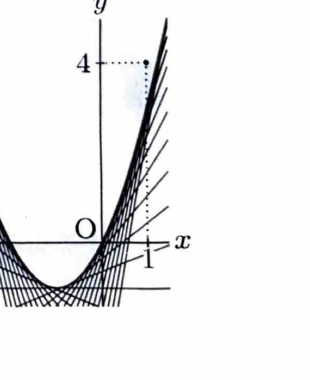

問題13

> **前提知識：接線**
>
> 曲線 $y=f(x)$ 上の点 $(t,f(t))$ における接線は
> $$
> y-f(t)=f'(t)(x-t)
> $$
> である。

---

## (1)
点 $(1,4)$ を通る関数
$$
y=x^2+2x
$$
の接線は存在しないことを証明せよ。
（佐賀大）

---

## (1) 解答

> **解法の選択**
>
> 接点を $(t,t^2+2t)$ とおいて一般の接線を求め、その接線が点 $(1,4)$ を通るための方程式を作る。その方程式が実数解をもたないことを判別式で示す。
>
> 関数を微分すると、
> $$
> y'=2x+2.
> $$
> よって接点 $x=t$ での傾きは
> $$
> 2t+2
> $$
> である。接線の公式に代入する。

$$
y-(t^2+2t)=(2t+2)(x-t).
$$

> この直線が $(1,4)$ を通るなら、$x=1$、$y=4$ を代入して、

$$
4-(t^2+2t)=(2t+2)(1-t).
$$

> 右辺を展開する。

$$
(2t+2)(1-t)=2t+2-2t^2-2t=2-2t^2.
$$

> したがって、

$$
4-t^2-2t=2-2t^2.
$$

> 左辺に移項すると、

$$
t^2-2t+2=0.
$$

> 判別式 $D=b^2-4ac$ に
> $$
> a=1,\qquad b=-2,\qquad c=2
> $$
> を代入する。

$$
D=(-2)^2-4\cdot1\cdot2=4-8=-4<0.
$$

> よってこの2次方程式は実数解をもたない。したがって、条件を満たす実数の接点 $t$ は存在しない。

$$
\boxed{\text{点 }(1,4)\text{ を通る接線は存在しない}}
$$

