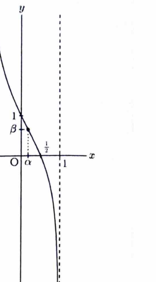

問題17

次の関数について答えよ。（東北大）

> **前提知識：増減とグラフ**
>
> $f'(x)>0$ の区間では $f$ は増加し、$f'(x)<0$ の区間では減少する。グラフの概形には、臨界点、極値、切片、無限遠での極限を用いる。

---

## (1)
関数
$$
f(x)=\arcsin x+2\sqrt{1-x^2}
$$
について、$-1\le x\le1$ とし、$-\dfrac\pi2\le\arcsin x\le\dfrac\pi2$ とする。$f(x)$ の最大値および最小値を求めよ。

---

## (1) 解答

> **解法の選択**
>
> 閉区間上の連続関数なので、導関数が $0$ になる点と端点を調べる。
>
> $-1<x<1$ で微分する。

$$
\begin{aligned}
f'(x)
&=
\frac1{\sqrt{1-x^2}}
+
2\cdot\frac12(1-x^2)^{-1/2}(-2x)\\
&=
\frac{1-2x}{\sqrt{1-x^2}}.
\end{aligned}
$$

> 分母は正なので、符号は $1-2x$ で決まる。
>
> $f'(x)=0$ より、

$$
1-2x=0,\qquad x=\frac12.
$$

> $-1<x<\dfrac12$ では $f'(x)>0$、$\dfrac12<x<1$ では $f'(x)<0$ である。よって $x=\dfrac12$ で最大となる。
>
> 各候補点の値を計算する。

$$
\begin{aligned}
f\left(\frac12\right)
&=
\arcsin\frac12+2\sqrt{1-\frac14}\\
&=
\frac\pi6+2\cdot\frac{\sqrt3}{2}\\
&=
\frac\pi6+\sqrt3.
\end{aligned}
$$

$$
f(-1)=\arcsin(-1)+0=-\frac\pi2.
$$

$$
f(1)=\arcsin1+0=\frac\pi2.
$$

したがって、
$$
\boxed{
\text{最大値 }\frac\pi6+\sqrt3\ \left(x=\frac12\right),\qquad
\text{最小値 }-\frac\pi2\ (x=-1)
}
$$

---

## (2)
同じ関数について、
$$
y=\frac d{dx}f(x)
$$
が単調減少であることを示せ。

---

## (2) 解答

> **解法の選択**
>
> $y=f'(x)$ の単調性は $y'=f''(x)$ の符号で調べる。
>
> (1) より、

$$
f'(x)=\frac{1-2x}{\sqrt{1-x^2}}.
$$

> 商の微分を使う。分子を $u=1-2x$、分母を $v=\sqrt{1-x^2}$ とすると、
> $$
> u'=-2,
> $$
> $$
> v'=-\frac{x}{\sqrt{1-x^2}}.
> $$

$$
\begin{aligned}
f''(x)
&=
\frac{-2\sqrt{1-x^2}-(1-2x)\left(-\frac{x}{\sqrt{1-x^2}}\right)}
{1-x^2}\\
&=
\frac{-2(1-x^2)+x(1-2x)}
{(1-x^2)^{3/2}}\\
&=
\frac{x-2}{(1-x^2)^{3/2}}.
\end{aligned}
$$

> $-1<x<1$ では分母は正であり、$x-2<0$ である。したがって、

$$
f''(x)<0\qquad(-1<x<1).
$$

よって、
$$
\boxed{y=f'(x)\text{ は }(-1,1)\text{ で単調減少する}}
$$

---

## (3)
同じ関数について、
$$
y=\frac d{dx}f(x)
$$
を $xy$ 平面上に図示せよ。

---

## (3) 解答

> **解法の選択**
>
> (2) で単調減少が分かっている。さらに凹凸、主要な点、端点での発散を調べてグラフを描く。
>
> グラフにする関数は
> $$
> y=f'(x)=\frac{1-2x}{\sqrt{1-x^2}}\qquad(-1<x<1)
> $$
> である。
>
> まず主要な点は、

$$
y(0)=1,
$$

$$
y\left(\frac12\right)=0.
$$

> 端点での極限は、

$$
\lim_{x\to-1+0}y=+\infty,
$$

$$
\lim_{x\to1-0}y=-\infty.
$$

> 凹凸を調べるため $y''=f'''$ を求める。(2) の
> $$
> f''(x)=\frac{x-2}{(1-x^2)^{3/2}}
> $$
> を微分する。

$$
\begin{aligned}
f'''(x)
&=
(1-x^2)^{-3/2}
+(x-2)\left(-\frac32\right)(1-x^2)^{-5/2}(-2x)\\
&=
\frac{1-x^2+3x(x-2)}{(1-x^2)^{5/2}}\\
&=
\frac{2x^2-6x+1}{(1-x^2)^{5/2}}.
\end{aligned}
$$

> 分母は正なので、変曲候補は
> $$
> 2x^2-6x+1=0
> $$
> の解である。解の公式を使う。

$$
x=\frac{6\pm\sqrt{36-8}}4
=
\frac{3\pm\sqrt7}{2}.
$$

> このうち $(-1,1)$ に入るのは、

$$
\alpha=\frac{3-\sqrt7}{2}
$$

だけである。そのとき、

$$
\begin{aligned}
\beta=y(\alpha)
&=
\frac{1-2\alpha}{\sqrt{1-\alpha^2}}\\
&=
\sqrt{\frac{2(\sqrt7-2)}3}.
\end{aligned}
$$

> $f'''(x)>0$ は $-1<x<\alpha$、$f'''(x)<0$ は $\alpha<x<1$ である。したがって、グラフは全体として単調減少し、$(\alpha,\beta)$ で凹凸が変わる。

