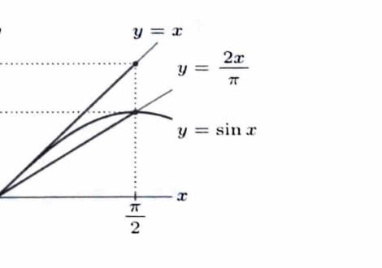

問題19

> **前提知識：微分を用いた不等式の証明**
>
> $F(t)$ の符号を示したいとき、$F'(t)$ の符号から単調性を調べ、基準点での値と比較する。

---

## (1)
次の不等式が成り立つことを示せ。
$$
\frac{2x}{\pi}\le\sin x\le x
\qquad
\left(0\le x\le\frac\pi2\right)
$$
（東北大）

---

## (1) 解答

> **解法の選択**
>
> 上側と下側を別々に、差の関数の増減を調べて証明する。幾何学的に単位円から示す方法もあるが、微分の応用として差関数を用いる。
>
> **上側 $\sin x\le x$**
>
> 差を
> $$
> f(x)=x-\sin x
> $$
> とおく。微分すると、

$$
f'(x)=1-\cos x.
$$

> $0\le x\le\pi/2$ では $\cos x\le1$ なので、

$$
f'(x)\ge0.
$$

> よって $f$ は単調増加し、
> $$
> f(0)=0
> $$
> だから、

$$
f(x)\ge0.
$$

したがって、
$$
\sin x\le x.
$$

> **下側 $\dfrac{2x}{\pi}\le\sin x$**
>
> 差を
> $$
> g(x)=\sin x-\frac{2x}{\pi}
> $$
> とおく。微分すると、

$$
g'(x)=\cos x-\frac2\pi.
$$

> $0<2/\pi<1$ なので、
> $$
> \cos\alpha=\frac2\pi
> $$
> を満たす $\alpha\in(0,\pi/2)$ がただ1つ存在する。
>
> $\cos x$ は $[0,\pi/2]$ で減少するため、
>
> - $0<x<\alpha$ では $g'(x)>0$。
> - $\alpha<x<\pi/2$ では $g'(x)<0$。
>
> また、

$$
g(0)=0,
$$

$$
g\left(\frac\pi2\right)
=
1-\frac{2(\pi/2)}\pi
=
0.
$$

> $g$ は $0$ から増加して最大となり、その後 $0$ まで減少するので、全区間で $g(x)\ge0$ である。

したがって、
$$
\frac{2x}{\pi}\le\sin x.
$$

以上より、
$$
\boxed{
\frac{2x}{\pi}\le\sin x\le x
\qquad
\left(0\le x\le\frac\pi2\right)
}
$$

