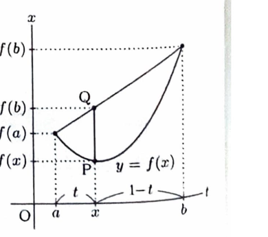

問題21

平均値の定理に関連する次の問いに答えよ。

> **前提知識：平均値の定理**
>
> $f$ が閉区間 $[a,b]$ で連続、開区間 $(a,b)$ で微分可能なら、ある $c\in(a,b)$ が存在して
> $$
> \frac{f(b)-f(a)}{b-a}=f'(c)
> $$
> が成り立つ。

---

## (1)
平均値の定理を仮定する。$f(x)=x^2$ のとき、区間 $(a,b)$ において
$$
\frac{f(b)-f(a)}{b-a}=f'(c)
$$
が成り立つような $c$ を求めよ。

---

## (1) 解答

> **解法の選択**
>
> $f(b)-f(a)$ と $f'(c)$ を直接計算して方程式を解く。
>
> $f(x)=x^2$ なので、

$$
f'(x)=2x.
$$

> 平均変化率は、

$$
\begin{aligned}
\frac{f(b)-f(a)}{b-a}
&=
\frac{b^2-a^2}{b-a}\\
&=
\frac{(b-a)(b+a)}{b-a}\\
&=a+b.
\end{aligned}
$$

> これが $f'(c)=2c$ に等しいので、

$$
a+b=2c.
$$

したがって、
$$
\boxed{c=\frac{a+b}{2}}
$$

> $a<c<b$ は、$a<b$ のとき中点が区間内部にあることから確かめられる。

---

## (2)
閉区間 $[a,b]$ で連続かつ開区間 $(a,b)$ で2回微分可能で、常に
$$
f''(x)>0
$$
を満たす関数 $f(x)$ を考える。区間 $(a,b)$ で
$$
F(x)=\frac{f(b)(x-a)+f(a)(b-x)}{b-a}-f(x)
$$
とおく。このとき、$F(x)$ は常に正であり、かつ $F(x)$ の極大値が区間 $(a,b)$ にただ1つだけ存在することを示せ。

---

## (2) 解答

> **解法の選択**
>
> $F'(x)$ の増減を調べる。平均値の定理で $F'(c)=0$ となる点の存在を示し、$F''(x)<0$ からその点が一意であることを示す。
>
> まず $F$ を微分する。

$$
F'(x)=\frac{f(b)-f(a)}{b-a}-f'(x).
$$

> 平均値の定理より、ある $c\in(a,b)$ が存在して、

$$
\frac{f(b)-f(a)}{b-a}=f'(c)
$$

が成り立つ。したがって、

$$
F'(c)=0.
$$

> さらに微分すると、

$$
F''(x)=-f''(x).
$$

> 仮定 $f''(x)>0$ より、

$$
F''(x)<0.
$$

> したがって $F'(x)$ は $(a,b)$ で狭義単調減少する。よって $F'(x)=0$ を満たす点は、存在するだけでなくただ1つである。
>
> $F'$ が減少し $F'(c)=0$ だから、
>
> - $a<x<c$ では $F'(x)>0$。
> - $c<x<b$ では $F'(x)<0$。
>
> 次に端点の値を計算する。

$$
\begin{aligned}
F(a)
&=
\frac{f(b)(a-a)+f(a)(b-a)}{b-a}-f(a)\\
&=0,
\end{aligned}
$$

$$
\begin{aligned}
F(b)
&=
\frac{f(b)(b-a)+f(a)(b-b)}{b-a}-f(b)\\
&=0.
\end{aligned}
$$

> $F$ は $a$ から $c$ まで増加し、$c$ から $b$ まで減少し、両端で $0$ である。したがって内部では、

$$
F(x)>0\qquad(a<x<b).
$$

> また、ただ1つの臨界点 $c$ で増加から減少に変わるので、極大値は $F(c)$ であり一意である。

$$
\boxed{
F(x)>0\ (a<x<b),\qquad
F\text{ の極大点はただ1つ}
}
$$

> 第1項
> $$
> \frac{f(b)(x-a)+f(a)(b-x)}{b-a}
> $$
> は端点 $(a,f(a))$ と $(b,f(b))$ を結ぶ弦の高さである。したがって $F(x)$ は弦と曲線の鉛直方向の差を表す。

---

## (3)
$b>a>1$ とする。次の不等式が成り立つことを示せ。
$$
\frac{b^2-a^2}{2ab}>\log\frac ba
$$
（島根大）

---

## (3) 解答

> **解法の選択**
>
> 目標の式を $x=b/a>1$ の1変数不等式に直し、差の増減を調べる。資料には (2) を積分して示す別解もあるが、差関数の方法が直接的である。
>
> $x\ge1$ に対して、

$$
g(x)=x-\frac1x-2\log x
$$

とおく。微分すると、

$$
\begin{aligned}
g'(x)
&=
1+\frac1{x^2}-\frac2x\\
&=
\left(1-\frac1x\right)^2\\
&\ge0.
\end{aligned}
$$

> また、
> $$
> g(1)=1-1-0=0.
> $$
> $x>1$ では $1-\dfrac1x\ne0$ なので $g'(x)>0$ であり、

$$
g(x)>0\qquad(x>1).
$$

> $b>a>1$ より $b/a>1$ なので、代入前の変数を
> $$
> x=\frac ba
> $$
> として、

$$
g\left(\frac ba\right)>0.
$$

> 展開すると、

$$
\frac ba-\frac ab-2\log\frac ba>0.
$$

> 最初の2項を通分する。

$$
\frac ba-\frac ab
=
\frac{b^2-a^2}{ab}.
$$

したがって、

$$
\frac{b^2-a^2}{ab}
>
2\log\frac ba.
$$

> 両辺を正の数 $2$ で割る。

$$
\boxed{
\frac{b^2-a^2}{2ab}>\log\frac ba
}
$$

> **別解の概要**
>
> (2) を $f(x)=1/x$ に適用すると、曲線 $y=1/x$ は弦より下にある。その不等式を $a$ から $b$ まで積分すると、左辺は台形の面積 $\dfrac{b^2-a^2}{2ab}$、右辺は $\int_a^b dx/x=\log(b/a)$ となり、同じ不等式を得る。
