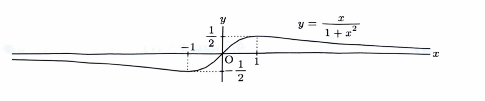

例題8

> **前提知識：増減とグラフ**
>
> $f'(x)>0$ の区間では $f$ は増加し、$f'(x)<0$ の区間では減少する。グラフの概形には、臨界点、極値、切片、無限遠での極限を用いる。

---

## (1)
関数
$$
f(x)=\frac{x}{1+x^2}
$$
の増減表を用いて、$f(x)$ のグラフの概形を描け。
（福井大）

---

## (1) 解答

> **解法の選択**
>
> 有理関数のグラフの概形を描くため、まず導関数の符号から増減を調べ、次に $x\to\pm\infty$ の極限を求める。奇関数であることも形の確認に使える。
>
> 商の微分公式を使う。分子を $u=x$、分母を $v=1+x^2$ とすると、
> $$
> u'=1,\qquad v'=2x.
> $$

$$
\begin{aligned}
f'(x)
&=
\frac{1\cdot(1+x^2)-x\cdot2x}{(1+x^2)^2}\\
&=
\frac{1-x^2}{(1+x^2)^2}\\
&=
-\frac{(x+1)(x-1)}{(1+x^2)^2}.
\end{aligned}
$$

> 分母 $(1+x^2)^2$ は常に正なので、符号は $1-x^2$ で決まる。
>
> - $x<-1$ では $1-x^2<0$。
> - $-1<x<1$ では $1-x^2>0$。
> - $x>1$ では $1-x^2<0$。
>
> また、
> $$
> f(-1)=-\frac12,\qquad
> f(1)=\frac12.
> $$

増減表は次のとおりである。

| $x$ | $-\infty$ | $-1$ |  | $1$ | $+\infty$ |
|---|---:|---:|:---:|---:|---:|
| $f'(x)$ | $-$ | $0$ | $+$ | $0$ | $-$ |
| $f(x)$ | $0$ に近づく | $-\dfrac12$ | 増加 | $\dfrac12$ | $0$ に近づく |

> 無限遠での極限を求める。分子・分母を $x^2$ で割る。

$$
\begin{aligned}
\lim_{x\to\pm\infty}\frac{x}{1+x^2}
&=
\lim_{x\to\pm\infty}
\frac{1/x}{1/x^2+1}\\
&=0.
\end{aligned}
$$

> また $f(0)=0$ であり、$f(-x)=-f(x)$ なので原点対称である。
>
> 以上から、$x=-1$ で極小値 $-\dfrac12$、$x=1$ で極大値 $\dfrac12$ をとり、両端で $x$ 軸に近づくグラフになる。

