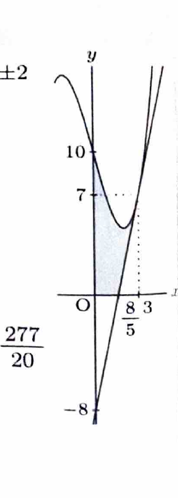

関数の極値は、導関数が0となる点を求め、導関数の符号変化を調べて判定する。曲線と接線で囲まれる面積では、交点と上下関係を調べる必要がある。

---

問題 35　関数

> 難度：B。出典：豊橋技科大。
$$
f(x)=\frac13x^3-4x+10
$$
について、以下の設問に答えよ。

---

## (1)

関数 $f(x)$ の極値をすべて求めよ。

---

## (1) 解答

> 三次関数なので、まず1階導関数を求めて臨界点を出し、符号表または2階導関数で極大・極小を判定する。資料では符号変化を用いている。

導関数は、
$$
f'(x)=x^2-4
$$
である。因数分解すると、
$$
f'(x)=(x+2)(x-2)
$$
となる。したがって、
$$
f'(x)=0
$$
を満たす点は、
$$
x=-2,\qquad x=2
$$
である。

導関数の符号を調べる。
- $x<-2$ では $(x+2)<0,\ (x-2)<0$ なので $f'(x)>0$。
- $-2<x<2$ では $(x+2)>0,\ (x-2)<0$ なので $f'(x)<0$。
- $x>2$ では $(x+2)>0,\ (x-2)>0$ なので $f'(x)>0$。

したがって、$x=-2$ で増加から減少へ変わるため極大、$x=2$ で減少から増加へ変わるため極小である。

値を代入する前の式は、
$$
f(x)=\frac13x^3-4x+10
$$
である。$x=-2$ を代入すると、
$$
f(-2)
=
\frac13(-2)^3-4(-2)+10
$$
$$
=
-\frac83+8+10
=
-\frac83+18
=
\frac{46}{3}
$$
となる。$x=2$ を代入すると、
$$
f(2)
=
\frac13(2)^3-4(2)+10
$$
$$
=
\frac83-8+10
=
\frac83+2
=
\frac{14}{3}
$$
となる。

したがって、
$$
\boxed{\text{極大値 }\frac{46}{3}\ \text{（}x=-2\text{）}}
$$
$$
\boxed{\text{極小値 }\frac{14}{3}\ \text{（}x=2\text{）}}
$$

---

## (2)

曲線 $y=f(x)$ 上の点 $(3,7)$ における接線 $y=g(x)$ と曲線 $y=f(x)$ が囲む領域のうち、領域
$$
\{(x,y)\mid x\ge0,\ y\ge0\}
$$
に含まれる部分の面積を求めよ。

---

## (2) 解答

> 接線の式を求め、曲線との交点を調べる。第1象限に含まれる部分では、$x=0$ から接線と $x$ 軸の交点までが曲線下の面積、そこから $x=3$ までは曲線と接線の差になる。資料の別解のように、曲線と接線の差を $0$ から $3$ まで積分し、接線の負の三角形を補正する方法が計算しやすい。

接線の傾きは、
$$
f'(x)=x^2-4
$$
へ $x=3$ を代入して、
$$
f'(3)=3^2-4=9-4=5
$$
である。点 $(3,7)$ を通り傾き5の直線は、
$$
y-7=5(x-3)
$$
であり、
$$
y=5x-8
$$
となる。したがって、
$$
g(x)=5x-8
$$
である。

接線と $x$ 軸の交点は、
$$
5x-8=0
$$
より、
$$
x=\frac85
$$
である。第1象限内の求める面積を直接書くと、
$$
S
=
\int_0^{8/5}f(x)\,dx
+
\int_{8/5}^{3}\{f(x)-g(x)\}\,dx
$$
である。

計算をまとめるため、
$$
S
=
\int_0^3\{f(x)-g(x)\}\,dx
+
\int_0^{8/5}g(x)\,dx
$$
と変形する。$0\le x\le8/5$ では $g(x)\le0$ なので、第2項は負の三角形の符号付き面積である。

まず、
$$
f(x)-g(x)
=
\left(\frac13x^3-4x+10\right)-(5x-8)
$$
$$
=
\frac13x^3-9x+18
$$
である。したがって、
$$
\int_0^3\{f(x)-g(x)\}\,dx
=
\int_0^3\left(\frac13x^3-9x+18\right)\,dx
$$
$$
=
\left[
\frac1{12}x^4-\frac92x^2+18x
\right]_0^3
$$
$$
=
\frac{81}{12}-\frac{81}{2}+54
$$
である。通分すると、
$$
\frac{81}{12}-\frac{486}{12}+\frac{648}{12}
=
\frac{243}{12}
=
\frac{81}{4}
$$
となる。

次に、
$$
\int_0^{8/5}(5x-8)\,dx
$$
は、底辺 $\frac85$、高さ $8$ の負の三角形の符号付き面積なので、
$$
-\frac12\cdot\frac85\cdot8
=
-\frac{32}{5}
$$
である。したがって、
$$
S
=
\frac{81}{4}-\frac{32}{5}
$$
である。通分して、
$$
S
=
\frac{405}{20}-\frac{128}{20}
=
\frac{277}{20}
$$
となる。

$$
\boxed{S=\frac{277}{20}}
$$
