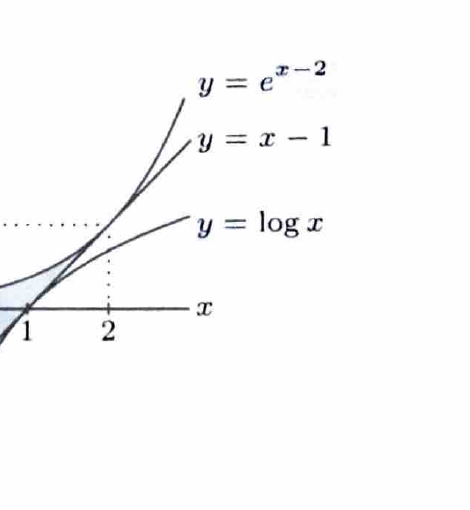

曲線の接線は、接点の $x$ 座標を $t$ とすると
$$
y-f(t)=f'(t)(x-t)
$$
で表される。二つの曲線が同じ直線を接線にもつ条件は、傾きと切片が一致することである。

---

問題 36　以下の設問 (1)、(2) に答えよ。

> 難度：B。出典：三重大。

---

## (1)

曲線 $y=\log_e x$ 上の点 $(1,0)$ における接線が、曲線
$$
y=ae^x
$$
の接線でもあるとき、定数 $a$ の値を求めよ。

---

## (1) 解答

> まず $y=\log x$ の接線を求める。次に $y=ae^x$ の接点を $x=t$ とおき、その接線を文字式で表して、二つの直線の傾きと切片を比較する。

曲線
$$
y=\log x
$$
の導関数は、
$$
y'=\frac1x
$$
である。$x=1$ を代入すると、
$$
y'(1)=1
$$
だから、点 $(1,0)$ における接線は、
$$
y-0=1(x-1)
$$
すなわち、
$$
y=x-1
$$
である。

次に、曲線
$$
y=ae^x
$$
の接点の $x$ 座標を $t$ とする。導関数は、
$$
y'=ae^x
$$
なので、$x=t$ での傾きは $ae^t$、接点は $(t,ae^t)$ である。接線の式は、
$$
y-ae^t=ae^t(x-t)
$$
である。展開すると、
$$
y=ae^tx+ae^t(1-t)
$$
となる。

この直線が
$$
y=x-1
$$
と一致するため、傾きと切片を比較して、
$$
ae^t=1
$$
および、
$$
ae^t(1-t)=-1
$$
である。第1式を第2式へ代入すると、
$$
1-t=-1
$$
より、
$$
t=2
$$
となる。次に、代入前の式
$$
ae^t=1
$$
へ $t=2$ を代入して、
$$
ae^2=1
$$
だから、
$$
a=e^{-2}
$$
である。

$$
\boxed{a=\frac1{e^2}}
$$

---

## (2)

この接線、曲線 $y=ae^x$、および $y$ 軸で囲まれた部分の面積を求めよ。

---

## (2) 解答

> (1) で $a=e^{-2}$、接点の $x$ 座標が2と分かった。$0\le x\le2$ では指数曲線が接線 $y=x-1$ より上にあるため、その差を積分する。

(1) より、
$$
y=ae^x=e^{-2}e^x=e^{x-2}
$$
であり、接線は
$$
y=x-1
$$
である。求める面積 $S$ は、
$$
S
=
\int_0^2\{e^{x-2}-(x-1)\}\,dx
$$
である。

項別に積分すると、
$$
\int e^{x-2}\,dx=e^{x-2},
$$
$$
\int(x-1)\,dx=\frac12x^2-x
$$
だから、
$$
S
=
\left[
e^{x-2}-\frac12x^2+x
\right]_0^2
$$
である。上端では、
$$
e^{2-2}-\frac12\cdot2^2+2
=
1-2+2
=
1
$$
である。下端では、
$$
e^{0-2}-0+0=e^{-2}
$$
である。よって、
$$
S=1-e^{-2}
$$
となる。

$$
\boxed{S=1-\frac1{e^2}}
$$
