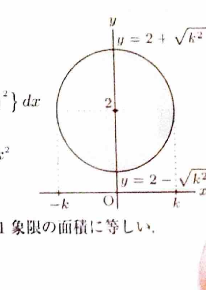

円
$$
x^2+(y-c)^2=k^2
$$
の上半円・下半円は、
$$
y=c+\sqrt{k^2-x^2},
\qquad
y=c-\sqrt{k^2-x^2}
$$
で表される。領域を $x$ 軸のまわりに回転するとき、断面が円環なら
$$
V=\pi\int(R^2-r^2)\,dx
$$
を用いる。

---

問題 39　円

> 難度：B。出典：東京都立大。
$$
x^2+(y-2)^2=k^2
$$
を $x$ 軸のまわりに回転してできる回転体の体積を求めよ。ただし、
$$
0<k<2
$$
とする。

---

## 解答

> $0<k<2$ なので円全体が $x$ 軸より上にあり、各 $x$ における断面は円環になる。上半円を外半径、下半円を内半径として円環法を用いる。パップスの定理でも解けるが、資料に沿って積分する。

円の式
$$
x^2+(y-2)^2=k^2
$$
から、
$$
(y-2)^2=k^2-x^2
$$
である。したがって、
$$
y-2=\pm\sqrt{k^2-x^2}
$$
より、上半円は
$$
y=2+\sqrt{k^2-x^2}
$$
であり、下半円は
$$
y=2-\sqrt{k^2-x^2}
$$
である。$x$ の範囲は、
$$
-k\le x\le k
$$
である。

$x$ 軸からの外半径を
$$
R(x)=2+\sqrt{k^2-x^2}
$$
とし、内半径を
$$
r(x)=2-\sqrt{k^2-x^2}
$$
とする。したがって、
$$
V
=
\pi\int_{-k}^{k}
\left[
\left(2+\sqrt{k^2-x^2}\right)^2
-
\left(2-\sqrt{k^2-x^2}\right)^2
\right]dx
$$
である。

差の平方の公式
$$
(A+B)^2-(A-B)^2=4AB
$$
へ、代入前の文字 $A,\ B$ に
$$
A=2,\qquad B=\sqrt{k^2-x^2}
$$
を代入すると、
$$
\left(2+\sqrt{k^2-x^2}\right)^2
-
\left(2-\sqrt{k^2-x^2}\right)^2
=
8\sqrt{k^2-x^2}
$$
となる。よって、
$$
V
=
8\pi\int_{-k}^{k}\sqrt{k^2-x^2}\,dx
$$
である。

被積分関数は偶関数なので、
$$
V
=
16\pi\int_0^k\sqrt{k^2-x^2}\,dx
$$
となる。積分
$$
\int_0^k\sqrt{k^2-x^2}\,dx
$$
は、半径 $k$ の円の第1象限部分の面積に等しいため、
$$
\int_0^k\sqrt{k^2-x^2}\,dx
=
\frac14\pi k^2
$$
である。したがって、
$$
V
=
16\pi\cdot\frac14\pi k^2
$$
より、
$$
\boxed{V=4\pi^2k^2}
$$

> パップスの定理では、面積 $\pi k^2$ の円板の重心が $x$ 軸から距離2にあり、重心の移動距離が $4\pi$ なので、
> $$
> V=\pi k^2\cdot4\pi=4\pi^2k^2
> $$
> と一度に求められる。
