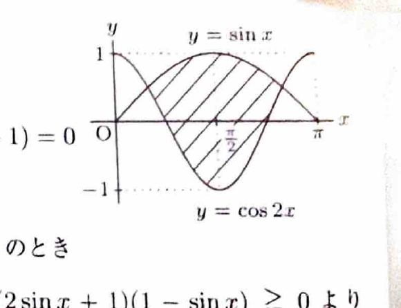

回転体の体積を円環法で求める場合、$x$ 軸から遠い側の曲線を外半径、近い側を内半径とする。曲線が $x$ 軸をまたぐ場合は、断面の形が変わる点を調べて積分区間を分ける。

---

問題 40　二つの曲線

> 難度：B。出典：岩手大。
$$
y=\cos2x\qquad(0\le x\le\pi),
$$
$$
y=\sin x\qquad(0\le x\le\pi)
$$
と、その二曲線によって囲まれた図形 $S$ について、次の問いに答えよ。

---

## (1)

二つの曲線を図示し、図形 $S$ を斜線で図示せよ。

---

## (1) 解答

> $y=\sin x$ は $0\le x\le\pi$ で非負であり、$x=\frac{\pi}{2}$ で最大値1をとる。$y=\cos2x$ は周期 $\pi$ で、$x=0,\pi$ で1、$x=\frac{\pi}{2}$ で $-1$ をとる。交点を結んだ二曲線間の領域が $S$ である。

代表値は、
$$
\begin{array}{c|ccc}
x&0&\frac{\pi}{2}&\pi\\ \hline
\sin x&0&1&0\\
\cos2x&1&-1&1
\end{array}
$$
である。二曲線は $x=\frac{\pi}{6},\frac{5\pi}{6}$ で交わり、その間では $y=\sin x$ が上側である。

---

## (2)

二つの曲線の交点の $x$ 座標を求めよ。

---

## (2) 解答

> 交点では $\cos2x=\sin x$ である。$\cos2x$ を $\sin x$ の式へ変換すると二次方程式になる。

交点の方程式は、
$$
\cos2x=\sin x
$$
である。恒等式
$$
\cos2x=1-2\sin^2x
$$
を代入すると、
$$
1-2\sin^2x=\sin x
$$
である。左辺へ移項して、
$$
2\sin^2x+\sin x-1=0
$$
となる。因数分解すると、
$$
(2\sin x-1)(\sin x+1)=0
$$
である。したがって、
$$
\sin x=\frac12
$$
または
$$
\sin x=-1
$$
である。

$0\le x\le\pi$ では $\sin x\ge0$ なので、$\sin x=-1$ は不適である。よって、
$$
\sin x=\frac12
$$
から、
$$
\boxed{x=\frac{\pi}{6},\ \frac{5\pi}{6}}
$$
である。

---

## (3)

図形 $S$ を $x$ 軸のまわりに1回転してできる立体の体積を求めよ。

---

## (3) 解答

> 図形は直線 $x=\frac{\pi}{2}$ に関して対称である。$y=\cos2x$ は途中で負になるため、回転断面は単純に $\pi\{\sin^2x-\cos^22x\}$ とできる区間と、内側まで塗りつぶされた円になる区間に分かれる。資料の分割に従って対称性を利用する。

交点は、
$$
x=\frac{\pi}{6},\qquad x=\frac{5\pi}{6}
$$
である。左半分 $[\frac{\pi}{6},\frac{\pi}{2}]$ を考える。

$y=\cos2x$ が0になる点は、
$$
\cos2x=0
$$
より、
$$
2x=\frac{\pi}{2}
$$
だから、
$$
x=\frac{\pi}{4}
$$
である。したがって、
- $\frac{\pi}{6}\le x\le\frac{\pi}{4}$ では、二曲線はともに $x$ 軸の上にあり、断面は外半径 $\sin x$、内半径 $\cos2x$ の円環。
- $\frac{\pi}{4}\le x\le\frac{\pi}{2}$ では、領域が $x$ 軸をまたぎ、回転後の断面は半径 $\sin x$ の円。

右半分も対称なので、体積 $V$ は、
$$
V
=
2\left[
\pi\int_{\pi/6}^{\pi/4}
\left(\sin^2x-\cos^22x\right)dx
+
\pi\int_{\pi/4}^{\pi/2}\sin^2x\,dx
\right]
$$
である。分配すると、
$$
V
=
2\pi
\left[
\int_{\pi/6}^{\pi/2}\sin^2x\,dx
-
\int_{\pi/6}^{\pi/4}\cos^22x\,dx
\right]
$$
となる。

半角公式
$$
\sin^2x=\frac{1-\cos2x}{2}
$$
を用いると、
$$
2\pi\int_{\pi/6}^{\pi/2}\sin^2x\,dx
=
\pi\int_{\pi/6}^{\pi/2}(1-\cos2x)\,dx
$$
である。また、
$$
\cos^22x=\frac{1+\cos4x}{2}
$$
より、
$$
2\pi\int_{\pi/6}^{\pi/4}\cos^22x\,dx
=
\pi\int_{\pi/6}^{\pi/4}(1+\cos4x)\,dx
$$
である。したがって、
$$
V
=
\pi\int_{\pi/6}^{\pi/2}(1-\cos2x)\,dx
-
\pi\int_{\pi/6}^{\pi/4}(1+\cos4x)\,dx
$$
となる。

第1項は、
$$
\pi\left[
x-\frac12\sin2x
\right]_{\pi/6}^{\pi/2}
$$
であり、
$$
=
\pi\left[
\frac{\pi}{2}
-
\left(
\frac{\pi}{6}-\frac12\sin\frac{\pi}{3}
\right)
\right]
$$
$$
=
\pi\left(
\frac{\pi}{3}+\frac{\sqrt3}{4}
\right)
$$
となる。第2項は、
$$
\pi\left[
x+\frac14\sin4x
\right]_{\pi/6}^{\pi/4}
$$
であり、
$$
=
\pi\left[
\frac{\pi}{4}
-
\left(
\frac{\pi}{6}+\frac14\sin\frac{2\pi}{3}
\right)
\right]
$$
$$
=
\pi\left(
\frac{\pi}{12}-\frac{\sqrt3}{8}
\right)
$$
となる。よって、
$$
V
=
\pi\left(
\frac{\pi}{3}+\frac{\sqrt3}{4}
-\frac{\pi}{12}+\frac{\sqrt3}{8}
\right)
$$
$$
=
\pi\left(
\frac{\pi}{4}+\frac{3\sqrt3}{8}
\right)
$$
である。

したがって、
$$
\boxed{
V=\frac{\pi^2}{4}+\frac{3\sqrt3}{8}\pi
}
$$
