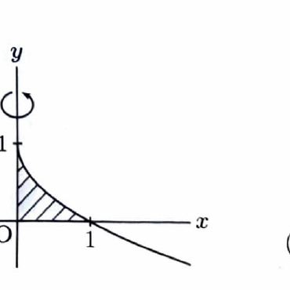

曲線 $x=f(y)$ と $y$ 軸および直線 $y=a,\ y=b$ で囲まれた領域を $y$ 軸のまわりに回転すると、$y$ に垂直な断面は半径 $|x|$ の円である。体積は
$$
V=\pi\int_a^b x^2\,dy
$$
となる。

---

問題 41　曲線

> 難度：B。出典：福井大。
$$
y=1-\sqrt{x}
$$
と直線
$$
x=0,\qquad y=0
$$
で囲まれた部分を $y$ 軸のまわりに回転してできる立体の体積を求めよ。

---

## 解答

> 回転軸が $y$ 軸なので、$x$ を $y$ の関数として表し、$y$ に関して円板法で積分するのが直接的である。円筒殻法で $x$ に関して積分する方法もある。

与式
$$
y=1-\sqrt{x}
$$
から、
$$
\sqrt{x}=1-y
$$
である。領域では $0\le y\le1$ なので $1-y\ge0$ であり、両辺を二乗して、
$$
x=(1-y)^2
$$
となる。これは、
$$
x=(y-1)^2
$$
とも書ける。

$y$ 軸のまわりに回転すると、各高さ $y$ での円板の半径は
$$
r(y)=x=(1-y)^2
$$
である。したがって、断面積は、
$$
A(y)=\pi r(y)^2
=
\pi(1-y)^4
$$
である。

$y$ の範囲は、$y=0$ から、$x=0$ のときの
$$
y=1-\sqrt0=1
$$
までである。よって、
$$
V
=
\pi\int_0^1(1-y)^4\,dy
$$
である。$u=1-y$ と置いてもよいが、そのまま積分すると、
$$
\int(1-y)^4\,dy
=
-\frac15(1-y)^5
$$
だから、
$$
V
=
\pi
\left[
-\frac15(1-y)^5
\right]_0^1
$$
となる。端点を代入して、
$$
V
=
\pi\left(
0-\left(-\frac15\right)
\right)
=
\frac{\pi}{5}
$$
である。

$$
\boxed{V=\frac{\pi}{5}}
$$

> 円筒殻法では、$0\le x\le1$ において半径 $x$、高さ $1-\sqrt{x}$ なので、
> $$
> V=2\pi\int_0^1x(1-\sqrt{x})\,dx
> $$
> としても同じ値を得る。
