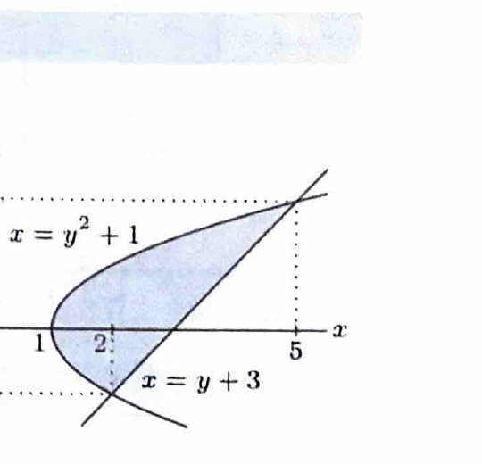

曲線が $x$ を $y$ の関数として表しやすい場合、面積は $y$ について
$$
S=\int(\text{右側の }x-\text{左側の }x)\,dy
$$
と計算できる。$y$ 軸回転の体積は、外半径・内半径を $x$ 座標で表して
$$
V=\pi\int(R(y)^2-r(y)^2)\,dy
$$
とする。

---

問題 42　平面上の曲線

> 難度：B。出典：宇都宮大。
$$
y^2=x-1
$$
および直線
$$
y=x-3
$$
について、次の問いに答えよ。

---

## (1)

これらの曲線と直線で囲まれた図形 $S$ の面積を求めよ。

---

## (1) 解答

> 放物線は $x=y^2+1$、直線は $x=y+3$ と表せるので、$y$ について積分する。$x$ について積分すると放物線の上下枝を分ける必要があるため、$y$ 積分の方が簡潔である。

まず、両方を $x$ について解く。
$$
y^2=x-1
$$
より、
$$
x=y^2+1
$$
である。また、
$$
y=x-3
$$
より、
$$
x=y+3
$$
である。

交点では、
$$
y^2+1=y+3
$$
だから、
$$
y^2-y-2=0
$$
である。因数分解して、
$$
(y-2)(y+1)=0
$$
より、
$$
y=-1,\qquad y=2
$$
となる。

例えば $y=0$ では、
$$
x_{\text{放物線}}=0^2+1=1,
$$
$$
x_{\text{直線}}=0+3=3
$$
だから、直線が右側、放物線が左側である。したがって、面積 $S$ は、
$$
S
=
\int_{-1}^{2}
\left\{
(y+3)-(y^2+1)
\right\}dy
$$
である。整理して、
$$
S
=
\int_{-1}^{2}
(-y^2+y+2)\,dy
$$
となる。積分すると、
$$
S
=
\left[
-\frac13y^3+\frac12y^2+2y
\right]_{-1}^{2}
$$
である。上端では、
$$
-\frac83+2+4
=
-\frac83+6
=
\frac{10}{3}
$$
であり、下端では、
$$
-\frac13(-1)^3+\frac12(-1)^2+2(-1)
=
\frac13+\frac12-2
$$
$$
=
\frac{2}{6}+\frac{3}{6}-\frac{12}{6}
=
-\frac76
$$
である。したがって、
$$
S
=
\frac{10}{3}-\left(-\frac76\right)
=
\frac{20}{6}+\frac76
=
\frac{27}{6}
=
\frac92
$$
である。

$$
\boxed{S=\frac92}
$$

---

## (2)

(1) の図形 $S$ を $y$ 軸のまわりに1回転してできる立体の体積を求めよ。

---

## (2) 解答

> $-1\le y\le2$ では両境界の $x$ 座標が正で、直線 $x=y+3$ が外側、放物線 $x=y^2+1$ が内側である。したがって円環法を $y$ に関して用いる。

外半径は、
$$
R(y)=y+3
$$
であり、内半径は、
$$
r(y)=y^2+1
$$
である。円環法より、
$$
V
=
\pi\int_{-1}^{2}
\left\{
(y+3)^2-(y^2+1)^2
\right\}dy
$$
である。

各平方を展開する前の文字式は、
$$
(y+3)^2=y^2+6y+9,
$$
$$
(y^2+1)^2=y^4+2y^2+1
$$
である。差を取ると、
$$
(y+3)^2-(y^2+1)^2
=
-y^4-y^2+6y+8
$$
となる。したがって、
$$
V
=
\pi\int_{-1}^{2}
(-y^4-y^2+6y+8)\,dy
$$
である。積分すると、
$$
V
=
\pi
\left[
-\frac15y^5-\frac13y^3+3y^2+8y
\right]_{-1}^{2}
$$
となる。

上端 $y=2$ では、
$$
-\frac{32}{5}-\frac83+12+16
$$
である。下端 $y=-1$ では、
$$
\frac15+\frac13+3-8
$$
である。差をまとめると、
$$
\frac{V}{\pi}
=
\left(
-\frac{32}{5}-\frac83+28
\right)
-
\left(
\frac15+\frac13-5
\right)
$$
$$
=
-\frac{33}{5}-3+33
$$
$$
=
-\frac{33}{5}+30
=
\frac{117}{5}
$$
である。よって、
$$
\boxed{V=\frac{117}{5}\pi}
$$
