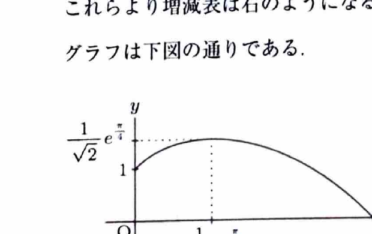

媒介変数表示
$$
x=x(t),\qquad y=y(t)
$$
で与えられた曲線では、
$$
\frac{dy}{dx}=\frac{dy/dt}{dx/dt}
\qquad\left(\frac{dx}{dt}\ne0\right)
$$
である。また、曲線と $x$ 軸で囲まれる面積は、$x$ が単調増加する場合、
$$
S=\int y\,dx=\int y(t)\frac{dx}{dt}\,dt
$$
で求められる。

---

問題 44　$C$ を区間

> 難度：B。出典：九州大。
$$
0\le t\le\frac{\pi}{2}
$$
で定義された媒介変数方程式
$$
x(t)=e^t\sin t,\qquad y(t)=e^t\cos t
$$
で表される $xy$ 平面上の曲線とする。

---

## (1)

導関数
$$
\frac{dx}{dt},\qquad \frac{dy}{dt},\qquad \frac{dy}{dx}
$$
をそれぞれ求めよ。

---

## (1) 解答

> $x(t),y(t)$ は指数関数と三角関数の積なので、積の微分法を用いる。$\frac{dy}{dx}$ は媒介変数表示の公式で求める。

まず、
$$
x(t)=e^t\sin t
$$
を微分する。積の微分法
$$
(uv)'=u'v+uv'
$$
へ、
$$
u=e^t,\qquad v=\sin t
$$
を代入すると、
$$
\frac{dx}{dt}
=
e^t\sin t+e^t\cos t
$$
である。共通因子をくくって、
$$
\boxed{
\frac{dx}{dt}=e^t(\sin t+\cos t)
}
$$
となる。

次に、
$$
y(t)=e^t\cos t
$$
を微分する。同様に、
$$
\frac{dy}{dt}
=
e^t\cos t-e^t\sin t
$$
だから、
$$
\boxed{
\frac{dy}{dt}=e^t(\cos t-\sin t)
}
$$
である。

媒介変数表示の公式
$$
\frac{dy}{dx}
=
\frac{dy/dt}{dx/dt}
$$
へ、上で求めた式を代入すると、
$$
\frac{dy}{dx}
=
\frac{e^t(\cos t-\sin t)}
{e^t(\sin t+\cos t)}
$$
である。$e^t>0$ なので約分でき、
$$
\boxed{
\frac{dy}{dx}
=
\frac{\cos t-\sin t}{\cos t+\sin t}
}
$$
となる。

---

## (2)

曲線 $C$ の増減を調べ、$xy$ 平面上にグラフをかけ。ただし、
$$
e^{\pi/4}=2.19
$$
である。

---

## (2) 解答

> 媒介変数曲線の概形は、$x(t),y(t)$ の端点での値と、それぞれの導関数の符号を調べて描く。特に $x$ が単調増加し、$y$ が途中で増加から減少へ変わることを確認する。

区間
$$
0\le t\le\frac{\pi}{2}
$$
では、
$$
\sin t\ge0,\qquad \cos t\ge0
$$
であり、両方が同時に0になることはない。したがって、
$$
\sin t+\cos t>0
$$
である。さらに $e^t>0$ だから、
$$
\frac{dx}{dt}=e^t(\sin t+\cos t)>0
$$
である。よって、$x(t)$ は全区間で単調増加する。

次に、
$$
\frac{dy}{dt}=e^t(\cos t-\sin t)
$$
の符号を調べる。$e^t>0$ なので、符号は
$$
\cos t-\sin t
$$
で決まる。極値候補は、
$$
\cos t-\sin t=0
$$
すなわち、
$$
\sin t=\cos t
$$
となる点である。区間内では、
$$
t=\frac{\pi}{4}
$$
である。

- $0\le t<\frac{\pi}{4}$ では $\cos t>\sin t$ なので $\frac{dy}{dt}>0$。
- $t=\frac{\pi}{4}$ では $\frac{dy}{dt}=0$。
- $\frac{\pi}{4}<t\le\frac{\pi}{2}$ では $\cos t<\sin t$ なので $\frac{dy}{dt}<0$。

したがって、$y(t)$ は $t=\frac{\pi}{4}$ まで増加し、その後減少する。

端点と最大点の座標を求める。$t=0$ では、
$$
x(0)=e^0\sin0=0,
$$
$$
y(0)=e^0\cos0=1
$$
だから、
$$
(x,y)=(0,1)
$$
である。

$t=\frac{\pi}{4}$ では、
$$
x\left(\frac{\pi}{4}\right)
=
e^{\pi/4}\sin\frac{\pi}{4}
=
\frac{e^{\pi/4}}{\sqrt2},
$$
$$
y\left(\frac{\pi}{4}\right)
=
e^{\pi/4}\cos\frac{\pi}{4}
=
\frac{e^{\pi/4}}{\sqrt2}
$$
である。与えられた近似値を代入すると、
$$
\frac{e^{\pi/4}}{\sqrt2}
\approx
\frac{2.19}{1.414}
\approx1.55
$$
である。したがって、最高点はおよそ
$$
(1.55,1.55)
$$
である。

$t=\frac{\pi}{2}$ では、
$$
x\left(\frac{\pi}{2}\right)
=
e^{\pi/2}\sin\frac{\pi}{2}
=
e^{\pi/2},
$$
$$
y\left(\frac{\pi}{2}\right)
=
e^{\pi/2}\cos\frac{\pi}{2}
=
0
$$
である。

以上より、曲線は $(0,1)$ から右上へ進み、$\left(\frac{e^{\pi/4}}{\sqrt2},\frac{e^{\pi/4}}{\sqrt2}\right)$ で最高点をとった後、右下へ進んで $(e^{\pi/2},0)$ に至る。

---

## (3)

曲線 $C$ と $x$ 軸、$y$ 軸で囲まれた図形の面積 $S$ を求めよ。

---

## (3) 解答

> (2) より $x(t)$ は全区間で単調増加し、$y(t)\ge0$ である。したがって、面積は $\int y\,dx$ を媒介変数 $t$ へ置換して計算できる。

面積の公式は、
$$
S=\int y\,dx
$$
である。媒介変数表示へ直すと、
$$
S
=
\int_0^{\pi/2}
y(t)\frac{dx}{dt}\,dt
$$
である。代入前の文字式は、
$$
y(t)=e^t\cos t,
$$
$$
\frac{dx}{dt}=e^t(\sin t+\cos t)
$$
である。これらを代入すると、
$$
S
=
\int_0^{\pi/2}
e^t\cos t\cdot e^t(\sin t+\cos t)\,dt
$$
$$
=
\int_0^{\pi/2}
e^{2t}\left(\sin t\cos t+\cos^2t\right)\,dt
$$
となる。

積和・半角公式
$$
\sin t\cos t=\frac12\sin2t,
$$
$$
\cos^2t=\frac12(1+\cos2t)
$$
を用いると、
$$
S
=
\frac12\int_0^{\pi/2}e^{2t}\sin2t\,dt
+
\frac12\int_0^{\pi/2}e^{2t}\cos2t\,dt
+
\frac12\int_0^{\pi/2}e^{2t}\,dt
$$
である。

指数関数と三角関数の積の公式より、
$$
\int e^{2t}\sin2t\,dt
=
\frac{e^{2t}}{2^2+2^2}
(2\sin2t-2\cos2t)
$$
$$
=
\frac14e^{2t}(\sin2t-\cos2t)
$$
である。また、
$$
\int e^{2t}\cos2t\,dt
=
\frac{e^{2t}}{2^2+2^2}
(2\cos2t+2\sin2t)
$$
$$
=
\frac14e^{2t}(\cos2t+\sin2t)
$$
である。さらに、
$$
\int e^{2t}\,dt=\frac12e^{2t}
$$
である。

したがって、
$$
S
=
\left[
\frac18e^{2t}(\sin2t-\cos2t)
+
\frac18e^{2t}(\cos2t+\sin2t)
+
\frac14e^{2t}
\right]_0^{\pi/2}
$$
となる。最初の二項をまとめると、
$$
\frac18e^{2t}(2\sin2t)
=
\frac14e^{2t}\sin2t
$$
だから、
$$
S
=
\left[
\frac14e^{2t}\sin2t+\frac14e^{2t}
\right]_0^{\pi/2}
$$
である。

上端 $t=\frac{\pi}{2}$ では、
$$
\sin\pi=0
$$
なので、
$$
\frac14e^\pi
$$
となる。下端 $t=0$ では、
$$
\sin0=0,\qquad e^0=1
$$
なので、
$$
\frac14
$$
である。よって、
$$
S
=
\frac14e^\pi-\frac14
$$
となる。

$$
\boxed{S=\frac{e^\pi-1}{4}}
$$
