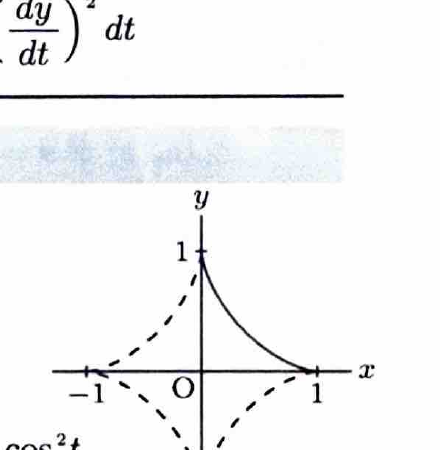

媒介変数表示
$$
x=f(t),\qquad y=g(t)
$$
で表された曲線の長さは、
$$
L
=
\int_\alpha^\beta
\sqrt{
\left(\frac{dx}{dt}\right)^2+
\left(\frac{dy}{dt}\right)^2
}\,dt
$$
である。

> 代表的な媒介変数曲線には次がある。
> - サイクロイド：
>   $$
>   x=a(t-\sin t),\qquad y=a(1-\cos t)
>   \qquad(0\le t\le2\pi)
>   $$
> - カージオイド：
>   $$
>   r=a(1+\cos\theta)
>   \qquad(0\le\theta\le2\pi)
>   $$
> - アステロイド：
>   $$
>   x=a\cos^3t,\qquad y=a\sin^3t
>   \qquad(0\le t\le2\pi)
>   $$
---

問題 45　次の媒介変数で表された曲線

> 難度：B。出典：高知大。
$$
x=f(t)=\cos^3t,\qquad y=g(t)=\sin^3t
$$
について、以下の問いに答えよ。

---

## (1)

この曲線は通常何と呼ばれているか答えよ。

---

## (1) 解答

> 媒介変数表示 $x=a\cos^3t,\ y=a\sin^3t$ で表される曲線は、星形の四尖点曲線である。

与えられた曲線は、
$$
\boxed{\text{アステロイド曲線（星芒形）}}
$$
と呼ばれる。

> 両式の $2/3$ 乗をとると、
> $$
> x^{2/3}+y^{2/3}
> =
> \cos^2t+\sin^2t
> =
> 1
> $$
> となり、アステロイドの陰関数表示が得られる。

---

## (2)

$f'(t)$ と $g'(t)$ を求めよ。

---

## (2) 解答

> 合成関数の微分法を用いる。$\cos^3t$ は $(\cos t)^3$、$\sin^3t$ は $(\sin t)^3$ と考える。

まず、
$$
f(t)=(\cos t)^3
$$
を微分すると、
$$
f'(t)
=
3(\cos t)^2\cdot(-\sin t)
$$
である。したがって、
$$
\boxed{f'(t)=-3\cos^2t\sin t}
$$
となる。

次に、
$$
g(t)=(\sin t)^3
$$
を微分すると、
$$
g'(t)
=
3(\sin t)^2\cdot\cos t
$$
である。したがって、
$$
\boxed{g'(t)=3\sin^2t\cos t}
$$
となる。

---

## (3)

$t$ の範囲を
$$
0\le t\le\frac{\pi}{2}
$$
としたときの曲線の長さ $L$ を求めよ。

---

## (3) 解答

> 媒介変数曲線の弧長公式を用いる。区間 $0\le t\le\frac{\pi}{2}$ では $\sin t,\cos t\ge0$ なので、平方根を外す際の符号を確定できる。

弧長公式は、
$$
L
=
\int_0^{\pi/2}
\sqrt{\{f'(t)\}^2+\{g'(t)\}^2}\,dt
$$
である。(2) の結果を代入すると、
$$
\{f'(t)\}^2
=
9\cos^4t\sin^2t,
$$
$$
\{g'(t)\}^2
=
9\sin^4t\cos^2t
$$
である。したがって、
$$
\{f'(t)\}^2+\{g'(t)\}^2
=
9\cos^4t\sin^2t
+
9\sin^4t\cos^2t
$$
となる。共通因子をくくると、
$$
=
9\sin^2t\cos^2t(\cos^2t+\sin^2t)
$$
である。恒等式
$$
\sin^2t+\cos^2t=1
$$
より、
$$
\{f'(t)\}^2+\{g'(t)\}^2
=
9\sin^2t\cos^2t
$$
となる。

よって、
$$
\sqrt{\{f'(t)\}^2+\{g'(t)\}^2}
=
3|\sin t\cos t|
$$
である。区間 $0\le t\le\frac{\pi}{2}$ では、
$$
\sin t\cos t\ge0
$$
だから、
$$
\sqrt{\{f'(t)\}^2+\{g'(t)\}^2}
=
3\sin t\cos t
$$
である。

したがって、
$$
L
=
3\int_0^{\pi/2}\sin t\cos t\,dt
$$
となる。倍角公式
$$
\sin2t=2\sin t\cos t
$$
を用いると、
$$
L
=
\frac32\int_0^{\pi/2}\sin2t\,dt
$$
である。積分すると、
$$
L
=
\frac32
\left[
-\frac12\cos2t
\right]_0^{\pi/2}
$$
$$
=
-\frac34(\cos\pi-\cos0)
$$
$$
=
-\frac34(-1-1)
=
\frac32
$$
となる。

$$
\boxed{L=\frac32}
$$
