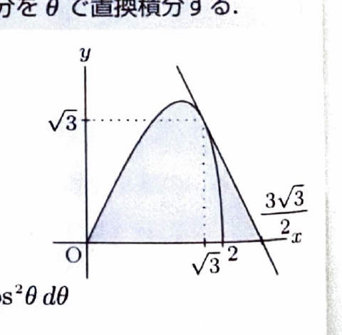

媒介変数曲線
$$
x=x(\theta),\qquad y=y(\theta)
$$
の接線の傾きは、
$$
\frac{dy}{dx}
=
\frac{dy/d\theta}{dx/d\theta}
$$
である。また、曲線下の領域を $x$ 軸のまわりに回転するとき、
$$
V=\pi\int y^2\,dx
$$
であり、媒介変数へ置換すると
$$
V=\pi\int y(\theta)^2\frac{dx}{d\theta}\,d\theta
$$
となる。

---

問題 47　$\theta$ が

> 難度：B。出典：大阪大。
$$
0\le\theta\le\frac{\pi}{2}
$$
の範囲で変化するとき、
$$
x=2\cos\theta,\qquad y=2\sin2\theta
$$
で表される点 $(x,y)$ は一つの曲線を描く。この曲線の方程式を $y=f(x)$ とする。$y=f(x)$ の1点 $(a,b)$ における接線の方程式が
$$
y=-2(x-c)
$$
であるとき、以下の問いに答えよ。

---

## (1)

$a,b,c$ の値をそれぞれ求めよ。

---

## (1) 解答

> 接線の傾きが $-2$ なので、媒介変数表示から $\frac{dy}{dx}$ を求め、その値が $-2$ となる $\theta$ を決める。その後、点の座標と直線の切片を求める。曲線を $x$ の式へ消去して微分する別解もある。

まず、
$$
x=2\cos\theta
$$
を微分すると、
$$
\frac{dx}{d\theta}
=
-2\sin\theta
$$
である。次に、
$$
y=2\sin2\theta
$$
を微分すると、
$$
\frac{dy}{d\theta}
=
4\cos2\theta
$$
である。したがって、
$$
\frac{dy}{dx}
=
\frac{4\cos2\theta}{-2\sin\theta}
=
-\frac{2\cos2\theta}{\sin\theta}
$$
である。

接線の傾きが $-2$ なので、
$$
-\frac{2\cos2\theta}{\sin\theta}
=
-2
$$
である。両辺を $-2$ で割ると、
$$
\frac{\cos2\theta}{\sin\theta}=1
$$
より、
$$
\cos2\theta=\sin\theta
$$
となる。恒等式
$$
\cos2\theta=1-2\sin^2\theta
$$
を代入すると、
$$
1-2\sin^2\theta=\sin\theta
$$
である。整理して、
$$
2\sin^2\theta+\sin\theta-1=0
$$
となる。因数分解すると、
$$
(2\sin\theta-1)(\sin\theta+1)=0
$$
である。$0\le\theta\le\frac{\pi}{2}$ では $\sin\theta\ge0$ なので、
$$
\sin\theta=-1
$$
は不適であり、
$$
\sin\theta=\frac12
$$
である。したがって、
$$
\theta=\frac{\pi}{6}
$$
となる。

接点の座標は、代入前の式
$$
x=2\cos\theta,\qquad y=2\sin2\theta
$$
へ $\theta=\frac{\pi}{6}$ を代入して、
$$
a=2\cos\frac{\pi}{6}
=
2\cdot\frac{\sqrt3}{2}
=
\sqrt3,
$$
$$
b=2\sin\frac{\pi}{3}
=
2\cdot\frac{\sqrt3}{2}
=
\sqrt3
$$
である。

接線
$$
y=-2(x-c)
$$
が点 $(\sqrt3,\sqrt3)$ を通るので、
$$
\sqrt3=-2(\sqrt3-c)
$$
である。展開すると、
$$
\sqrt3=-2\sqrt3+2c
$$
だから、
$$
2c=3\sqrt3
$$
となる。よって、
$$
c=\frac{3\sqrt3}{2}
$$
である。

したがって、
$$
\boxed{
a=\sqrt3,\qquad
b=\sqrt3,\qquad
c=\frac{3\sqrt3}{2}
}
$$

---

## (2)

区間 $0\le x\le a$ における曲線 $y=f(x)$ と、区間 $a\le x\le c$ における直線
$$
y=-2(x-c)
$$
と $x$ 軸で囲まれる領域を、$x$ 軸のまわりに1回転してできる立体の体積を求めよ。

---

## (2) 解答

> 立体を、曲線部分を回転した体積 $V_1$ と、直線部分を回転した円錐の体積 $V_2$ に分ける。曲線部分は媒介変数で $\pi\int y^2\,dx$ を計算する。直線部分は積分でも円錐公式でも求められる。

(1) より、
$$
a=\sqrt3,\qquad b=\sqrt3,\qquad c=\frac{3\sqrt3}{2}
$$
である。全体の体積を、
$$
V=V_1+V_2
$$
とする。

### 曲線部分の体積 $V_1$

曲線部分では、
$$
V_1
=
\pi\int_0^{\sqrt3}y^2\,dx
$$
である。媒介変数では、
$$
x=2\cos\theta
$$
なので、
$$
x=0
\Rightarrow
\theta=\frac{\pi}{2},
$$
$$
x=\sqrt3
\Rightarrow
2\cos\theta=\sqrt3
\Rightarrow
\theta=\frac{\pi}{6}
$$
である。また、
$$
\frac{dx}{d\theta}=-2\sin\theta,
$$
$$
y=2\sin2\theta
$$
だから、
$$
V_1
=
\pi
\int_{\pi/2}^{\pi/6}
(2\sin2\theta)^2
(-2\sin\theta)\,d\theta
$$
である。積分区間を逆にすると、
$$
V_1
=
8\pi
\int_{\pi/6}^{\pi/2}
\sin^22\theta\sin\theta\,d\theta
$$
となる。

倍角公式
$$
\sin2\theta=2\sin\theta\cos\theta
$$
より、
$$
\sin^22\theta
=
4\sin^2\theta\cos^2\theta
$$
だから、
$$
V_1
=
32\pi
\int_{\pi/6}^{\pi/2}
\sin^3\theta\cos^2\theta\,d\theta
$$
である。$\sin^3\theta$ を、
$$
\sin^3\theta
=
\sin\theta(1-\cos^2\theta)
$$
と変形すると、
$$
V_1
=
32\pi
\int_{\pi/6}^{\pi/2}
(\cos^2\theta-\cos^4\theta)\sin\theta\,d\theta
$$
となる。

ここで、
$$
u=\cos\theta,\qquad du=-\sin\theta\,d\theta
$$
とおく。直接原始関数を書くと、
$$
\int(\cos^2\theta-\cos^4\theta)\sin\theta\,d\theta
=
-\frac13\cos^3\theta+\frac15\cos^5\theta
$$
である。したがって、
$$
V_1
=
32\pi
\left[
-\frac13\cos^3\theta+\frac15\cos^5\theta
\right]_{\pi/6}^{\pi/2}
$$
となる。$\cos\frac{\pi}{2}=0$ なので上端は0である。下端では、
$$
\cos\frac{\pi}{6}=\frac{\sqrt3}{2}
$$
だから、
$$
V_1
=
-32\pi
\left[
-\frac13\left(\frac{\sqrt3}{2}\right)^3
+
\frac15\left(\frac{\sqrt3}{2}\right)^5
\right]
$$
である。各べきは、
$$
\left(\frac{\sqrt3}{2}\right)^3
=
\frac{3\sqrt3}{8},
$$
$$
\left(\frac{\sqrt3}{2}\right)^5
=
\frac{9\sqrt3}{32}
$$
だから、
$$
V_1
=
32\pi
\left(
\frac{\sqrt3}{8}
-
\frac{9\sqrt3}{160}
\right)
$$
$$
=
32\pi
\left(
\frac{20\sqrt3-9\sqrt3}{160}
\right)
$$
$$
=
32\pi\cdot\frac{11\sqrt3}{160}
=
\frac{11\sqrt3}{5}\pi
$$
となる。

### 直線部分の体積 $V_2$

直線部分を回転してできる立体は、底面半径
$$
b=\sqrt3
$$
、高さ
$$
c-a
=
\frac{3\sqrt3}{2}-\sqrt3
=
\frac{\sqrt3}{2}
$$
の円錐である。円錐の体積公式
$$
V=\frac13\pi r^2h
$$
へ、
$$
r=\sqrt3,\qquad h=\frac{\sqrt3}{2}
$$
を代入すると、
$$
V_2
=
\frac13\pi(\sqrt3)^2\cdot\frac{\sqrt3}{2}
$$
$$
=
\frac13\pi\cdot3\cdot\frac{\sqrt3}{2}
=
\frac{\sqrt3}{2}\pi
$$
である。

したがって、
$$
V
=
\frac{11\sqrt3}{5}\pi
+
\frac{\sqrt3}{2}\pi
$$
である。通分して、
$$
V
=
\left(
\frac{22\sqrt3}{10}
+
\frac{5\sqrt3}{10}
\right)\pi
$$
より、
$$
\boxed{
V=\frac{27\sqrt3}{10}\pi
}
$$
となる。
