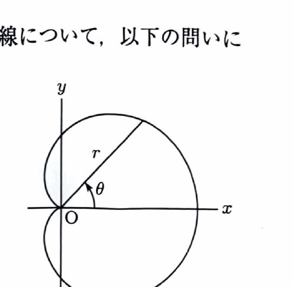

極座標
$$
r=f(\theta)
$$
から直交座標への変換は、
$$
x=r\cos\theta,\qquad y=r\sin\theta
$$
である。極座標曲線の面積は、
$$
S=\frac12\int_\alpha^\beta r^2\,d\theta
$$
であり、曲線の長さは、
$$
L=
\int_\alpha^\beta
\sqrt{
r^2+\left(\frac{dr}{d\theta}\right)^2
}\,d\theta
$$
である。

---

問題 48　極方程式

> 難度：B。出典：豊橋技科大。
$$
r=1+\cos\theta
\qquad(0\le\theta\le2\pi)
$$
で表される曲線について、以下の問いに答えよ。

---

## (1)

曲線上の点の座標 $(x,y)$ を $\theta$ を用いて表せ。

---

## (1) 解答

> 極座標から直交座標への基本変換へ、与えられた $r$ を代入する。

変換公式は、
$$
x=r\cos\theta,\qquad y=r\sin\theta
$$
である。代入前の文字 $r$ へ、
$$
r=1+\cos\theta
$$
を代入すると、
$$
\boxed{
x=(1+\cos\theta)\cos\theta
}
$$
および、
$$
\boxed{
y=(1+\cos\theta)\sin\theta
}
$$
となる。

---

## (2)

曲線上の $\theta=\frac{\pi}{4}$ における点を $P$ とする。点 $P$ における曲線の接線の方程式を $x$ と $y$ を用いて表せ。

---

## (2) 解答

> (1) の媒介変数表示を $\theta$ で微分し、$\frac{dy}{dx}$ を求める。次に $\theta=\frac{\pi}{4}$ での点と傾きを点傾き式へ代入する。

まず、
$$
x=(1+\cos\theta)\cos\theta
$$
を微分する。積の微分法より、
$$
\frac{dx}{d\theta}
=
(-\sin\theta)\cos\theta
+
(1+\cos\theta)(-\sin\theta)
$$
である。整理すると、
$$
\frac{dx}{d\theta}
=
-\sin\theta\cos\theta-\sin\theta-\sin\theta\cos\theta
$$
$$
=
-\sin\theta-2\sin\theta\cos\theta
$$
である。倍角公式
$$
\sin2\theta=2\sin\theta\cos\theta
$$
を用いて、
$$
\frac{dx}{d\theta}
=
-\sin\theta-\sin2\theta
$$
となる。

次に、
$$
y=(1+\cos\theta)\sin\theta
$$
を微分すると、
$$
\frac{dy}{d\theta}
=
(-\sin\theta)\sin\theta
+
(1+\cos\theta)\cos\theta
$$
である。整理して、
$$
\frac{dy}{d\theta}
=
-\sin^2\theta+\cos\theta+\cos^2\theta
$$
$$
=
\cos\theta+(\cos^2\theta-\sin^2\theta)
$$
$$
=
\cos\theta+\cos2\theta
$$
となる。

点 $P$ の座標を求める。$\theta=\frac{\pi}{4}$ では、
$$
\cos\frac{\pi}{4}
=
\sin\frac{\pi}{4}
=
\frac{\sqrt2}{2}
$$
である。したがって、
$$
r=1+\frac{\sqrt2}{2}
=
\frac{2+\sqrt2}{2}
$$
である。直交座標は、
$$
x_P=r\cos\frac{\pi}{4}
=
\left(1+\frac{\sqrt2}{2}\right)\frac{\sqrt2}{2}
$$
$$
=
\frac{\sqrt2}{2}+\frac12
=
\frac{\sqrt2+1}{2}
$$
である。同様に、
$$
y_P=\frac{\sqrt2+1}{2}
$$
となる。よって、
$$
P\left(
\frac{\sqrt2+1}{2},
\frac{\sqrt2+1}{2}
\right)
$$
である。

接線の傾きは、
$$
\frac{dy}{dx}
=
\frac{dy/d\theta}{dx/d\theta}
$$
である。$\theta=\frac{\pi}{4}$ を代入する前の式は、
$$
\frac{dy}{dx}
=
\frac{\cos\theta+\cos2\theta}
{-\sin\theta-\sin2\theta}
$$
である。ここへ、
$$
\cos\frac{\pi}{4}=\frac{\sqrt2}{2},
\quad
\cos\frac{\pi}{2}=0,
\quad
\sin\frac{\pi}{4}=\frac{\sqrt2}{2},
\quad
\sin\frac{\pi}{2}=1
$$
を代入すると、
$$
\left.\frac{dy}{dx}\right|_{\theta=\pi/4}
=
\frac{\frac{\sqrt2}{2}}
{-\frac{\sqrt2}{2}-1}
$$
である。分子分母を2倍して、
$$
=
-\frac{\sqrt2}{\sqrt2+2}
$$
となる。有理化すると、
$$
-\frac{\sqrt2}{\sqrt2+2}
\cdot
\frac{2-\sqrt2}{2-\sqrt2}
=
-\frac{2\sqrt2-2}{2}
$$
$$
=-(\sqrt2-1)
$$
である。

したがって、点傾き式は、
$$
y-\frac{\sqrt2+1}{2}
=
-(\sqrt2-1)
\left(
x-\frac{\sqrt2+1}{2}
\right)
$$
である。整理すると、
$$
\boxed{
y
=
-(\sqrt2-1)x
+
\frac{2+\sqrt2}{2}
}
$$
となる。

---

## (3)

曲線に囲まれた領域の面積を求めよ。

---

## (3) 解答

> この曲線は $x$ 軸に関して対称であるため、上半分 $0\le\theta\le\pi$ の面積を2倍する。全区間 $0\le\theta\le2\pi$ を直接積分してもよい。

極座標の面積公式は、
$$
S=\frac12\int r^2\,d\theta
$$
である。対称性より、
$$
S
=
2\cdot\frac12
\int_0^\pi(1+\cos\theta)^2\,d\theta
$$
だから、
$$
S
=
\int_0^\pi(1+\cos\theta)^2\,d\theta
$$
である。展開すると、
$$
(1+\cos\theta)^2
=
1+2\cos\theta+\cos^2\theta
$$
なので、
$$
S
=
\int_0^\pi1\,d\theta
+
2\int_0^\pi\cos\theta\,d\theta
+
\int_0^\pi\cos^2\theta\,d\theta
$$
である。

第1項は、
$$
\int_0^\pi1\,d\theta=\pi
$$
である。第2項は、
$$
2[\sin\theta]_0^\pi=0
$$
である。第3項は、半角公式
$$
\cos^2\theta=\frac{1+\cos2\theta}{2}
$$
より、
$$
\int_0^\pi\cos^2\theta\,d\theta
=
\frac12\int_0^\pi(1+\cos2\theta)\,d\theta
=
\frac{\pi}{2}
$$
である。したがって、
$$
S
=
\pi+0+\frac{\pi}{2}
$$
より、
$$
\boxed{S=\frac32\pi}
$$
となる。

---

## (4)

曲線の全長を求めよ。

---

## (4) 解答

> 極座標曲線の弧長公式を用いる。曲線は $x$ 軸対称なので $0\le\theta\le\pi$ の長さを2倍する。根号内が半角公式により完全平方になる。

与式は、
$$
r=1+\cos\theta
$$
であるから、
$$
\frac{dr}{d\theta}=-\sin\theta
$$
である。弧長公式へ代入すると、
$$
L
=
2\int_0^\pi
\sqrt{
(1+\cos\theta)^2+\sin^2\theta
}\,d\theta
$$
である。

根号内を展開すると、
$$
(1+\cos\theta)^2+\sin^2\theta
=
1+2\cos\theta+\cos^2\theta+\sin^2\theta
$$
である。恒等式
$$
\cos^2\theta+\sin^2\theta=1
$$
より、
$$
=
2+2\cos\theta
$$
となる。半角公式
$$
1+\cos\theta=2\cos^2\frac{\theta}{2}
$$
を用いると、
$$
2+2\cos\theta
=
2(1+\cos\theta)
=
4\cos^2\frac{\theta}{2}
$$
である。したがって、
$$
\sqrt{r^2+\left(\frac{dr}{d\theta}\right)^2}
=
2\left|\cos\frac{\theta}{2}\right|
$$
である。$0\le\theta\le\pi$ では、
$$
0\le\frac{\theta}{2}\le\frac{\pi}{2}
$$
なので、
$$
\cos\frac{\theta}{2}\ge0
$$
である。よって、
$$
L
=
2\int_0^\pi
2\cos\frac{\theta}{2}\,d\theta
$$
$$
=
4\int_0^\pi\cos\frac{\theta}{2}\,d\theta
$$
となる。積分すると、
$$
\int\cos\frac{\theta}{2}\,d\theta
=
2\sin\frac{\theta}{2}
$$
だから、
$$
L
=
4
\left[
2\sin\frac{\theta}{2}
\right]_0^\pi
$$
$$
=
8\left(\sin\frac{\pi}{2}-\sin0\right)
=
8
$$
である。

$$
\boxed{L=8}
$$
