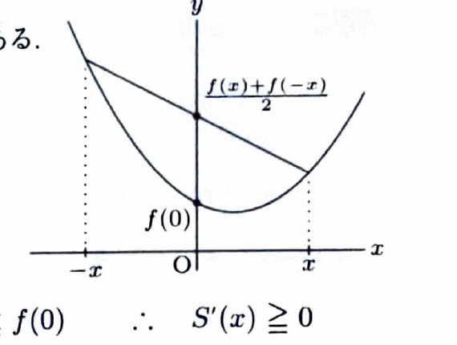

微分積分法の基本定理より、
$$
S(x)=\int_a^x f(t)\,dt
$$
なら、
$$
S'(x)=f(x)
$$
である。積分区間の両端が $x$ の関数の場合は、
$$
\frac{d}{dx}
\int_{g(x)}^{h(x)}f(t)\,dt
=
f(h(x))h'(x)-f(g(x))g'(x)
$$
を用いる。

---

問題 50

> 難度：C。出典：島根大。

---

## (1)

$f(x)$ は $(-\infty,+\infty)$ で定義された連続関数とする。
$$
F(x)=\int_{-x}^{x}f(t)\,dt
$$
とおくとき、導関数 $F'(x)$ を $f(x)$ を用いて表せ。

---

## (1) 解答

> 積分の上端と下端がともに $x$ に依存するため、可変端点をもつ積分の微分公式を使う。原始関数を導入して合成関数の微分を行っても同じ結果になる。

一般公式は、
$$
\frac{d}{dx}
\int_{g(x)}^{h(x)}f(t)\,dt
=
f(h(x))h'(x)-f(g(x))g'(x)
$$
である。ここで、代入前の文字式に対し、
$$
g(x)=-x,\qquad h(x)=x
$$
を代入する。微分は、
$$
g'(x)=-1,\qquad h'(x)=1
$$
である。したがって、
$$
F'(x)
=
f(x)\cdot1-f(-x)\cdot(-1)
$$
となる。整理して、
$$
\boxed{
F'(x)=f(x)+f(-x)
}
$$
である。

> 原始関数 $G'(t)=f(t)$ を用いると、
> $$
> F(x)=G(x)-G(-x)
> $$
> であり、
> $$
> F'(x)=G'(x)-G'(-x)(-1)=f(x)+f(-x)
> $$
> と確認できる。

---

## (2)

$f(x)$ は $(-\infty,+\infty)$ で定義された下に凸な連続関数とする。このとき、すべての $x>0$ に対して次の不等式が成り立つことを示せ。

$$
2xf(0)\le\int_{-x}^{x}f(t)\,dt
$$

---

## (2) 解答

> 示すべき不等式の左辺を右辺から引いた関数を作り、その導関数が非負であることを下に凸という条件から示す。点ごとの凸性不等式を積分する方法もあるが、(1) の結果を直接活用する方法が資料の方針である。

関数
$$
S(x)
=
\int_{-x}^{x}f(t)\,dt-2xf(0)
$$
とおく。示したい不等式は、
$$
S(x)\ge0
$$
と同値である。まず、
$$
S(0)
=
\int_0^0f(t)\,dt-0
=
0
$$
である。

(1) より、
$$
\frac{d}{dx}
\int_{-x}^{x}f(t)\,dt
=
f(x)+f(-x)
$$
である。また、
$$
\frac{d}{dx}\{2xf(0)\}=2f(0)
$$
だから、
$$
S'(x)
=
f(x)+f(-x)-2f(0)
$$
である。整理して、
$$
S'(x)
=
2\left\{
\frac{f(x)+f(-x)}{2}-f(0)
\right\}
$$
となる。

ここで $f$ は下に凸である。下に凸な関数では、二点
$$
(-x,f(-x)),\qquad (x,f(x))
$$
を結ぶ弦はグラフより上側にある。$0$ は $-x$ と $x$ の中点なので、凸性の中点不等式より、
$$
f\left(\frac{-x+x}{2}\right)
\le
\frac{f(-x)+f(x)}{2}
$$
である。左辺は、
$$
f(0)
$$
だから、
$$
f(0)
\le
\frac{f(-x)+f(x)}{2}
$$
である。よって、
$$
\frac{f(x)+f(-x)}{2}-f(0)\ge0
$$
となり、
$$
S'(x)\ge0
$$
である。

したがって、$S(x)$ は $x\ge0$ で単調増加する。$S(0)=0$ なので、すべての $x>0$ に対して、
$$
S(x)\ge S(0)=0
$$
である。すなわち、
$$
\int_{-x}^{x}f(t)\,dt-2xf(0)\ge0
$$
であるから、
$$
\boxed{
2xf(0)\le\int_{-x}^{x}f(t)\,dt
}
$$
が示された。

> 別解として、各 $t\in[-x,x]$ に対して凸性から
> $$
> f(t)+f(-t)\ge2f(0)
> $$
> を得て、$0\le t\le x$ で積分すると、
> $$
> \int_0^x\{f(t)+f(-t)\}\,dt
> \ge
> \int_0^x2f(0)\,dt
> $$
> となる。左辺は $\int_{-x}^{x}f(t)\,dt$、右辺は $2xf(0)$ であり、同じ不等式が得られる。
