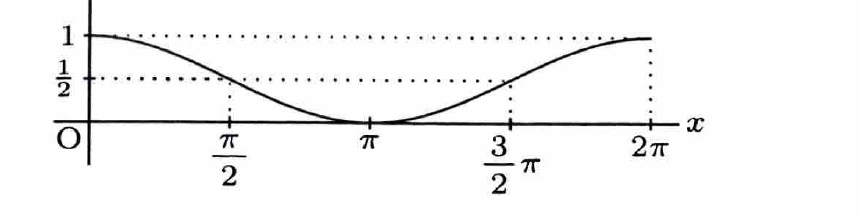
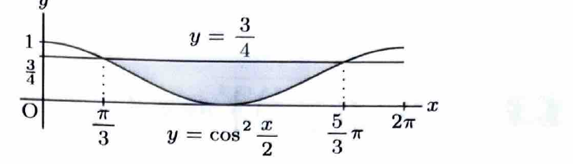

> この節では、定積分を用いて平面図形の面積、立体の体積、曲線の長さを求める。問題文からグラフの概形を描き、交点や上下関係を確認して積分式を立てることが重要である。さらに、微分積分法の基本定理や区分求積法も扱う。

面積を積分で求めるときは、最初にグラフの概形を確認し、交点を求める。区間 $[a,b]$ で上側が $y=f(x)$、下側が $y=g(x)$ なら、
$$
S=\int_a^b\{f(x)-g(x)\}\,dx
$$
である。
---

例題 13　曲線

> 出典：鹿児島大。
$$
y=\cos^2\frac{x}{2}
$$
について、以下の問いに答えよ。

---

## (1)

曲線のグラフを $0\le x\le2\pi$ の範囲で描け。

---

## (1) 解答

> 半角公式により、与式を余弦曲線の拡大・平行移動として捉える。値を逐一計算して点を結ぶ方法もあるが、変換として理解する方が形を正確に把握できる。

半角公式
$$
\cos^2\frac{x}{2}=\frac{1+\cos x}{2}
$$
より、
$$
y=\frac12\cos x+\frac12
$$
である。

> これは $y=\cos x$ のグラフを $y$ 軸方向に $\frac12$ 倍し、その後 $y$ 軸の正方向へ $\frac12$ 平行移動したグラフである。

代表値を確認する。
$$
x=0\Rightarrow y=1,
$$
$$
x=\frac{\pi}{2}\Rightarrow y=\frac12,
$$
$$
x=\pi\Rightarrow y=0,
$$
$$
x=\frac{3\pi}{2}\Rightarrow y=\frac12,
$$
$$
x=2\pi\Rightarrow y=1.
$$
したがって、$0\le x\le2\pi$ では、$(0,1)$ から減少して $(\pi,0)$ で最小となり、その後増加して $(2\pi,1)$ へ至る。

---

## (2)

$0\le x\le2\pi$ の範囲において、曲線と直線
$$
y=\frac34
$$
で囲まれた部分の面積を求めよ。

---

## (2) 解答

> まず交点を求める。二つの交点の間では直線 $y=\frac34$ が上、曲線が下になるため、「上－下」を積分する。

交点では、
$$
\cos^2\frac{x}{2}=\frac34
$$
である。半角公式を代入する前の文字式は、
$$
\cos^2\frac{x}{2}=\frac{1+\cos x}{2}
$$
であるから、
$$
\frac{1+\cos x}{2}=\frac34
$$
となる。両辺を2倍して、
$$
1+\cos x=\frac32
$$
より、
$$
\cos x=\frac12
$$
である。$0\le x\le2\pi$ において、
$$
x=\frac{\pi}{3},\qquad x=\frac{5\pi}{3}
$$
となる。

したがって、求める面積 $S$ は、
$$
S=
\int_{\pi/3}^{5\pi/3}
\left(
\frac34-\cos^2\frac{x}{2}
\right)\,dx
$$
である。半角公式
$$
\cos^2\frac{x}{2}=\frac{1+\cos x}{2}
$$
を代入すると、
$$
S=
\int_{\pi/3}^{5\pi/3}
\left(
\frac34-\frac{1+\cos x}{2}
\right)\,dx
$$
である。括弧内を整理して、
$$
S=
\int_{\pi/3}^{5\pi/3}
\left(
\frac14-\frac12\cos x
\right)\,dx
$$
となる。積分すると、
$$
S=
\left[
\frac14x-\frac12\sin x
\right]_{\pi/3}^{5\pi/3}
$$
である。上端と下端を代入して、
$$
S
=
\frac14\left(\frac{5\pi}{3}-\frac{\pi}{3}\right)
-\frac12\left(
\sin\frac{5\pi}{3}-\sin\frac{\pi}{3}
\right)
$$
となる。ここで、
$$
\sin\frac{5\pi}{3}=-\frac{\sqrt3}{2},
\qquad
\sin\frac{\pi}{3}=\frac{\sqrt3}{2}
$$
だから、
$$
S
=
\frac{\pi}{3}
-\frac12(-\sqrt3)
=
\frac{\pi}{3}+\frac{\sqrt3}{2}
$$
である。

$$
\boxed{S=\frac{\pi}{3}+\frac{\sqrt3}{2}}
$$
