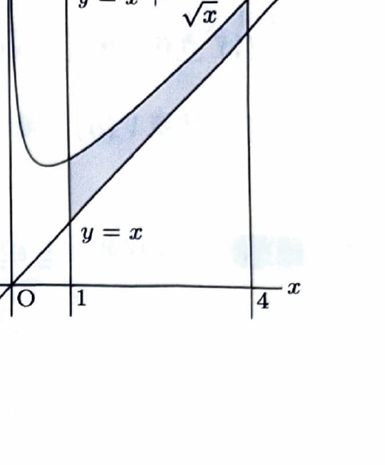

曲線 $y=f(x)$ と $y=g(x)$ に挟まれた面積は
$$
S=\int_a^b|f(x)-g(x)|\,dx
$$
である。二つの曲線に挟まれた領域を $x$ 軸のまわりに回転するときは、外半径と内半径を用いる円環法により
$$
V=\pi\int_a^b\left\{R(x)^2-r(x)^2\right\}\,dx
$$
とする。

---

例題 15　曲線

> 出典：宇都宮大。
$$
y=x+\frac1{\sqrt{x}}
$$
と直線
$$
y=x,\qquad x=1,\qquad x=4
$$
で囲まれた図形を $A$ とする。以下の問いに答えよ。

---

## (1)

図形 $A$ の面積を求めよ。

---

## (1) 解答

> $1\le x\le4$ では $\frac1{\sqrt{x}}>0$ なので、曲線 $y=x+\frac1{\sqrt{x}}$ が直線 $y=x$ より上にある。したがって「上－下」をそのまま積分する。

上側の関数と下側の関数の差は、
$$
\left(x+\frac1{\sqrt{x}}\right)-x
=
\frac1{\sqrt{x}}
=
x^{-1/2}
$$
である。したがって、面積 $S$ は、
$$
S
=
\int_1^4
\left(
x+\frac1{\sqrt{x}}-x
\right)\,dx
=
\int_1^4x^{-1/2}\,dx
$$
である。べき関数の積分公式を用いると、
$$
\int x^{-1/2}\,dx
=
\frac{x^{1/2}}{1/2}
=
2\sqrt{x}
$$
だから、
$$
S
=
\left[
2\sqrt{x}
\right]_1^4
$$
となる。端点を代入して、
$$
S=2\sqrt4-2\sqrt1=4-2=2
$$
である。

$$
\boxed{S=2}
$$

---

## (2)

図形 $A$ を $x$ 軸のまわりに1回転してできる立体の体積を求めよ。

---

## (2) 解答

> 回転後の断面は円環である。外半径は $x+\frac1{\sqrt{x}}$、内半径は $x$ なので、差そのものを二乗してはいけない。必ず「外半径の二乗－内半径の二乗」を用いる。

外半径を
$$
R(x)=x+\frac1{\sqrt{x}}
$$
とし、内半径を
$$
r(x)=x
$$
とする。円環法の公式
$$
V=\pi\int_a^b\{R(x)^2-r(x)^2\}\,dx
$$
へ、
$$
a=1,\qquad b=4
$$
を代入すると、
$$
V
=
\pi\int_1^4
\left\{
\left(x+\frac1{\sqrt{x}}\right)^2-x^2
\right\}\,dx
$$
である。

二乗を展開する前の文字式は、
$$
\left(x+\frac1{\sqrt{x}}\right)^2
$$
であり、
$$
\left(x+\frac1{\sqrt{x}}\right)^2
=
x^2+2x\cdot\frac1{\sqrt{x}}+\frac1x
$$
$$
=
x^2+2\sqrt{x}+\frac1x
$$
となる。したがって、
$$
\left(x+\frac1{\sqrt{x}}\right)^2-x^2
=
2\sqrt{x}+\frac1x
$$
である。よって、
$$
V
=
\pi\int_1^4
\left(
2x^{1/2}+\frac1x
\right)\,dx
$$
となる。項別に積分して、
$$
\int2x^{1/2}\,dx
=
2\cdot\frac23x^{3/2}
=
\frac43x^{3/2},
$$
$$
\int\frac1x\,dx=\log x
$$
だから、
$$
V
=
\pi
\left[
\frac43x^{3/2}+\log x
\right]_1^4
$$
である。端点を代入すると、
$$
V
=
\pi
\left\{
\left(\frac43\cdot4^{3/2}+\log4\right)
-
\left(\frac43+\log1\right)
\right\}
$$
となる。ここで、
$$
4^{3/2}=8,\qquad \log4=2\log2,\qquad\log1=0
$$
だから、
$$
V
=
\pi
\left(
\frac{32}{3}-\frac43+2\log2
\right)
$$
$$
=
\pi\left(\frac{28}{3}+2\log2\right)
$$
である。

$$
\boxed{
V=\pi\left(\frac{28}{3}+2\log2\right)
}
$$

> 誤りやすい式
> $$
> \pi\int_1^4
> \left\{
> \left(x+\frac1{\sqrt{x}}\right)-x
> \right\}^2dx
> $$
> は、領域全体が $x$ 軸から離れているため、この回転体の断面積を表さない。
