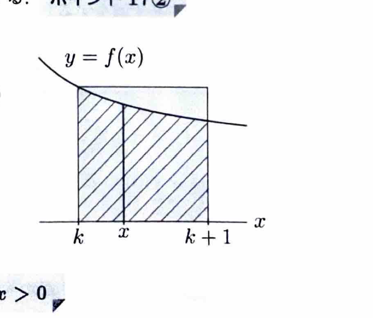
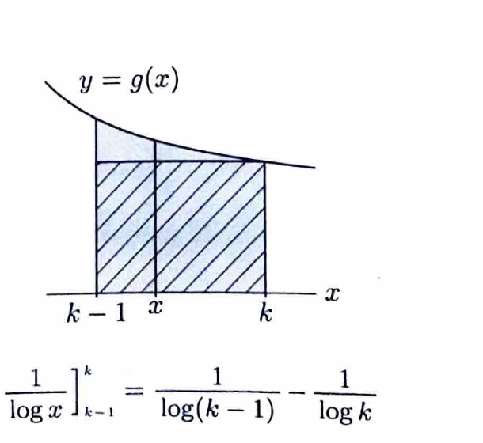

区間 $I$ 上の関数 $f$ が単調減少であるとは、任意の $x_1,x_2\in I$ に対して、

$$
x_1<x_2
$$

ならば、

$$
f(x_1)\ge f(x_2)
$$

となることをいう。

特に、

$$
x_1<x_2
\Longrightarrow
f(x_1)>f(x_2)
$$

ならば、$f$ は狭義単調減少である。

また、上に有界な単調増加数列は収束する。

---

問題 63

次の (1)〜(4) に答えよ。ただし、$\log$ は自然対数を表す。

---

## (1)

$k$ を自然数とし、$f(x)$ を $k\le x\le k+1$ で連続な狭義単調減少関数とする。このとき、

$$
\int_k^{k+1}f(x)\,dx<f(k)
$$

が成り立つことを示せ。

---

## (1) 解答

> 単調減少関数では、区間内の値は左端の値 $f(k)$ より小さい。区間の長さが $1$ なので、定数 $f(k)$ の積分はちょうど $f(k)$ になる。この面積比較を積分不等式として書く。

$f$ は狭義単調減少である。したがって、

$$
k<x\le k+1
$$

ならば、

$$
f(x)<f(k)
$$

である。

両辺を区間 $[k,k+1]$ で積分する。端点 $x=k$ では等号だが、1点だけの値は定積分に影響しないため、狭義不等号を保って、

$$
\int_k^{k+1}f(x)\,dx
<
\int_k^{k+1}f(k)\,dx
$$

となる。

右辺では $f(k)$ は $x$ に関する定数であるから、

$$
\int_k^{k+1}f(k)\,dx
=
f(k)[x]_k^{k+1}
$$

$$
=
f(k)\{(k+1)-k\}
$$

$$
=f(k)
$$

である。したがって、

$$
\boxed{
\int_k^{k+1}f(x)\,dx<f(k)
}
$$

が成り立つ。

> 図では、曲線 $y=f(x)$ の下の面積が、高さ $f(k)$、幅 $1$ の長方形の面積より小さいことを表している。

---

## (2)

$x>1$ において、関数

$$
g(x)=\frac1{x(\log x)^2}
$$

は狭義単調減少であることを示せ。

---

## (2) 解答

> 狭義単調減少を示す標準的な方法は、導関数が負であることを確認することである。積の逆数として微分し、$x>1$ では $\log x>0$ であることを使って符号を判定する。

関数を指数の形で書く。

$$
g(x)=x^{-1}(\log x)^{-2}
$$

積の微分公式を使う。まず、

$$
\frac{d}{dx}x^{-1}=-x^{-2}
$$

である。また、合成関数の微分より、

$$
\frac{d}{dx}(\log x)^{-2}
=
-2(\log x)^{-3}\cdot\frac1x
$$

となる。したがって、

$$
g'(x)
=
(-x^{-2})(\log x)^{-2}
+
x^{-1}
\left[
-2(\log x)^{-3}\cdot\frac1x
\right]
$$

$$
=
-x^{-2}(\log x)^{-2}
-
2x^{-2}(\log x)^{-3}
$$

共通因子をくくる。

$$
g'(x)
=
-x^{-2}(\log x)^{-3}
\{\log x+2\}
$$

すなわち、

$$
g'(x)
=
-\frac{\log x+2}{x^2(\log x)^3}
$$

である。

$x>1$ のとき、

$$
x^2>0
$$

であり、

$$
\log x>0
$$

だから、

$$
(\log x)^3>0
$$

である。また、

$$
\log x+2>0
$$

である。したがって、分数

$$
\frac{\log x+2}{x^2(\log x)^3}
$$

は正であり、その前に負号が付いているので、

$$
g'(x)<0
\qquad
(x>1)
$$

である。よって、

$$
\boxed{
g(x)=\frac1{x(\log x)^2}
\text{ は }x>1\text{ で狭義単調減少}
}
$$

---

## (3)

$k$ を $3$ 以上の自然数とする。(2) で定義した関数 $g(x)$ に対し、

$$
g(k)
<
\frac1{\log(k-1)}
-
\frac1{\log k}
$$

が成り立つことを示せ。

---

## (3) 解答

> (2) で $g$ が狭義単調減少であることが分かった。(1) の面積比較を区間 $[k-1,k]$ に適用すると、右端値 $g(k)$ より積分の方が大きい。積分は $-1/\log x$ の差として計算できる。

(2) より、$g$ は $x>1$ で狭義単調減少である。したがって、

$$
k-1<x<k
$$

ならば、$x<k$ なので、

$$
g(x)>g(k)
$$

である。

両辺を $k-1$ から $k$ まで積分する。

$$
\int_{k-1}^{k}g(x)\,dx
>
\int_{k-1}^{k}g(k)\,dx
$$

右辺は、

$$
\int_{k-1}^{k}g(k)\,dx
=
g(k)\{k-(k-1)\}
=
g(k)
$$

である。したがって、

$$
g(k)
<
\int_{k-1}^{k}g(x)\,dx
$$

となる。

ここで、

$$
g(x)=\frac1{x(\log x)^2}
$$

なので、

$$
\int_{k-1}^{k}g(x)\,dx
=
\int_{k-1}^{k}
\frac1{x(\log x)^2}\,dx
$$

原始関数を求める。文字だけの置換を、

$$
u=\log x
$$

とすると、

$$
du=\frac1x\,dx
$$

である。したがって、

$$
\int\frac1{x(\log x)^2}\,dx
=
\int u^{-2}\,du
$$

$$
=
-u^{-1}+C
$$

$$
=
-\frac1{\log x}+C
$$

である。よって、

$$
\int_{k-1}^{k}
\frac1{x(\log x)^2}\,dx
=
\left[
-\frac1{\log x}
\right]_{k-1}^{k}
$$

$$
=
-\frac1{\log k}
+
\frac1{\log(k-1)}
$$

$$
=
\frac1{\log(k-1)}
-
\frac1{\log k}
$$

である。したがって、

$$
\boxed{
g(k)
<
\frac1{\log(k-1)}
-
\frac1{\log k}
}
$$

が成り立つ。

> 図では、区間 $[k-1,k]$ において、曲線 $y=g(x)$ の下の面積が、高さ $g(k)$、幅 $1$ の長方形の面積より大きいことを表している。

---

## (4)

$n=2,3,\ldots$ に対して、

$$
T_n
=
\sum_{k=2}^{n}
\frac1{k(\log k)^2}
$$

と置く。極限

$$
\lim_{n\to\infty}T_n
$$

が存在することを示せ。

---

## (4) 解答

> $T_n$ は正項の部分和なので単調増加する。収束を示すには、上に有界であることを示せばよい。(3) の不等式を $k=3$ から $n$ まで足すと、右辺が望遠鏡型になり、$n$ によらない上界が得られる。

まず、隣り合う部分和の差を計算する。定義より、

$$
T_n
=
\sum_{k=2}^{n}
\frac1{k(\log k)^2}
$$

であり、

$$
T_{n-1}
=
\sum_{k=2}^{n-1}
\frac1{k(\log k)^2}
$$

である。したがって、

$$
T_n-T_{n-1}
=
\frac1{n(\log n)^2}
$$

$n\ge2$ のとき、

$$
n>0
$$

かつ、

$$
\log n>0
$$

だから、

$$
T_n-T_{n-1}>0
$$

である。よって、$\{T_n\}$ は単調増加数列である。

次に、上界を求める。定義を初項と残りに分ける。

$$
T_n
=
\frac1{2(\log2)^2}
+
\sum_{k=3}^{n}
\frac1{k(\log k)^2}
$$

(3) より、$k\ge3$ に対して、

$$
\frac1{k(\log k)^2}
<
\frac1{\log(k-1)}
-
\frac1{\log k}
$$

である。したがって、

$$
T_n
<
\frac1{2(\log2)^2}
+
\sum_{k=3}^{n}
\left(
\frac1{\log(k-1)}
-
\frac1{\log k}
\right)
$$

右辺の和を書き並べる。

$$
\sum_{k=3}^{n}
\left(
\frac1{\log(k-1)}
-
\frac1{\log k}
\right)
$$

$$
=
\left(
\frac1{\log2}-\frac1{\log3}
\right)
+
\left(
\frac1{\log3}-\frac1{\log4}
\right)
+\cdots+
\left(
\frac1{\log(n-1)}-\frac1{\log n}
\right)
$$

途中の項が打ち消し合うので、

$$
=
\frac1{\log2}
-
\frac1{\log n}
$$

となる。したがって、

$$
T_n
<
\frac1{2(\log2)^2}
+
\frac1{\log2}
-
\frac1{\log n}
$$

$n>1$ では、

$$
\log n>0
$$

なので、

$$
-\frac1{\log n}<0
$$

である。よって、

$$
T_n
<
\frac1{2(\log2)^2}
+
\frac1{\log2}
$$

となる。右辺は $n$ によらない定数なので、$\{T_n\}$ は上に有界である。

したがって、$\{T_n\}$ は上に有界な単調増加数列である。単調有界数列の収束定理により、

$$
\boxed{
\lim_{n\to\infty}T_n
\text{ は有限値として存在する}
}
$$
