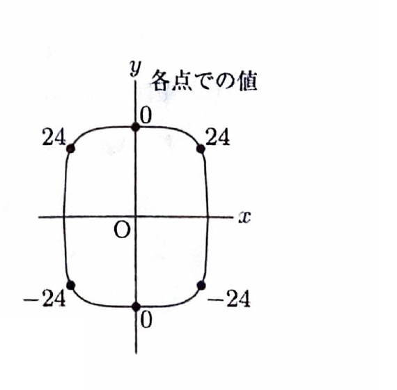

> **関連知識：閉曲線上の条件付き極値**
>
> 閉曲線上の連続関数は最大値・最小値をもつ。ラグランジュの未定乗数法で候補点を求めた後、曲線上で候補点が並ぶ順序と関数値を比較すると、局所的な極大・極小も判定できる。

---

問題 93

関数

$$
f(x,y)=3x^2y
$$

について、条件

$$
2x^4+y^4=48
$$

のもとでの $f(x,y)$ の極値を求めよ。

---

## 解答

> 制約曲線は有界閉曲線なので、ラグランジュの未定乗数法で候補点をすべて求める。その後、曲線に沿った候補点の並びと値を比較して極大・極小を分類する。

制約関数を、

$$
\varphi(x,y)=2x^4+y^4-48
$$

とおく。

偏導関数は、

$$
f_x=6xy,
\qquad
f_y=3x^2
$$

$$
\varphi_x=8x^3,
\qquad
\varphi_y=4y^3
$$

である。

ラグランジュ方程式は、

$$
6xy-8\lambda x^3=0
$$

すなわち、

$$
2x(3y-4\lambda x^2)=0
\tag{1}
$$

また、

$$
3x^2-4\lambda y^3=0
\tag{2}
$$

制約は、

$$
2x^4+y^4-48=0
\tag{3}
$$

である。

### $x=0$ の場合

(3) より、

$$
y^4=48
$$

したがって、

$$
y=\pm\sqrt[4]{48}
=\pm2\sqrt[4]{3}
$$

候補点は、

$$
\left(0,\pm2\sqrt[4]{3}\right)
$$

である。

### $x\ne0$ の場合

(1) より、

$$
3y-4\lambda x^2=0
$$

したがって、

$$
\lambda=\frac{3y}{4x^2}
$$

これを (2) へ代入する前の式は、

$$
3x^2-4\lambda y^3=0
$$

である。代入すると、

$$
3x^2
-4\cdot\frac{3y}{4x^2}y^3
=0
$$

$$
3x^2-\frac{3y^4}{x^2}=0
$$

両辺に $\dfrac{x^2}{3}$ を掛けると、

$$
x^4-y^4=0
$$

したがって、

$$
y=\pm x
$$

である。

これを制約 (3) へ代入すると、

$$
2x^4+x^4=48
$$

$$
3x^4=48
$$

$$
x^4=16
$$

したがって、

$$
x=\pm2
$$

候補点は、

$$
(\pm2,2),
\qquad
(\pm2,-2)
$$

である。

各候補点での関数値を求める。代入前の式は、

$$
f(x,y)=3x^2y
$$

である。

$$
f\left(0,\pm2\sqrt[4]{3}\right)=0
$$

$$
f(\pm2,2)=3\cdot4\cdot2=24
$$

$$
f(\pm2,-2)=3\cdot4\cdot(-2)=-24
$$

制約曲線上での候補点と値の並びは、次の図のようになる。

曲線に沿って値を比較すると、上端の値0の両側には値24の点があるため、上端は局所最小である。一方、下端の値0の両側には値 $-24$ の点があるため、下端は局所最大である。

したがって、極大点と極大値は、

$$
\boxed{
(\pm2,2)\text{ で極大値 }24
}
$$

および、

$$
\boxed{
\left(0,-2\sqrt[4]{3}\right)
\text{ で極大値 }0
}
$$

である。

極小点と極小値は、

$$
\boxed{
(\pm2,-2)\text{ で極小値 }-24
}
$$

および、

$$
\boxed{
\left(0,2\sqrt[4]{3}\right)
\text{ で極小値 }0
}
$$

である。

> 条件曲線全体での最大値は $24$、最小値は $-24$ である。
