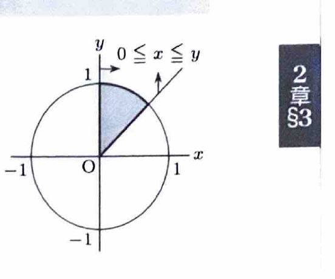
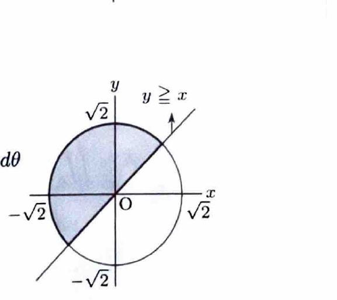
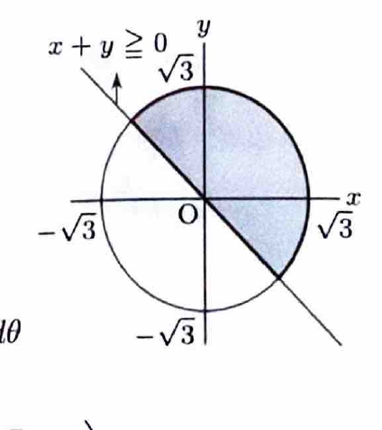

極座標変換
$$
x=r\cos\theta,\qquad y=r\sin\theta
$$
を用いると、
$$
x^2+y^2=r^2,\qquad dxdy=r\,drd\theta
$$
である。面積要素にヤコビアンの因子 $r$ が付くことに注意する。

---
問題 100

$D$ を括弧内の不等式の表す領域とするとき、次の2重積分の値を求めよ。

---
## (1)

$$
\iint_D\frac1{1+x^2+y^2}\,dxdy
$$

ただし、
$$
x^2+y^2\le1,\qquad0\le x\le y
$$
である。

---
## (1) 解答

> 領域が単位円の扇形で、被積分関数が $x^2+y^2$ だけに依存するため、極座標変換を用いる。直交座標では円弧を平方根で表す必要がある。

条件 $0\le x\le y$ は、
$$
0\le r\cos\theta\le r\sin\theta
$$
より、第1象限で
$$
\frac{\pi}{4}\le\theta\le\frac{\pi}{2}
$$
を表す。また、
$$
0\le r\le1
$$
である。

したがって、
$$
\iint_D\frac1{1+x^2+y^2}\,dxdy
=
\int_{\pi/4}^{\pi/2}\int_0^1
\frac{r}{1+r^2}\,drd\theta
$$

内側の積分で、置換前の文字式
$$
t=1+r^2
$$
を用いると、
$$
dt=2r\,dr
$$
なので、
$$
\int\frac{r}{1+r^2}\,dr
=
\frac12\log(1+r^2)
$$

よって、
$$
\int_0^1\frac{r}{1+r^2}\,dr
=
\left[\frac12\log(1+r^2)\right]_0^1
=
\frac12\log2
$$

したがって、
$$
\iint_D\frac1{1+x^2+y^2}\,dxdy
=
\left(\frac{\pi}{2}-\frac{\pi}{4}\right)\frac12\log2
=
\boxed{\frac{\pi}{8}\log2}
$$

---
## (2)

$$
\iint_Dx^2\,dxdy
$$

ただし、
$$
x^2+y^2\le2,\qquad y\ge x
$$
である。

---
## (2) 解答

> 原点中心の円を直線 $y=x$ が二等分しているので、極座標が自然である。被積分関数 $x^2$ も $r^2\cos^2\theta$ になるため計算しやすい。

円より、
$$
0\le r\le\sqrt2
$$
である。条件 $y\ge x$ は、
$$
\sin\theta\ge\cos\theta
$$
なので、
$$
\frac{\pi}{4}\le\theta\le\frac{5\pi}{4}
$$
である。

したがって、
$$
\iint_Dx^2\,dxdy
=
\int_{\pi/4}^{5\pi/4}\int_0^{\sqrt2}
r^2\cos^2\theta\cdot r\,drd\theta
$$
$$
=
\left(\int_0^{\sqrt2}r^3\,dr\right)
\left(\int_{\pi/4}^{5\pi/4}\cos^2\theta\,d\theta\right)
$$

$r$ の積分は、
$$
\int_0^{\sqrt2}r^3\,dr
=
\left[\frac14r^4\right]_0^{\sqrt2}
=
1
$$

また、
$$
\cos^2\theta=\frac12(1+\cos2\theta)
$$
より、
$$
\int_{\pi/4}^{5\pi/4}\cos^2\theta\,d\theta
=
\left[
\frac12\theta+\frac14\sin2\theta
\right]_{\pi/4}^{5\pi/4}
=
\frac{\pi}{2}
$$

したがって、
$$
\boxed{\iint_Dx^2\,dxdy=\frac{\pi}{2}}
$$

---
## (3)

$$
\iint_D\frac{x+y}{x^2+y^2+1}\,dxdy
$$

ただし、
$$
x^2+y^2\le3,\qquad x+y\ge0
$$
である。

---
## (3) 解答

> 円と原点を通る直線で定まる半円なので、極座標変換を用いる。被積分関数の分母が $r^2+1$、分子が $r(\cos\theta+\sin\theta)$ となり、変数分離できる。

円より、
$$
0\le r\le\sqrt3
$$
である。また、
$$
x+y=r(\cos\theta+\sin\theta)\ge0
$$
より、
$$
-\frac{\pi}{4}\le\theta\le\frac{3\pi}{4}
$$
である。

したがって、
$$
\iint_D\frac{x+y}{x^2+y^2+1}\,dxdy
=
\int_{-\pi/4}^{3\pi/4}
\int_0^{\sqrt3}
\frac{r(\cos\theta+\sin\theta)}{r^2+1}\,r\,drd\theta
$$
$$
=
\left(
\int_0^{\sqrt3}\frac{r^2}{r^2+1}\,dr
\right)
\left(
\int_{-\pi/4}^{3\pi/4}(\cos\theta+\sin\theta)\,d\theta
\right)
$$

まず、
$$
\frac{r^2}{r^2+1}
=
1-\frac1{r^2+1}
$$
なので、
$$
\int_0^{\sqrt3}\frac{r^2}{r^2+1}\,dr
=
[r-\tan^{-1}r]_0^{\sqrt3}
=
\sqrt3-\frac{\pi}{3}
$$

また、
$$
\int(\cos\theta+\sin\theta)\,d\theta
=
\sin\theta-\cos\theta
$$
より、
$$
\int_{-\pi/4}^{3\pi/4}(\cos\theta+\sin\theta)\,d\theta
=
2\sqrt2
$$

したがって、
$$
\iint_D\frac{x+y}{x^2+y^2+1}\,dxdy
=
2\sqrt2\left(\sqrt3-\frac{\pi}{3}\right)
$$
$$
=
\boxed{\frac{2\sqrt2}{3}(3\sqrt3-\pi)}
$$
