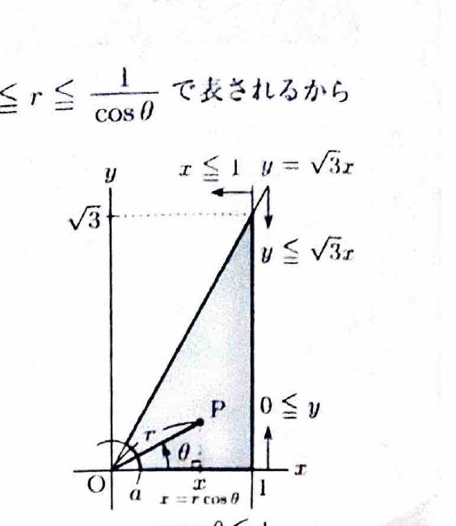

極座標変換
$$
x=r\cos\theta,\qquad y=r\sin\theta
$$
を用いると、
$$
x^2+y^2=r^2,\qquad dxdy=r\,drd\theta
$$
である。面積要素にヤコビアンの因子 $r$ が付くことに注意する。

---
問題 101

$0<a<1$ に対して、
$$
D_a=
\{(x,y)\mid a^2\le x^2+y^2,\ 0\le x\le1,\ 0\le y\le\sqrt3x\}
$$
とする。重積分
$$
I_a=
\iint_{D_a}\frac{x+y}{x^2+y^2}\,dxdy
$$
を計算し、極限
$$
\lim_{a\to+0}I_a
$$
を求めよ。

---
## 解答

> 領域は原点を中心とする半径 $a$ の円の外側、直線 $x=1$ の左側、2本の半直線 $y=0,\ y=\sqrt3x$ の間である。分母が $x^2+y^2$ なので、極座標変換を用いる。直交座標では円弧と斜線の両方を扱う必要があり、領域分割が複雑になる。

角度条件は、
$$
0\le\theta\le\frac{\pi}{3}
$$
である。内側の円から、
$$
r\ge a
$$
である。また $x\le1$ は、
$$
r\cos\theta\le1
$$
なので、
$$
r\le\frac1{\cos\theta}
$$
である。

したがって、
$$
0\le\theta\le\frac{\pi}{3},\qquad
a\le r\le\frac1{\cos\theta}
$$
となる。

被積分関数は、
$$
\frac{x+y}{x^2+y^2}
=
\frac{r\cos\theta+r\sin\theta}{r^2}
=
\frac{\cos\theta+\sin\theta}{r}
$$
である。面積要素 $r\,drd\theta$ を掛けると、
$$
\cos\theta+\sin\theta
$$
となる。

よって、
$$
I_a
=
\int_0^{\pi/3}
\int_a^{1/\cos\theta}
(\cos\theta+\sin\theta)\,drd\theta
$$

$r$ で積分して、
$$
I_a
=
\int_0^{\pi/3}
\left(
\frac1{\cos\theta}-a
\right)
(\cos\theta+\sin\theta)\,d\theta
$$
$$
=
\int_0^{\pi/3}
\left(
1+\tan\theta-a\cos\theta-a\sin\theta
\right)d\theta
$$

各項の原始関数は、
$$
\int1\,d\theta=\theta,
\qquad
\int\tan\theta\,d\theta=-\log|\cos\theta|,
$$
$$
\int\cos\theta\,d\theta=\sin\theta,
\qquad
\int\sin\theta\,d\theta=-\cos\theta
$$
である。したがって、
$$
I_a
=
\left[
\theta-\log|\cos\theta|-a(\sin\theta-\cos\theta)
\right]_0^{\pi/3}
$$

境界値を代入すると、
$$
I_a
=
\frac{\pi}{3}
-\log\frac12
-a\left(\frac{\sqrt3}{2}-\frac12\right)
-a
$$

ここで、
$$
-\log\frac12=\log2
$$
であり、$a$ の項をまとめると、
$$
-a\left(\frac{\sqrt3-1}{2}\right)-a
=
-\frac{\sqrt3+1}{2}a
$$
である。

よって、
$$
\boxed{
I_a=
\frac{\pi}{3}+\log2-\frac{\sqrt3+1}{2}a
}
$$

最後に、
$$
\lim_{a\to+0}a=0
$$
なので、
$$
\boxed{
\lim_{a\to+0}I_a
=
\frac{\pi}{3}+\log2
}
$$
