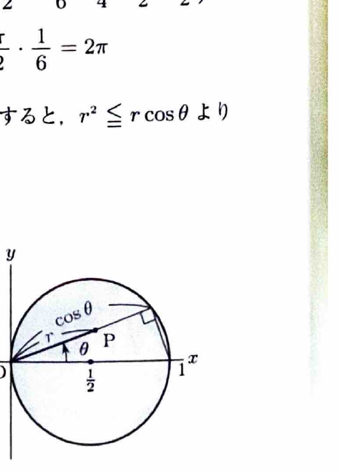
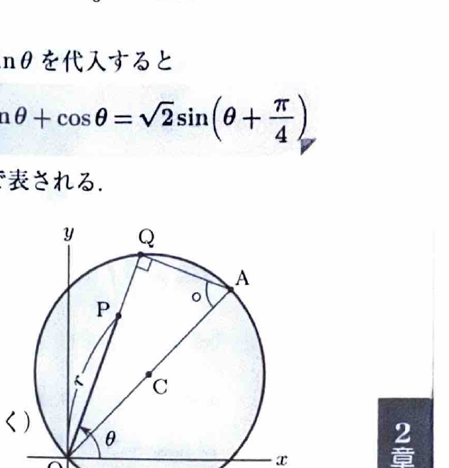

極座標変換
$$
x=r\cos\theta,\qquad y=r\sin\theta
$$
を用いると、
$$
x^2+y^2=r^2,\qquad dxdy=r\,drd\theta
$$
である。面積要素にヤコビアンの因子 $r$ が付くことに注意する。

ウォリス積分の漸化式として、適切な端点 $a,b$ に対し
$$
I_n=\int_a^b\sin^n x\,dx
$$
とおくと、
$$
I_n=\frac{n-1}{n}I_{n-2}
$$
が使える。余弦の積分も同様である。特に
$$
\int_0^{\pi/2}\cos^4\theta\,d\theta
=
\frac34\cdot\frac12\cdot\frac{\pi}{2}
=
\frac{3\pi}{16}
$$
である。

> 資料のウォリス積分の計算例：
> $$
> \int_0^\pi\sin^5x\,dx
> =
> \frac45\cdot\frac23\int_0^\pi\sin x\,dx
> =
> \frac{16}{15}
> $$
> $$
> \int_{-\pi/2}^{\pi/2}\cos^6x\,dx
> =
> \frac56\cdot\frac34\cdot\frac12
> \int_{-\pi/2}^{\pi/2}dx
> =
> \frac{5\pi}{16}
> $$

---
問題 102

$D$ を括弧内の不等式の表す領域とするとき、次の2重積分の値を求めよ。

---
## (1)

$$
\iint_Dy^2\,dxdy
$$

ただし、
$$
x^2+y^2\le4x,\qquad y\ge0
$$
である。

---
## (1) 解答

> 境界円が原点を通り、領域が上半分に限られるため、極座標変換で $r$ の上限を角度の関数として表す。例題29と同じ領域である。直交座標でも計算できるが、円の平方根が現れる。

極座標を代入すると、
$$
r^2\le4r\cos\theta
$$
より、
$$
0\le r\le4\cos\theta
$$
である。また、
$$
0\le\theta\le\frac{\pi}{2}
$$
である。

被積分関数は、
$$
y^2=r^2\sin^2\theta
$$
なので、
$$
\iint_Dy^2\,dxdy
=
\int_0^{\pi/2}
\int_0^{4\cos\theta}
r^2\sin^2\theta\cdot r\,drd\theta
$$

$r$ で積分すると、
$$
\int_0^{4\cos\theta}r^3\,dr
=
\left[\frac14r^4\right]_0^{4\cos\theta}
=
64\cos^4\theta
$$

したがって、
$$
\iint_Dy^2\,dxdy
=
64\int_0^{\pi/2}\sin^2\theta\cos^4\theta\,d\theta
$$

ここで、
$$
\sin^2\theta=1-\cos^2\theta
$$
なので、
$$
=
64\int_0^{\pi/2}
(\cos^4\theta-\cos^6\theta)\,d\theta
$$

ウォリス積分より、
$$
\int_0^{\pi/2}\cos^4\theta\,d\theta
=
\frac34\cdot\frac12\cdot\frac{\pi}{2}
=
\frac{3\pi}{16}
$$
および
$$
\int_0^{\pi/2}\cos^6\theta\,d\theta
=
\frac56\cdot\frac34\cdot\frac12\cdot\frac{\pi}{2}
=
\frac{5\pi}{32}
$$
である。

よって、
$$
64\left(\frac{3\pi}{16}-\frac{5\pi}{32}\right)
=
64\cdot\frac{\pi}{32}
=
\boxed{2\pi}
$$

---
## (2)

$$
\iint_D\sqrt{x}\,dxdy
$$

ただし、
$$
x^2+y^2\le x
$$
である。

---
## (2) 解答

> 境界円が原点を通るため、極座標で $r\le\cos\theta$ と表せる。被積分関数 $\sqrt{x}$ は $\sqrt{r\cos\theta}$ となる。領域と被積分関数は $x$ 軸対称なので、上半分を積分して2倍する。

極座標を代入すると、
$$
r^2\le r\cos\theta
$$
より、
$$
0\le r\le\cos\theta
$$
である。また、
$$
-\frac{\pi}{2}\le\theta\le\frac{\pi}{2}
$$
である。

対称性より、
$$
\iint_D\sqrt{x}\,dxdy
=
2\int_0^{\pi/2}\int_0^{\cos\theta}
\sqrt{r\cos\theta}\,r\,drd\theta
$$

整理すると、
$$
=
2\int_0^{\pi/2}
(\cos\theta)^{1/2}
\left\{
\int_0^{\cos\theta}r^{3/2}\,dr
\right\}d\theta
$$

$r$ の原始関数は、
$$
\int r^{3/2}\,dr
=
\frac25r^{5/2}
$$
なので、
$$
\int_0^{\cos\theta}r^{3/2}\,dr
=
\frac25(\cos\theta)^{5/2}
$$

したがって、
$$
\iint_D\sqrt{x}\,dxdy
=
\frac45\int_0^{\pi/2}\cos^3\theta\,d\theta
$$

ウォリス積分より、
$$
\int_0^{\pi/2}\cos^3\theta\,d\theta
=
\frac23
$$
であるため、
$$
\boxed{\iint_D\sqrt{x}\,dxdy=\frac8{15}}
$$

---
## (3)

$$
\iint_D\sqrt{x^2+y^2}\,dxdy
$$

ただし、
$$
(x-1)^2+(y-1)^2\le2
$$
である。

---
## (3) 解答

> 被積分関数は原点からの距離 $r$ なので極座標を用いる。円は原点を通り、極座標では半径方向の上限が三角関数で表せる。直交座標では円の上下を平方根で表す必要がある。

円の不等式を展開すると、
$$
x^2+y^2\le2x+2y
$$
である。極座標を代入して、
$$
r^2\le2r(\cos\theta+\sin\theta)
$$
より、
$$
0\le r\le2(\cos\theta+\sin\theta)
$$
である。

恒等式
$$
\cos\theta+\sin\theta
=
\sqrt2\sin\left(\theta+\frac{\pi}{4}\right)
$$
を用いると、
$$
0\le r\le2\sqrt2\sin\left(\theta+\frac{\pi}{4}\right)
$$
である。右辺が非負となる範囲は、
$$
-\frac{\pi}{4}\le\theta\le\frac{3\pi}{4}
$$
である。

被積分関数は、
$$
\sqrt{x^2+y^2}=r
$$
なので、
$$
\iint_D\sqrt{x^2+y^2}\,dxdy
=
\int_{-\pi/4}^{3\pi/4}
\int_0^{2\sqrt2\sin(\theta+\pi/4)}
r\cdot r\,drd\theta
$$

$r$ で積分すると、
$$
\int_0^Rr^2\,dr
=
\frac13R^3
$$
である。ここで、
$$
R=2\sqrt2\sin\left(\theta+\frac{\pi}{4}\right)
$$
を代入すると、
$$
\frac13R^3
=
\frac{16\sqrt2}{3}
\sin^3\left(\theta+\frac{\pi}{4}\right)
$$

したがって、
$$
\iint_D\sqrt{x^2+y^2}\,dxdy
=
\frac{16\sqrt2}{3}
\int_{-\pi/4}^{3\pi/4}
\sin^3\left(\theta+\frac{\pi}{4}\right)d\theta
$$

置換前の文字式を
$$
t=\theta+\frac{\pi}{4}
$$
とすると、積分区間は $0\le t\le\pi$ になる。よって、
$$
=
\frac{16\sqrt2}{3}
\int_0^\pi\sin^3t\,dt
$$

対称性とウォリス積分より、
$$
\int_0^\pi\sin^3t\,dt
=
2\int_0^{\pi/2}\sin^3t\,dt
=
2\cdot\frac23
=
\frac43
$$

したがって、
$$
\boxed{
\iint_D\sqrt{x^2+y^2}\,dxdy
=
\frac{64\sqrt2}{9}
}
$$
