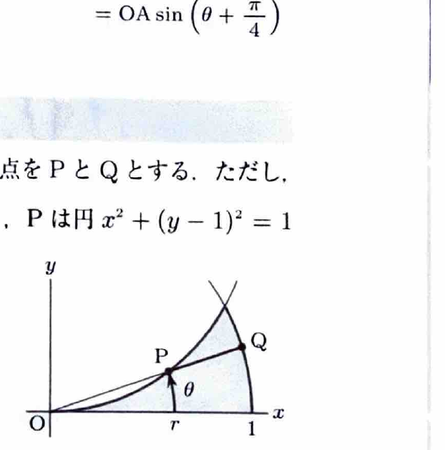

極座標変換
$$
x=r\cos\theta,\qquad y=r\sin\theta
$$
を用いると、
$$
x^2+y^2=r^2,\qquad dxdy=r\,drd\theta
$$
である。面積要素にヤコビアンの因子 $r$ が付くことに注意する。

---
問題 103

領域
$$
D=
\{(x,y)\mid x^2+y^2\le1,\ x^2+(y-1)^2\ge1,\ x\ge0,\ y\ge0\}
$$
において、
$$
\iint_Dxe^{x^2+y^2}\,dxdy
$$
を求めよ。

---
## 解答

> 2つの境界が円であり、被積分関数の指数部が $x^2+y^2$ なので極座標変換を用いる。積分順序は重要で、$r$ から先に積分すると $r^2e^{r^2}$ の初等積分が得られないため、$\theta$ から先に積分する。

2つ目の円の境界は、
$$
x^2+(y-1)^2=1
$$
である。展開すると、
$$
x^2+y^2=2y
$$
であり、極座標では、
$$
r^2=2r\sin\theta
$$
より、
$$
r=2\sin\theta
$$
である。

第1象限で単位円の内側かつこの円の外側なので、
$$
2\sin\theta\le r\le1
$$
である。この範囲が存在する条件は、
$$
2\sin\theta\le1
$$
より、
$$
0\le\theta\le\frac{\pi}{6}
$$
である。

したがって領域は、
$$
0\le\theta\le\frac{\pi}{6},
\qquad
2\sin\theta\le r\le1
$$
とも表せる。

しかし、被積分関数を変換すると、
$$
xe^{x^2+y^2}\,dxdy
=
r\cos\theta\cdot e^{r^2}\cdot r\,drd\theta
=
r^2e^{r^2}\cos\theta\,drd\theta
$$
であり、$r$ から先に積分しにくい。そこで同じ領域を、
$$
0\le r\le1,\qquad
0\le\theta\le\sin^{-1}\frac r2
$$
と表す。

よって、
$$
\iint_Dxe^{x^2+y^2}\,dxdy
=
\int_0^1
\left\{
\int_0^{\sin^{-1}(r/2)}
r^2e^{r^2}\cos\theta\,d\theta
\right\}dr
$$

まず $\theta$ で積分すると、
$$
\int\cos\theta\,d\theta=\sin\theta
$$
なので、
$$
\int_0^{\sin^{-1}(r/2)}
\cos\theta\,d\theta
=
\left[\sin\theta\right]_0^{\sin^{-1}(r/2)}
=
\frac r2
$$

したがって、
$$
\iint_Dxe^{x^2+y^2}\,dxdy
=
\frac12\int_0^1r^3e^{r^2}\,dr
$$

置換前の文字式を
$$
t=r^2
$$
とすると、
$$
dt=2r\,dr
$$
であり、
$$
r^3\,dr=r^2(r\,dr)=\frac12t\,dt
$$
である。よって、
$$
\frac12\int_0^1r^3e^{r^2}\,dr
=
\frac14\int_0^1te^t\,dt
$$

部分積分で、
$$
\int te^t\,dt=te^t-e^t
$$
なので、
$$
\frac14\int_0^1te^t\,dt
=
\frac14[te^t-e^t]_0^1
=
\frac14\{0-(-1)\}
=
\boxed{\frac14}
$$

> 同じ領域でも、被積分関数によって適した積分順序が変わる。これがこの問題の重要点である。
