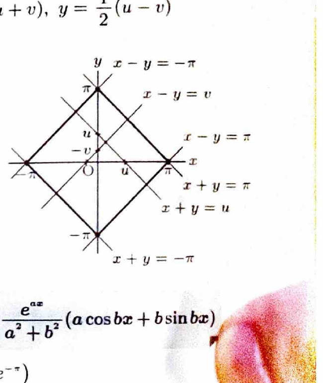

変数変換
$$
x=\varphi(u,v),\qquad y=\psi(u,v)
$$
では、
$$
dxdy=
\left|
\frac{\partial(x,y)}{\partial(u,v)}
\right|dudv
$$
である。ヤコビアンは
$$
\frac{\partial(x,y)}{\partial(u,v)}
=
\begin{vmatrix}
x_u&x_v\\
y_u&y_v
\end{vmatrix}
$$
で計算し、積分ではその絶対値を用いる。

---
問題 104

$D$ を括弧内の不等式の表す領域とするとき、次の2重積分の値を求めよ。

---
## (1)

$$
\iint_D(2x+y)^3\sin(x-y)\,dxdy
$$

ただし、
$$
0\le2x+y\le\pi,\qquad0\le x-y\le\pi
$$
である。

---
## (1) 解答

> 領域と被積分関数の両方に $2x+y$ と $x-y$ がそのまま現れるため、$u=2x+y,\ v=x-y$ とおく。すると領域が長方形になり、被積分関数も $u^3\sin v$ と分離される。

変数変換を
$$
u=2x+y,\qquad v=x-y
$$
とする。連立方程式を解くと、
$$
x=\frac13(u+v),\qquad
y=\frac13(u-2v)
$$
である。

領域は、
$$
0\le u\le\pi,\qquad0\le v\le\pi
$$
となる。

ヤコビアンは、
$$
\frac{\partial(x,y)}{\partial(u,v)}
=
\begin{vmatrix}
\frac13&\frac13\\
\frac13&-\frac23
\end{vmatrix}
=
-\frac13
$$
である。したがって、
$$
dxdy=\frac13dudv
$$
である。

よって、
$$
\iint_D(2x+y)^3\sin(x-y)\,dxdy
=
\frac13
\int_0^\pi\int_0^\pi
u^3\sin v\,dvdu
$$

積に分離すると、
$$
=
\frac13
\left(\int_0^\pi u^3\,du\right)
\left(\int_0^\pi\sin v\,dv\right)
$$

それぞれ、
$$
\int_0^\pi u^3\,du
=
\left[\frac14u^4\right]_0^\pi
=
\frac{\pi^4}{4}
$$
および、
$$
\int_0^\pi\sin v\,dv
=
[-\cos v]_0^\pi
=
2
$$
である。

したがって、
$$
\boxed{
\iint_D(2x+y)^3\sin(x-y)\,dxdy
=
\frac{\pi^4}{6}
}
$$

---
## (2)

$$
\iint_D
\frac{e^{x+y}\cos(x+y)}
{(x-y)^2+\pi^2}
\,dxdy
$$

ただし、
$$
|x|+|y|\le\pi
$$
である。

---
## (2) 解答

> 被積分関数に $x+y$ と $x-y$ が現れるため、$u=x+y,\ v=x-y$ とおく。領域 $|x|+|y|\le\pi$ は、符号の場合分けをすると $-\pi\le u\le\pi,\ -\pi\le v\le\pi$ という長方形に移る。

変数変換を
$$
u=x+y,\qquad v=x-y
$$
とする。逆変換は、
$$
x=\frac12(u+v),\qquad
y=\frac12(u-v)
$$
である。

領域は、
$$
-\pi\le u\le\pi,\qquad
-\pi\le v\le\pi
$$
となる。

ヤコビアンは、
$$
\frac{\partial(x,y)}{\partial(u,v)}
=
\begin{vmatrix}
\frac12&\frac12\\
\frac12&-\frac12
\end{vmatrix}
=
-\frac12
$$
なので、
$$
dxdy=\frac12dudv
$$
である。

被積分関数は、
$$
\frac{e^u\cos u}{v^2+\pi^2}
$$
となる。よって、
$$
\iint_D
\frac{e^{x+y}\cos(x+y)}
{(x-y)^2+\pi^2}
\,dxdy
$$
$$
=
\frac12
\int_{-\pi}^{\pi}
\int_{-\pi}^{\pi}
\frac{e^u\cos u}{v^2+\pi^2}
\,dvdu
$$

積に分離して、
$$
=
\frac12
\left(
\int_{-\pi}^{\pi}\frac{dv}{v^2+\pi^2}
\right)
\left(
\int_{-\pi}^{\pi}e^u\cos u\,du
\right)
$$

第1の積分は、
$$
\int\frac{dv}{v^2+\pi^2}
=
\frac1\pi\tan^{-1}\frac v\pi
$$
なので、
$$
\int_{-\pi}^{\pi}\frac{dv}{v^2+\pi^2}
=
\frac1\pi
\left[
\tan^{-1}\frac v\pi
\right]_{-\pi}^{\pi}
=
\frac12
$$

第2の積分では、公式
$$
\int e^{au}\cos(bu)\,du
=
\frac{e^{au}}{a^2+b^2}
\{a\cos(bu)+b\sin(bu)\}
$$
を使う。$a=b=1$ を代入すると、
$$
\int e^u\cos u\,du
=
\frac12e^u(\cos u+\sin u)
$$

したがって、
$$
\int_{-\pi}^{\pi}e^u\cos u\,du
=
\left[
\frac12e^u(\cos u+\sin u)
\right]_{-\pi}^{\pi}
$$
$$
=
-\frac12e^\pi+\frac12e^{-\pi}
=
-\frac12(e^\pi-e^{-\pi})
$$

よって、
$$
\iint_D
\frac{e^{x+y}\cos(x+y)}
{(x-y)^2+\pi^2}
\,dxdy
=
\frac12\cdot\frac12\cdot
\left\{-\frac12(e^\pi-e^{-\pi})\right\}
$$

したがって、
$$
\boxed{
-\frac18(e^\pi-e^{-\pi})
}
$$

