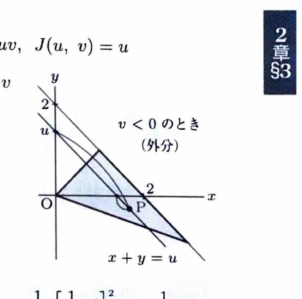
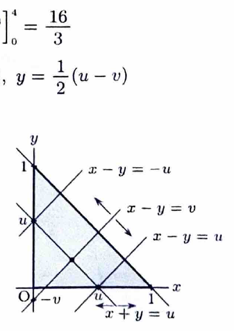
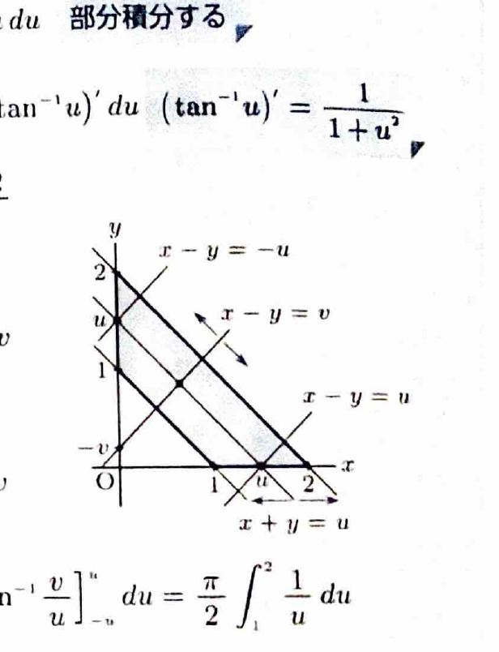

変数変換
$$
x=\varphi(u,v),\qquad y=\psi(u,v)
$$
では、
$$
dxdy=
\left|
\frac{\partial(x,y)}{\partial(u,v)}
\right|dudv
$$
である。ヤコビアンは
$$
\frac{\partial(x,y)}{\partial(u,v)}
=
\begin{vmatrix}
x_u&x_v\\
y_u&y_v
\end{vmatrix}
$$
で計算し、積分ではその絶対値を用いる。

三角形型の領域では、
$$
u=x+y,\qquad v=\frac{y}{x+y}
$$
すなわち、
$$
x=u(1-v),\qquad y=uv
$$
とおくと、
$$
\left|\frac{\partial(x,y)}{\partial(u,v)}\right|=u
$$
となる。

> 3重積分で
> $$
> x+y+z\le a,\qquad x\ge0,\ y\ge0,\ z\ge0
> $$
> の場合は、
> $$
> x=u(1-v),\qquad
> y=uv(1-w),\qquad
> z=uvw
> $$
> と変換すると、
> $$
> 0\le u\le a,\qquad0\le v\le1,\qquad0\le w\le1
> $$
> となり、ヤコビアンは
> $$
> \left|
> \frac{\partial(x,y,z)}{\partial(u,v,w)}
> \right|
> =
> u^2v
> $$
> である。

---
問題 106

$D$ を括弧内の不等式の表す領域とするとき、次の2重積分の値を求めよ。

---
## (1)

$$
\iint_D(x+y)^{10}\,dxdy
$$

ただし、
$$
x\ge0,\qquad y\ge0,\qquad x+y\le1
$$
である。

---
## (1) 解答

> 被積分関数が $x+y$ のみであり、領域も $x+y\le1$ なので、$u=x+y,\ v=y/(x+y)$ を用いる。通常の累次積分でも解けるが、この変換なら領域が長方形になる。

変換を、
$$
x=u(1-v),\qquad y=uv
$$
とする。領域は、
$$
0\le u\le1,\qquad0\le v\le1
$$
となり、
$$
dxdy=u\,dudv
$$
である。

また、
$$
x+y=u
$$
なので、
$$
\iint_D(x+y)^{10}\,dxdy
=
\int_0^1\int_0^1u^{10}\cdot u\,dvdu
$$
$$
=
\int_0^1u^{11}
\left(\int_0^1dv\right)du
=
\int_0^1u^{11}\,du
$$

したがって、
$$
\boxed{
\iint_D(x+y)^{10}\,dxdy
=
\left[\frac1{12}u^{12}\right]_0^1
=
\frac1{12}
}
$$

---
## (2)

$$
\iint_Dxy\,dxdy
$$

ただし、
$$
x+3y\ge0,\qquad x-y\ge0,\qquad x+y\le2
$$
である。

---
## (2) 解答

> 境界のうち $x+y=2$ があり、残る2直線は原点を通るので、$u=x+y,\ v=y/(x+y)$ を用いる。直交座標で領域を上下に分ける方法もあるが、変数変換で長方形になる。

変換を、
$$
x=u(1-v),\qquad y=uv
$$
とする。条件
$$
x+3y\ge0
$$
に代入すると、
$$
u(1-v)+3uv=u(1+2v)\ge0
$$
より、
$$
v\ge-\frac12
$$
である。

また、
$$
x-y\ge0
$$
に代入すると、
$$
u(1-v)-uv=u(1-2v)\ge0
$$
より、
$$
v\le\frac12
$$
である。

さらに、
$$
0\le u\le2
$$
なので、領域は、
$$
0\le u\le2,\qquad-\frac12\le v\le\frac12
$$
となる。

被積分関数と面積要素は、
$$
xy=u(1-v)\cdot uv=u^2(v-v^2)
$$
および、
$$
dxdy=u\,dudv
$$
である。よって、
$$
\iint_Dxy\,dxdy
=
\int_0^2\int_{-1/2}^{1/2}
u^3(v-v^2)\,dvdu
$$

内側の積分は、
$$
\int(v-v^2)\,dv
=
\frac12v^2-\frac13v^3
$$
である。境界を代入すると、
$$
\left[
\frac12v^2-\frac13v^3
\right]_{-1/2}^{1/2}
=
-\frac1{12}
$$

したがって、
$$
\iint_Dxy\,dxdy
=
-\frac1{12}\int_0^2u^3\,du
=
-\frac1{12}
\left[\frac14u^4\right]_0^2
=
\boxed{-\frac13}
$$

---
## (3)

$$
\iint_Dy\,dxdy
$$

ただし、
$$
y\le3x,\qquad x\le3y,\qquad x+y\le4
$$
である。

---
## (3) 解答

> (2)と同じ三角形型の変換を使う。2本の斜線は $v$ の定数範囲に変わる。

変換を、
$$
x=u(1-v),\qquad y=uv
$$
とする。

条件
$$
y\le3x
$$
より、
$$
uv\le3u(1-v)
$$
なので、
$$
v\le\frac34
$$
である。

条件
$$
x\le3y
$$
より、
$$
u(1-v)\le3uv
$$
なので、
$$
v\ge\frac14
$$
である。

また、
$$
0\le u\le4
$$
である。よって、
$$
\iint_Dy\,dxdy
=
\int_0^4\int_{1/4}^{3/4}
uv\cdot u\,dvdu
$$
$$
=
\int_0^4u^2
\left[
\frac12v^2
\right]_{1/4}^{3/4}
du
$$

$v$ の積分値は、
$$
\frac12\left(\frac9{16}-\frac1{16}\right)
=
\frac14
$$
である。したがって、
$$
\iint_Dy\,dxdy
=
\frac14\int_0^4u^2\,du
=
\frac14
\left[\frac13u^3\right]_0^4
=
\boxed{\frac{16}{3}}
$$

---
## (4)

$$
\iint_D
\frac{x+y}{1+(x-y)^2}
\,dxdy
$$

ただし、
$$
x+y\le1,\qquad x\ge0,\qquad y\ge0
$$
である。

---
## (4) 解答

> 被積分関数に $x+y$ と $x-y$ が現れるため、$u=x+y,\ v=x-y$ を用いる。領域は $0\le u\le1,\ -u\le v\le u$ となる。三角形型の変換でも可能だが、分母が $1+v^2$ になるこの変換が適切である。

変換を、
$$
u=x+y,\qquad v=x-y
$$
とする。逆変換は、
$$
x=\frac12(u+v),\qquad
y=\frac12(u-v)
$$
であり、
$$
dxdy=\frac12dudv
$$
である。

$x\ge0$ より、
$$
u+v\ge0
$$
すなわち、
$$
v\ge-u
$$
である。$y\ge0$ より、
$$
u-v\ge0
$$
すなわち、
$$
v\le u
$$
である。

したがって、
$$
0\le u\le1,\qquad-u\le v\le u
$$
となる。

よって、
$$
\iint_D
\frac{x+y}{1+(x-y)^2}
\,dxdy
=
\frac12
\int_0^1
\int_{-u}^{u}
\frac{u}{1+v^2}
\,dvdu
$$

$v$ に関して偶関数なので、
$$
=
\int_0^1u
\left\{
\int_0^u\frac{dv}{1+v^2}
\right\}du
$$
$$
=
\int_0^1u\tan^{-1}u\,du
$$

部分積分を行う。文字の選択を、
$$
A=\tan^{-1}u,\qquad dB=u\,du
$$
とする。すると、
$$
dA=\frac{du}{1+u^2},\qquad B=\frac12u^2
$$
である。

よって、
$$
\int_0^1u\tan^{-1}u\,du
=
\left[
\frac12u^2\tan^{-1}u
\right]_0^1
-
\frac12\int_0^1\frac{u^2}{1+u^2}\,du
$$

ここで、
$$
\frac{u^2}{1+u^2}=1-\frac1{1+u^2}
$$
なので、
$$
=
\frac12\cdot\frac{\pi}{4}
-
\frac12
\left[
u-\tan^{-1}u
\right]_0^1
$$
$$
=
\frac{\pi}{8}
-
\frac12\left(1-\frac{\pi}{4}\right)
=
\boxed{\frac{\pi-2}{4}}
$$

---
## (5)

$$
\iint_D\frac{dxdy}{x^2+y^2}
$$

ただし、
$$
1\le x+y\le2,\qquad x\ge0,\qquad y\ge0
$$
である。

---
## (5) 解答

> 分母 $x^2+y^2$ と境界 $x+y=\text{定数}$ がある。$u=x+y,\ v=x-y$ とおくと、分母が $(u^2+v^2)/2$ になり、$v$ の範囲が対称になる。極座標でも可能だが、半径の上下限が角度に依存する。

変換を、
$$
u=x+y,\qquad v=x-y
$$
とする。逆変換と面積要素は、
$$
x=\frac12(u+v),\qquad
y=\frac12(u-v),\qquad
dxdy=\frac12dudv
$$
である。

領域は、
$$
1\le u\le2,\qquad-u\le v\le u
$$
となる。

分母を計算すると、
$$
x^2+y^2
=
\frac14(u+v)^2+\frac14(u-v)^2
=
\frac12(u^2+v^2)
$$
である。

したがって、
$$
\frac1{x^2+y^2}\,dxdy
=
\frac{2}{u^2+v^2}\cdot\frac12dudv
=
\frac{dudv}{u^2+v^2}
$$

よって、
$$
\iint_D\frac{dxdy}{x^2+y^2}
=
\int_1^2\int_{-u}^{u}
\frac{dvdu}{u^2+v^2}
$$

$v$ について偶関数なので、
$$
=
2\int_1^2\int_0^u
\frac{dvdu}{u^2+v^2}
$$

文字のまま積分すると、
$$
\int\frac{dv}{u^2+v^2}
=
\frac1u\tan^{-1}\frac vu
$$
である。境界を代入して、
$$
\int_0^u\frac{dv}{u^2+v^2}
=
\frac1u
\left[
\tan^{-1}\frac vu
\right]_0^u
=
\frac{\pi}{4u}
$$

したがって、
$$
\iint_D\frac{dxdy}{x^2+y^2}
=
2\int_1^2\frac{\pi}{4u}\,du
=
\frac{\pi}{2}
[\log u]_1^2
=
\boxed{\frac{\pi}{2}\log2}
$$
