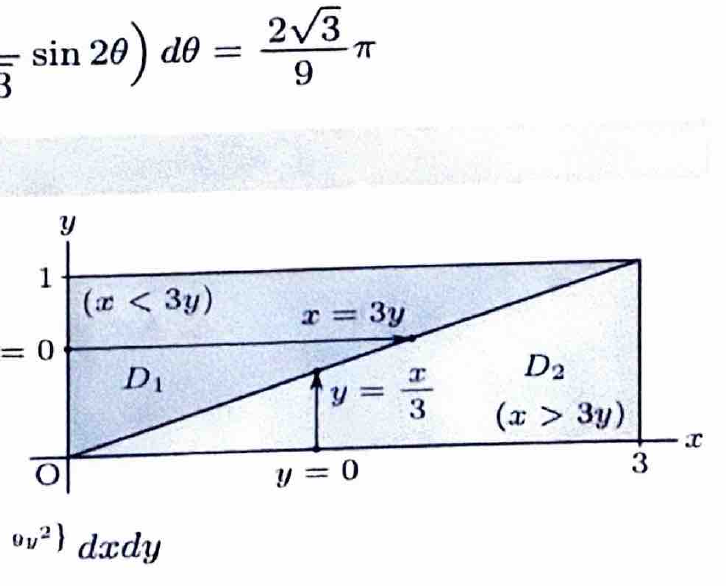

累次積分では、領域を
$$
D=\{(x,y)\mid a\le x\le b,\ \varphi_1(x)\le y\le\varphi_2(x)\}
$$
と表せるとき、
$$
\iint_D f(x,y)\,dxdy
=
\int_a^b\left\{\int_{\varphi_1(x)}^{\varphi_2(x)}f(x,y)\,dy\right\}dx
$$
と計算できる。積分順序を逆にする場合は、同じ領域を
$$
D=\{(x,y)\mid c\le y\le d,\ \psi_1(y)\le x\le\psi_2(y)\}
$$
と表し直す。

---
問題 108

積分
$$
\int_0^3
\left(
\int_0^1e^{\max\{x^2,9y^2\}}\,dy
\right)dx
$$
を求めよ。

---
## 解答

> 指数の中に $\max\{x^2,9y^2\}$ があるため、$x^2$ と $9y^2$ の大小が切り替わる境界で領域を分割する。領域では $x\ge0,\ y\ge0$ なので、境界は $x=3y$ である。分割せずに積分することはできない。

積分領域全体は、
$$
0\le x\le3,\qquad0\le y\le1
$$
である。

$x^2\le9y^2$ は、非負範囲なので、
$$
x\le3y
$$
と同値である。そこで、
$$
D_1:\ 0\le y\le1,\qquad0\le x\le3y
$$
とする。この領域では、
$$
\max\{x^2,9y^2\}=9y^2
$$
である。

また、
$$
D_2:\ 0\le x\le3,\qquad0\le y\le\frac x3
$$
とする。この領域では、
$$
\max\{x^2,9y^2\}=x^2
$$
である。

したがって、
$$
\int_0^3
\left(
\int_0^1e^{\max\{x^2,9y^2\}}\,dy
\right)dx
=
\iint_{D_1}e^{9y^2}\,dxdy
+
\iint_{D_2}e^{x^2}\,dxdy
$$

第1項は、$x$ から先に積分すると、
$$
\iint_{D_1}e^{9y^2}\,dxdy
=
\int_0^1
\left\{
\int_0^{3y}e^{9y^2}\,dx
\right\}dy
$$
$$
=
\int_0^13ye^{9y^2}\,dy
$$

置換前の文字式を、
$$
t=9y^2
$$
とすると、
$$
dt=18y\,dy
$$
なので、
$$
3y\,dy=\frac16dt
$$
である。よって、
$$
\int_0^13ye^{9y^2}\,dy
=
\frac16\int_0^9e^t\,dt
=
\frac16(e^9-1)
$$

第2項は、$y$ から先に積分すると、
$$
\iint_{D_2}e^{x^2}\,dxdy
=
\int_0^3
\left\{
\int_0^{x/3}e^{x^2}\,dy
\right\}dx
$$
$$
=
\int_0^3\frac x3e^{x^2}\,dx
$$

置換前の文字式を、
$$
t=x^2
$$
とすると、
$$
dt=2x\,dx
$$
なので、
$$
\frac x3dx=\frac16dt
$$
である。よって、
$$
\int_0^3\frac x3e^{x^2}\,dx
=
\frac16\int_0^9e^t\,dt
=
\frac16(e^9-1)
$$

2つを加えて、
$$
\boxed{
\int_0^3
\left(
\int_0^1e^{\max\{x^2,9y^2\}}\,dy
\right)dx
=
\frac13(e^9-1)
}
$$
