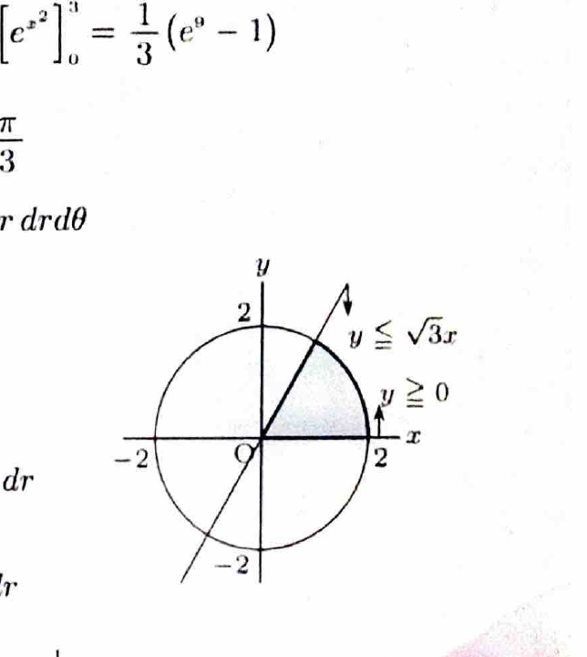
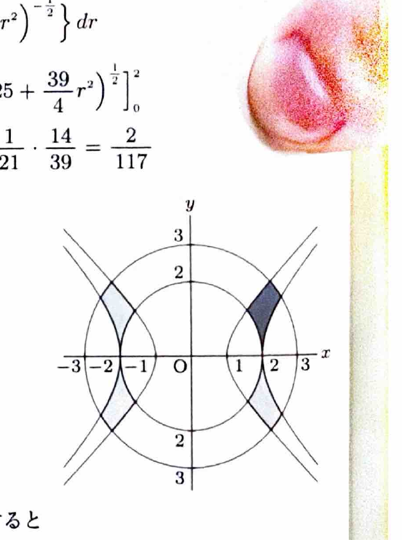

極座標変換
$$
x=r\cos\theta,\qquad y=r\sin\theta
$$
を用いると、
$$
x^2+y^2=r^2,\qquad dxdy=r\,drd\theta
$$
である。面積要素にヤコビアンの因子 $r$ が付くことに注意する。

変数変換
$$
x=\varphi(u,v),\qquad y=\psi(u,v)
$$
では、
$$
dxdy=
\left|
\frac{\partial(x,y)}{\partial(u,v)}
\right|dudv
$$
である。ヤコビアンは
$$
\frac{\partial(x,y)}{\partial(u,v)}
=
\begin{vmatrix}
x_u&x_v\\
y_u&y_v
\end{vmatrix}
$$
で計算し、積分ではその絶対値を用いる。

---
問題 109

$D$ を括弧内の不等式の表す領域とするとき、次の2重積分の値を求めよ。

---
## (1)

$$
\iint_D
\frac{xy}
{\left(\sqrt{25-6x^2+15y^2}\right)^3}
\,dxdy
$$

ただし、
$$
x^2+y^2\le4,\qquad0\le y\le\sqrt3x
$$
である。

---
## (1) 解答

> 領域は半径2の円の中の扇形なので、極座標変換を用いる。被積分関数の分母に $\cos^2\theta,\sin^2\theta$ が残るため、角度積分では $t=\sin^2\theta$ と置換する。

条件 $0\le y\le\sqrt3x$ より、
$$
0\le\theta\le\frac{\pi}{3}
$$
である。また、
$$
0\le r\le2
$$
である。

極座標で、
$$
xy=r^2\sin\theta\cos\theta
$$
であり、分母の中は、
$$
25-6x^2+15y^2
=
25-6r^2\cos^2\theta+15r^2\sin^2\theta
$$
である。

したがって、
$$
\iint_D
\frac{xy}
{\left(\sqrt{25-6x^2+15y^2}\right)^3}
\,dxdy
$$
$$
=
\int_0^2\int_0^{\pi/3}
\frac{r^3\sin\theta\cos\theta}
{\left(25-6r^2\cos^2\theta+15r^2\sin^2\theta\right)^{3/2}}
\,d\theta dr
$$

角度積分で、置換前の文字式を、
$$
t=\sin^2\theta
$$
とする。微分すると、
$$
dt=2\sin\theta\cos\theta\,d\theta
$$
である。また、
$$
\cos^2\theta=1-t
$$
なので、分母の中は、
$$
25-6r^2(1-t)+15r^2t
=
25-6r^2+21r^2t
$$
となる。

角度の範囲は、$\theta=0$ で $t=0$、$\theta=\pi/3$ で $t=3/4$ である。よって、
$$
=
\int_0^2\frac{r^3}{2}
\left\{
\int_0^{3/4}
(25-6r^2+21r^2t)^{-3/2}\,dt
\right\}dr
$$

不定積分は、
$$
\int(A+Bt)^{-3/2}\,dt
=
-\frac2B(A+Bt)^{-1/2}
$$
である。ここで、
$$
A=25-6r^2,\qquad B=21r^2
$$
を代入すると、
$$
=
\frac1{21}
\int_0^2
\left\{
\frac{r}{\sqrt{25-6r^2}}
-
\frac{r}{\sqrt{25+\frac{39}{4}r^2}}
\right\}dr
$$

第1項では、置換前の文字式
$$
u=25-6r^2
$$
を用いると、
$$
du=-12r\,dr
$$
である。したがって、
$$
\int_0^2\frac{r}{\sqrt{25-6r^2}}\,dr
=
\frac16(5-1)
=
\frac23
$$

第2項では、
$$
v=25+\frac{39}{4}r^2
$$
とおくと、
$$
dv=\frac{39}{2}r\,dr
$$
である。よって、
$$
\int_0^2
\frac{r}{\sqrt{25+\frac{39}{4}r^2}}\,dr
=
\frac4{39}(8-5)
=
\frac4{13}
$$

したがって、
$$
\frac1{21}
\left(
\frac23-\frac4{13}
\right)
=
\frac1{21}\cdot\frac{14}{39}
=
\boxed{\frac2{117}}
$$

---
## (2)

$$
\iint_Dxy\,dxdy
$$

ただし、
$$
x^2-4\le y^2\le x^2-1,
$$
$$
4\le x^2+y^2\le9,\qquad x\ge0,\qquad y\ge0
$$
である。

---
## (2) 解答

> 第1象限なので $x=\sqrt X,\ y=\sqrt Y$ として平方を新変数にすると、条件が $X+Y$ と $X-Y$ の長方形条件になる。さらに $u=X+Y,\ v=X-Y$ と変換する。極座標だけでは双曲線条件が残る。

変数変換を、
$$
x=\sqrt X,\qquad y=\sqrt Y
$$
とする。すなわち、
$$
X=x^2,\qquad Y=y^2
$$
である。

微分関係は、
$$
dx=\frac1{2\sqrt X}dX,\qquad
dy=\frac1{2\sqrt Y}dY
$$
なので、
$$
dxdy=\frac1{4\sqrt{XY}}\,dXdY
$$
である。

また、
$$
xy=\sqrt{XY}
$$
なので、
$$
xy\,dxdy
=
\frac14dXdY
$$
となる。

条件は、
$$
4\le X+Y\le9
$$
および、
$$
1\le X-Y\le4
$$
となる。

さらに、
$$
u=X+Y,\qquad v=X-Y
$$
とおく。逆変換は、
$$
X=\frac12(u+v),\qquad
Y=\frac12(u-v)
$$
であり、
$$
\left|
\frac{\partial(X,Y)}{\partial(u,v)}
\right|
=
\frac12
$$
である。

変換後の領域は、
$$
4\le u\le9,\qquad1\le v\le4
$$
となる。したがって、
$$
\iint_Dxy\,dxdy
=
\frac14
\int_4^9\int_1^4
\frac12\,dvdu
$$
$$
=
\frac18(9-4)(4-1)
=
\boxed{\frac{15}{8}}
$$
