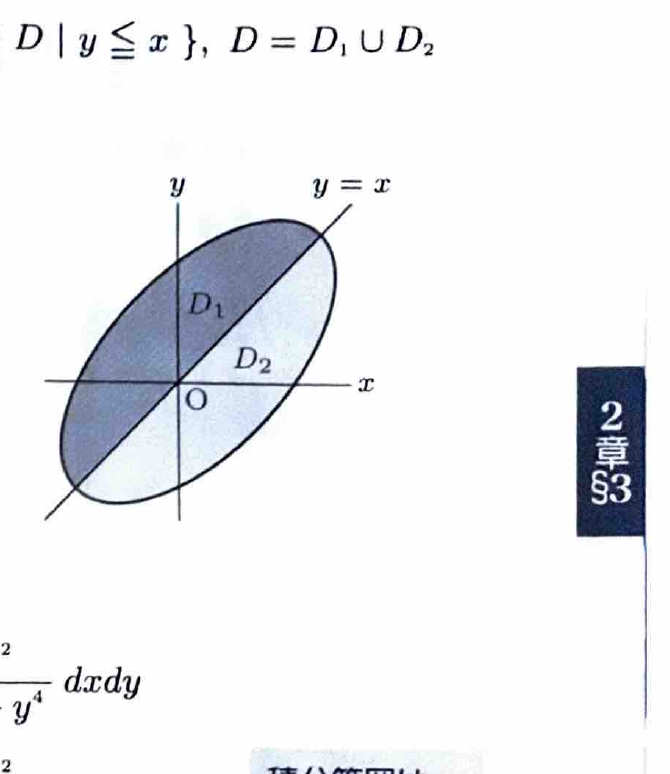

変数変換
$$
x=\varphi(u,v),\qquad y=\psi(u,v)
$$
では、
$$
dxdy=
\left|
\frac{\partial(x,y)}{\partial(u,v)}
\right|dudv
$$
である。ヤコビアンは
$$
\frac{\partial(x,y)}{\partial(u,v)}
=
\begin{vmatrix}
x_u&x_v\\
y_u&y_v
\end{vmatrix}
$$
で計算し、積分ではその絶対値を用いる。

---
問題 110

$D$ は $\mathbb{R}^2$ 内の有界閉領域で、直線 $y=x$ について線対称であるとする。積分
$$
\iint_D
\frac{x^2-y^2}{1+x^4+y^4}
\,dxdy
$$
を求めよ。

---
## 解答

> 領域が $x$ と $y$ の交換で不変であり、被積分関数は交換によって符号が反転する。したがって、対称な点どうしの寄与が打ち消し合う。領域を2つに分けて変数変換する方法で厳密に示す。積分を直接計算する必要はない。

領域を、
$$
D_1=\{(x,y)\in D\mid y\ge x\},
$$
$$
D_2=\{(x,y)\in D\mid y\le x\}
$$
に分ける。すると、
$$
D=D_1\cup D_2
$$
である。

$D_2$ の積分で、変数変換を、
$$
x=v,\qquad y=u
$$
とする。ヤコビアンは、
$$
\frac{\partial(x,y)}{\partial(u,v)}
=
\begin{vmatrix}
0&1\\
1&0
\end{vmatrix}
=
-1
$$
なので、絶対値は1である。

領域が $y=x$ に関して対称なので、$D_2$ は変換後に $D_1$ へ移る。被積分関数は、
$$
\frac{x^2-y^2}{1+x^4+y^4}
\longmapsto
\frac{v^2-u^2}{1+v^4+u^4}
=
-\frac{u^2-v^2}{1+u^4+v^4}
$$
となる。

したがって、
$$
\iint_D
\frac{x^2-y^2}{1+x^4+y^4}
\,dxdy
$$
$$
=
\iint_{D_1}
\frac{x^2-y^2}{1+x^4+y^4}
\,dxdy
+
\iint_{D_2}
\frac{x^2-y^2}{1+x^4+y^4}
\,dxdy
$$
$$
=
\iint_{D_1}
\frac{x^2-y^2}{1+x^4+y^4}
\,dxdy
+
\iint_{D_1}
\frac{-x^2+y^2}{1+x^4+y^4}
\,dxdy
$$
$$
=
\iint_{D_1}0\,dxdy
=
\boxed{0}
$$

> 一般に、対称領域上で、対称変換により符号が反転する関数の積分は0になる。
