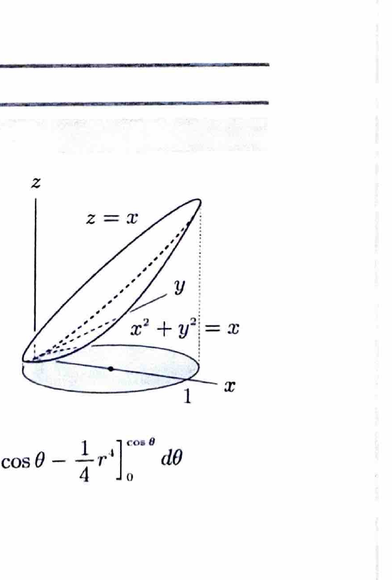
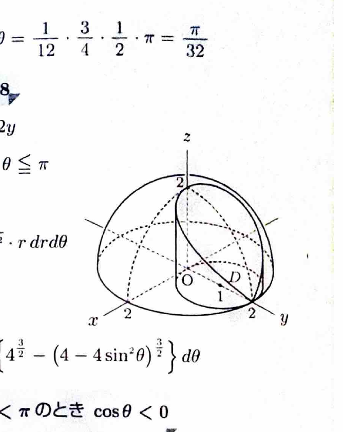

極座標変換
$$
x=r\cos\theta,\qquad y=r\sin\theta
$$
を用いると、
$$
x^2+y^2=r^2,\qquad dxdy=r\,drd\theta
$$
である。面積要素にヤコビアンの因子 $r$ が付くことに注意する。

体積は、底面領域 $D$ 上で
$$
V=\iint_D
\{z_{\mathrm{upper}}-z_{\mathrm{lower}}\}
\,dxdy
$$
と求める。

---
問題 111

次の体積を求めよ。

---
## (1)

面
$$
z=x^2+y^2
$$
と面
$$
z=x
$$
で囲まれた部分。

---
## (1) 解答

> 2曲面の交線を $xy$ 平面へ射影して底面領域を求め、その上で上面 $z=x$ と下面 $z=x^2+y^2$ の差を積分する。境界が円になるため極座標変換を用いる。円柱座標で3重積分する方法もあるが、2重積分の方が簡潔である。

交線は、
$$
x^2+y^2=x
$$
である。したがって底面領域は、
$$
D:\ x^2+y^2\le x
$$
である。

極座標を代入すると、
$$
r^2\le r\cos\theta
$$
より、
$$
0\le r\le\cos\theta
$$
である。$\cos\theta\ge0$ なので、
$$
-\frac{\pi}{2}\le\theta\le\frac{\pi}{2}
$$
である。

高さは、
$$
z_{\mathrm{upper}}-z_{\mathrm{lower}}
=
x-(x^2+y^2)
=
r\cos\theta-r^2
$$
である。

よって、
$$
V
=
\int_{-\pi/2}^{\pi/2}
\int_0^{\cos\theta}
(r\cos\theta-r^2)r\,drd\theta
$$
$$
=
\int_{-\pi/2}^{\pi/2}
\int_0^{\cos\theta}
(r^2\cos\theta-r^3)\,drd\theta
$$

$r$ で積分すると、
$$
\int(r^2\cos\theta-r^3)\,dr
=
\frac13r^3\cos\theta-\frac14r^4
$$
である。境界を代入して、
$$
\left[
\frac13r^3\cos\theta-\frac14r^4
\right]_0^{\cos\theta}
=
\left(\frac13-\frac14\right)\cos^4\theta
=
\frac1{12}\cos^4\theta
$$

したがって、
$$
V
=
\frac1{12}
\int_{-\pi/2}^{\pi/2}\cos^4\theta\,d\theta
$$

対称性とウォリス積分より、
$$
\int_{-\pi/2}^{\pi/2}\cos^4\theta\,d\theta
=
2\int_0^{\pi/2}\cos^4\theta\,d\theta
=
2\cdot\frac{3\pi}{16}
=
\frac{3\pi}{8}
$$

よって、
$$
\boxed{V=\frac{\pi}{32}}
$$

---
## (2)

領域
$$
x^2+y^2+z^2\le4,\qquad z\ge0
$$
と領域
$$
x^2+(y-1)^2\le1
$$
の共通部分。

---
## (2) 解答

> 上半球 $z=\sqrt{4-x^2-y^2}$ の下で、底面が円 $x^2+(y-1)^2\le1$ となる立体である。底面の円は原点を通るため、極座標で $r\le2\sin\theta$ と表せる。円柱座標による3重積分と同じ計算になる。

底面領域は、
$$
D:\ x^2+(y-1)^2\le1
$$
である。展開すると、
$$
x^2+y^2\le2y
$$
である。

極座標を代入して、
$$
r^2\le2r\sin\theta
$$
より、
$$
0\le r\le2\sin\theta
$$
である。また、
$$
0\le\theta\le\pi
$$
である。

上面は、
$$
z=\sqrt{4-r^2}
$$
で、下面は $z=0$ である。よって、
$$
V
=
\int_0^\pi
\int_0^{2\sin\theta}
\sqrt{4-r^2}\,r\,drd\theta
$$

内側の積分で、置換前の文字式を、
$$
u=4-r^2
$$
とする。微分すると、
$$
du=-2r\,dr
$$
なので、
$$
r\,dr=-\frac12du
$$
である。したがって、
$$
\int r\sqrt{4-r^2}\,dr
=
-\frac13(4-r^2)^{3/2}
$$

境界を代入すると、
$$
\int_0^{2\sin\theta}
r\sqrt{4-r^2}\,dr
=
\frac13
\left\{
8-(4-4\sin^2\theta)^{3/2}
\right\}
$$

ここで、
$$
4-4\sin^2\theta=4\cos^2\theta
$$
なので、
$$
(4-4\sin^2\theta)^{3/2}
=
8|\cos\theta|^3
$$
である。

よって、
$$
V
=
\frac83
\int_0^\pi
(1-|\cos\theta|^3)\,d\theta
$$

対称性より、
$$
\int_0^\pi|\cos\theta|^3\,d\theta
=
2\int_0^{\pi/2}\cos^3\theta\,d\theta
=
2\cdot\frac23
=
\frac43
$$

したがって、
$$
V
=
\frac83
\left(
\pi-\frac43
\right)
=
\boxed{\frac89(3\pi-4)}
$$
