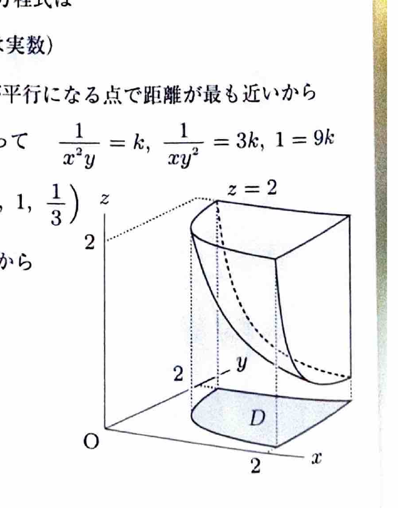

曲面 $z=f(x,y)$ の点 $(x_0,y_0,z_0)$ における接平面は、
$$
z-z_0
=
f_x(x_0,y_0)(x-x_0)
+
f_y(x_0,y_0)(y-y_0)
$$
である。法線方向は、
$$
(-f_x,-f_y,1)
$$
と取れる。

---
問題 112

曲面
$$
z=\frac1{xy},\qquad x>0,\ y>0
$$
を $S$ とする。

---
## (1)

点 $(x,y)=(1,2)$ における曲面 $S$ の接平面の方程式と法線の方程式を求めよ。

---
## (1) 解答

> 曲面が $z=f(x,y)$ の形なので、偏微分を求めて接平面公式へ代入する。法線は接平面の法線ベクトルを方向ベクトルとする直線である。

関数は、
$$
f(x,y)=\frac1{xy}
$$
である。偏微分を文字のまま求めると、
$$
f_x(x,y)=-\frac1{x^2y},
\qquad
f_y(x,y)=-\frac1{xy^2}
$$
である。

点 $(1,2)$ における高さは、
$$
z_0=f(1,2)=\frac12
$$
である。

次に、偏微分へ値を代入すると、
$$
f_x(1,2)
=
-\frac1{1^2\cdot2}
=
-\frac12
$$
および、
$$
f_y(1,2)
=
-\frac1{1\cdot2^2}
=
-\frac14
$$
である。

接平面公式は、
$$
z-z_0
=
f_x(x_0,y_0)(x-x_0)
+
f_y(x_0,y_0)(y-y_0)
$$
である。値を代入すると、
$$
z-\frac12
=
-\frac12(x-1)
-\frac14(y-2)
$$

両辺を4倍して整理すると、
$$
4z-2=-2x+2-y+2
$$
より、
$$
\boxed{2x+y+4z=6}
$$
である。

接平面の法線ベクトルは、
$$
(2,1,4)
$$
である。したがって、点
$$
\left(1,2,\frac12\right)
$$
を通る法線は、媒介変数 $t\in\mathbb{R}$ を用いて、
$$
\boxed{
x=1+2t,\qquad
y=2+t,\qquad
z=\frac12+4t
}
$$
である。

---
## (2)

曲面 $S$ 上で、平面
$$
x+3y+9z+18=0
$$
との距離が最も近い点の座標を求めよ。

---
## (2) 解答

> 曲面と平面の最短距離点では、曲面の接平面が与えられた平面に平行になる。したがって、曲面の法線ベクトルと平面の法線ベクトルを平行にする。ラグランジュの未定乗数法でも同じ条件が得られる。

曲面 $z=f(x,y)$ の法線ベクトルは、
$$
(-f_x,-f_y,1)
=
\left(
\frac1{x^2y},
\frac1{xy^2},
1
\right)
$$
である。

平面の法線ベクトルは、
$$
(1,3,9)
$$
である。両者が平行なので、ある実数 $k$ に対して、
$$
\left(
\frac1{x^2y},
\frac1{xy^2},
1
\right)
=
k(1,3,9)
$$
となる。

成分比較すると、
$$
\frac1{x^2y}=k,
$$
$$
\frac1{xy^2}=3k,
$$
$$
1=9k
$$
である。

まず、
$$
1=9k
$$
より、
$$
k=\frac19
$$
である。

第1式へ代入すると、
$$
\frac1{x^2y}=\frac19
$$
なので、
$$
x^2y=9
$$
である。

第2式へ代入すると、
$$
\frac1{xy^2}=\frac13
$$
なので、
$$
xy^2=3
$$
である。

2式を割ると、
$$
\frac{x^2y}{xy^2}
=
\frac93
$$
より、
$$
\frac xy=3
$$
したがって、
$$
x=3y
$$
である。

これを、
$$
xy^2=3
$$
へ代入すると、
$$
3y\cdot y^2=3
$$
すなわち、
$$
y^3=1
$$
である。$y>0$ なので、
$$
y=1
$$
であり、
$$
x=3
$$
である。

最後に曲面の式へ代入すると、
$$
z=\frac1{xy}
=
\frac1{3\cdot1}
=
\frac13
$$

したがって、求める点は、
$$
\boxed{\left(3,1,\frac13\right)}
$$
である。

---
## (3)

6つの平面
$$
x=0,\ x=2,\ y=0,\ y=2,\ z=0,\ z=2
$$
で囲まれる立方体を曲面 $S$ で分割して得られる2つの領域のうち、原点を含まない方の領域の体積を求めよ。

---
## (3) 解答

> 原点を含まない側は、立方体内で曲面 $z=1/(xy)$ の上側から上面 $z=2$ までの部分である。まず、上面 $z=2$ と曲面の交線を $xy$ 平面へ射影し、積分領域を求める。3重積分でもよいが、高さの差を2重積分する方が簡単である。

上面との交線は、
$$
2=\frac1{xy}
$$
なので、
$$
y=\frac1{2x}
$$
である。

原点を含まない側が存在するには、
$$
\frac1{xy}\le2
$$
すなわち、
$$
xy\ge\frac12
$$
が必要である。

$0\le y\le2$ の範囲で、
$$
\frac1{2x}\le2
$$
となるには、
$$
x\ge\frac14
$$
である。

したがって射影領域は、
$$
D:
\frac14\le x\le2,
\qquad
\frac1{2x}\le y\le2
$$
である。

各点 $(x,y)$ における高さは、
$$
2-\frac1{xy}
$$
である。よって、
$$
V
=
\int_{1/4}^2
\left\{
\int_{1/(2x)}^2
\left(
2-\frac1{xy}
\right)dy
\right\}dx
$$

まず文字のまま $y$ で積分すると、
$$
\int
\left(
2-\frac1{xy}
\right)dy
=
2y-\frac1x\log y
$$

境界を代入して、
$$
\int_{1/(2x)}^2
\left(
2-\frac1{xy}
\right)dy
$$
$$
=
\left[
2y-\frac1x\log y
\right]_{1/(2x)}^2
$$
$$
=
4-\frac1x\log2
-
\left\{
\frac1x-\frac1x\log\frac1{2x}
\right\}
$$

ここで、
$$
\log\frac1{2x}=-\log(2x)
$$
なので、
$$
=
4-\frac1x-\frac1x\log2-\frac1x\log(2x)
$$
$$
=
4-\frac1x-\frac{2\log2}{x}-\frac{\log x}{x}
$$

したがって、
$$
V
=
\int_{1/4}^2
\left(
4-\frac1x-\frac{2\log2}{x}-\frac{\log x}{x}
\right)dx
$$

積分すると、
$$
V
=
\left[
4x-\log x-2(\log2)\log x-\frac12(\log x)^2
\right]_{1/4}^2
$$

境界値
$$
\log2=L,\qquad
\log\frac14=-2L
$$
とおくと、
$$
V
=
\{8-L-2L^2-\tfrac12L^2\}
-
\{1+2L+4L^2-2L^2\}
$$
$$
=
7-3L-\frac92L^2
$$

したがって、
$$
\boxed{
V=
7-3\log2-\frac92(\log2)^2
}
$$
