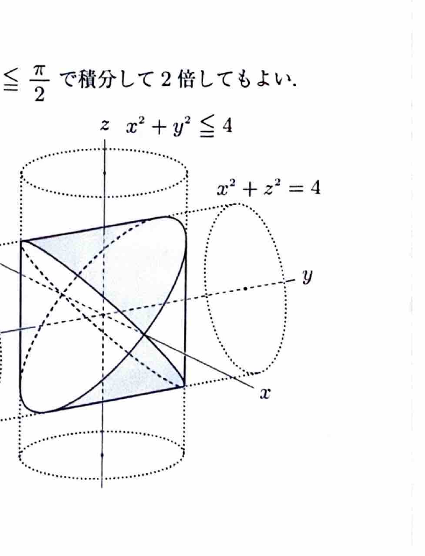

曲面 $z=f(x,y)$ の領域 $D$ に対応する部分の面積は
$$
S=
\iint_D
\sqrt{
1+\left(\frac{\partial z}{\partial x}\right)^2
+\left(\frac{\partial z}{\partial y}\right)^2
}
\,dxdy
$$
で求める。

極座標変換
$$
x=r\cos\theta,\qquad y=r\sin\theta
$$
を用いると、
$$
x^2+y^2=r^2,\qquad dxdy=r\,drd\theta
$$
である。面積要素にヤコビアンの因子 $r$ が付くことに注意する。

---
問題 113

次の曲面の、括弧内の不等式の表す領域 $D$ に対応する部分の面積を求めよ。

---
## (1)

球面
$$
x^2+y^2+z^2=a^2,\qquad a>0
$$

ただし、
$$
D:\ x^2+y^2\le ax
$$
である。

---
## (1) 解答

> 球面は上半球と下半球の2枚のグラフに分けられる。まず上半球の曲面積を求めて2倍する。底面領域が原点を通る円なので極座標を用いる。

上半球は、
$$
z=\sqrt{a^2-x^2-y^2}
$$
である。偏微分は、
$$
z_x=-\frac{x}{\sqrt{a^2-x^2-y^2}},
\qquad
z_y=-\frac{y}{\sqrt{a^2-x^2-y^2}}
$$
である。

したがって、
$$
1+z_x^2+z_y^2
=
1+
\frac{x^2+y^2}{a^2-x^2-y^2}
=
\frac{a^2}{a^2-x^2-y^2}
$$
より、
$$
\sqrt{1+z_x^2+z_y^2}
=
\frac{a}{\sqrt{a^2-x^2-y^2}}
$$
である。

領域条件を極座標にすると、
$$
r^2\le ar\cos\theta
$$
より、
$$
0\le r\le a\cos\theta
$$
である。また、
$$
-\frac{\pi}{2}\le\theta\le\frac{\pi}{2}
$$
である。

球面全体の該当面積は上下2枚なので、
$$
S
=
2\int_{-\pi/2}^{\pi/2}
\int_0^{a\cos\theta}
\frac{a}{\sqrt{a^2-r^2}}r\,drd\theta
$$

内側の積分で、置換前の文字式を、
$$
u=a^2-r^2
$$
とする。すると、
$$
du=-2r\,dr
$$
なので、
$$
\int\frac{ar}{\sqrt{a^2-r^2}}\,dr
=
-a\sqrt{a^2-r^2}
$$
である。

境界を代入すると、
$$
\int_0^{a\cos\theta}
\frac{ar}{\sqrt{a^2-r^2}}\,dr
=
a^2-a^2|\sin\theta|
$$

したがって、
$$
S
=
2a^2
\int_{-\pi/2}^{\pi/2}
(1-|\sin\theta|)\,d\theta
$$

対称性より、
$$
S
=
4a^2
\int_0^{\pi/2}(1-\sin\theta)\,d\theta
$$
$$
=
4a^2
[\theta+\cos\theta]_0^{\pi/2}
$$
$$
=
4a^2\left(\frac{\pi}{2}-1\right)
=
\boxed{2(\pi-2)a^2}
$$

---
## (2)

円柱面
$$
x^2+z^2=4
$$

ただし、
$$
D:\ x^2+y^2\le4
$$
である。

---
## (2) 解答

> 円柱面は上半分 $z=\sqrt{4-x^2}$ と下半分 $z=-\sqrt{4-x^2}$ に分けられる。上半分の面積を求めて2倍する。$z$ は $y$ に依存しないため、曲面積公式が簡単になる。

上半分は、
$$
z=\sqrt{4-x^2}
$$
である。偏微分は、
$$
z_x=-\frac{x}{\sqrt{4-x^2}},
\qquad
z_y=0
$$
である。

したがって、
$$
\sqrt{1+z_x^2+z_y^2}
=
\sqrt{
1+\frac{x^2}{4-x^2}
}
=
\frac2{\sqrt{4-x^2}}
$$
である。

底面領域は、
$$
-2\le x\le2,
\qquad
-\sqrt{4-x^2}\le y\le\sqrt{4-x^2}
$$
である。

上半分の面積は、
$$
S_{\mathrm{upper}}
=
\int_{-2}^{2}
\int_{-\sqrt{4-x^2}}^{\sqrt{4-x^2}}
\frac2{\sqrt{4-x^2}}
\,dydx
$$

$y$ で積分すると、
$$
\int_{-\sqrt{4-x^2}}^{\sqrt{4-x^2}}
\frac2{\sqrt{4-x^2}}
\,dy
=
\frac2{\sqrt{4-x^2}}\cdot2\sqrt{4-x^2}
=
4
$$

したがって、
$$
S_{\mathrm{upper}}
=
\int_{-2}^24\,dx
=
16
$$

上下2枚を合わせると、
$$
\boxed{S=2\cdot16=32}
$$

> 資料には、この立体の体積も求められるようにしておくとの補足があり、体積は $128/3$ である。
