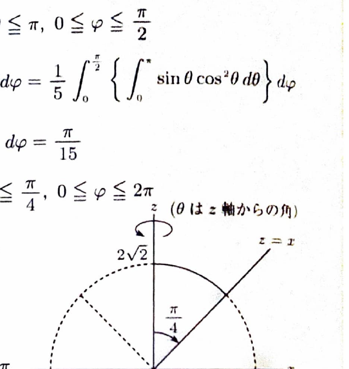
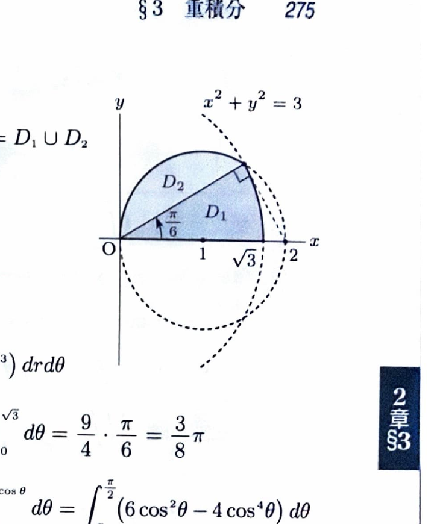

3次元極座標
$$
x=r\sin\theta\cos\varphi,\qquad
y=r\sin\theta\sin\varphi,\qquad
z=r\cos\theta
$$
では、
$$
dxdydz=r^2\sin\theta\,drd\theta d\varphi
$$
である。通常、
$$
0\le\theta\le\pi,\qquad0\le\varphi\le2\pi
$$
とする。

ウォリス積分の漸化式として、適切な端点 $a,b$ に対し
$$
I_n=\int_a^b\sin^n x\,dx
$$
とおくと、
$$
I_n=\frac{n-1}{n}I_{n-2}
$$
が使える。余弦の積分も同様である。特に
$$
\int_0^{\pi/2}\cos^4\theta\,d\theta
=
\frac34\cdot\frac12\cdot\frac{\pi}{2}
=
\frac{3\pi}{16}
$$
である。

> 資料のウォリス積分の計算例：
> $$
> \int_0^\pi\sin^5x\,dx
> =
> \frac45\cdot\frac23\int_0^\pi\sin x\,dx
> =
> \frac{16}{15}
> $$
> $$
> \int_{-\pi/2}^{\pi/2}\cos^6x\,dx
> =
> \frac56\cdot\frac34\cdot\frac12
> \int_{-\pi/2}^{\pi/2}dx
> =
> \frac{5\pi}{16}
> $$

---
問題 114

領域 $V$ に関する次の3重積分の値を求めよ。

---
## (1)

$$
V:\ x^2+y^2+z^2\le1,\qquad x\ge0,\qquad y\ge0
$$

に対して、
$$
\iiint_Vz^2\,dxdydz
$$
を求めよ。

---
## (1) 解答

> 領域は単位球のうち $x\ge0,\ y\ge0$ の部分であり、球面境界と被積分関数 $z^2$ は3次元極座標で簡単になる。直交座標や円柱座標でも可能だが、球座標が最も直接的である。

3次元極座標では、
$$
z=r\cos\theta
$$
である。条件 $x\ge0,\ y\ge0$ は、方位角について、
$$
0\le\varphi\le\frac{\pi}{2}
$$
を表す。

したがって領域は、
$$
0\le r\le1,\qquad
0\le\theta\le\pi,\qquad
0\le\varphi\le\frac{\pi}{2}
$$
である。

被積分関数と体積要素を掛けると、
$$
z^2\,dxdydz
=
r^2\cos^2\theta\cdot r^2\sin\theta
\,drd\theta d\varphi
$$
である。

よって、
$$
\iiint_Vz^2\,dxdydz
=
\int_0^{\pi/2}
\int_0^\pi
\int_0^1
r^4\cos^2\theta\sin\theta
\,drd\theta d\varphi
$$

変数ごとに分離して、
$$
=
\left(\int_0^1r^4\,dr\right)
\left(\int_0^\pi\cos^2\theta\sin\theta\,d\theta\right)
\left(\int_0^{\pi/2}d\varphi\right)
$$

それぞれ、
$$
\int_0^1r^4\,dr=\frac15
$$
である。

角度積分では、置換前の文字式を
$$
u=\cos\theta
$$
とすると、
$$
du=-\sin\theta\,d\theta
$$
である。よって、
$$
\int_0^\pi\cos^2\theta\sin\theta\,d\theta
=
-\int_1^{-1}u^2\,du
=
\int_{-1}^1u^2\,du
=
\frac23
$$

また、
$$
\int_0^{\pi/2}d\varphi=\frac{\pi}{2}
$$
である。

したがって、
$$
\iiint_Vz^2\,dxdydz
=
\frac15\cdot\frac23\cdot\frac{\pi}{2}
=
\boxed{\frac{\pi}{15}}
$$

---
## (2)

$zx$ 平面において、曲線
$$
z=\sqrt{8-x^2},
\qquad
0\le x\le2\sqrt2
$$
と直線
$$
z=x
$$
および $z$ 軸で囲まれた領域を $z$ 軸のまわりに回転して得られる立体 $V$ に対して、
$$
\iiint_V\sqrt{x^2+y^2+z^2}\,dxdydz
$$
を求めよ。

---
## (2) 解答

> 回転体は原点中心、半径 $2\sqrt2$ の球の内部で、直線 $z=x$ を回転してできる円錐の内側にある。球面と円錐面がともに球座標で定数範囲になるため、3次元極座標を用いる。

$zx$ 平面で、
$$
z=\sqrt{8-x^2}
$$
は、
$$
x^2+z^2=8
$$
すなわち半径 $2\sqrt2$ の円である。

直線 $z=x$ は、$z$ 軸からの角を $\theta$ とすると、
$$
\theta=\frac{\pi}{4}
$$
を表す。回転体は $z$ 軸側なので、
$$
0\le\theta\le\frac{\pi}{4}
$$
である。

したがって、
$$
0\le r\le2\sqrt2,\qquad
0\le\theta\le\frac{\pi}{4},\qquad
0\le\varphi\le2\pi
$$
である。

被積分関数は、
$$
\sqrt{x^2+y^2+z^2}=r
$$
なので、
$$
\iiint_V\sqrt{x^2+y^2+z^2}\,dxdydz
$$
$$
=
\int_0^{2\pi}
\int_0^{\pi/4}
\int_0^{2\sqrt2}
r\cdot r^2\sin\theta
\,drd\theta d\varphi
$$

変数ごとに分離すると、
$$
=
\left(\int_0^{2\sqrt2}r^3\,dr\right)
\left(\int_0^{\pi/4}\sin\theta\,d\theta\right)
\left(\int_0^{2\pi}d\varphi\right)
$$

半径積分は、
$$
\int_0^{2\sqrt2}r^3\,dr
=
\left[\frac14r^4\right]_0^{2\sqrt2}
=
16
$$

角度積分は、
$$
\int_0^{\pi/4}\sin\theta\,d\theta
=
[-\cos\theta]_0^{\pi/4}
=
1-\frac1{\sqrt2}
$$

また、
$$
\int_0^{2\pi}d\varphi=2\pi
$$
である。

したがって、
$$
\iiint_V\sqrt{x^2+y^2+z^2}\,dxdydz
=
16\left(1-\frac1{\sqrt2}\right)2\pi
$$
$$
=
\boxed{16(2-\sqrt2)\pi}
$$

---
## (3)

$$
V:\ \frac{x^2}{a^2}+\frac{y^2}{b^2}+\frac{z^2}{c^2}\le1
$$
に対して、
$$
\iiint_Vx^2y^2\,dxdydz
$$
を求めよ。ただし、$a,b,c$ は正の定数とする。

---
## (3) 解答

> 領域が楕円体なので、単位球を $x,y,z$ 方向にそれぞれ $a,b,c$ 倍する楕円体座標を用いる。被積分関数と領域は各座標平面に関して対称なので、第1八分体で積分して8倍する。直交座標では境界が根号になり非常に複雑である。

変数変換を、
$$
x=ar\sin\theta\cos\varphi,
$$
$$
y=br\sin\theta\sin\varphi,
$$
$$
z=cr\cos\theta
$$
とする。

3次元極座標を各軸方向へ拡大した変換なので、ヤコビアンは、
$$
dxdydz
=
abc\,r^2\sin\theta
\,drd\theta d\varphi
$$
である。

第1八分体では、
$$
0\le r\le1,\qquad
0\le\theta\le\frac{\pi}{2},\qquad
0\le\varphi\le\frac{\pi}{2}
$$
である。

被積分関数は、
$$
x^2y^2
=
a^2b^2r^4
\sin^4\theta
\cos^2\varphi
\sin^2\varphi
$$
である。

したがって、全領域の積分は、
$$
\iiint_Vx^2y^2\,dxdydz
$$
$$
=
8a^3b^3c
\int_0^1r^6\,dr
\int_0^{\pi/2}\sin^5\theta\,d\theta
\int_0^{\pi/2}\sin^2\varphi\cos^2\varphi\,d\varphi
$$

半径積分は、
$$
\int_0^1r^6\,dr=\frac17
$$
である。

ウォリス積分より、
$$
\int_0^{\pi/2}\sin^5\theta\,d\theta
=
\frac45\cdot\frac23
=
\frac8{15}
$$
である。

また、
$$
\sin^2\varphi\cos^2\varphi
=
\frac14\sin^22\varphi
$$
なので、
$$
\int_0^{\pi/2}\sin^2\varphi\cos^2\varphi\,d\varphi
=
\frac14\int_0^{\pi/2}\sin^22\varphi\,d\varphi
=
\frac{\pi}{16}
$$

したがって、
$$
\iiint_Vx^2y^2\,dxdydz
=
8a^3b^3c
\cdot\frac17
\cdot\frac8{15}
\cdot\frac{\pi}{16}
$$
$$
=
\boxed{\frac4{105}\pi a^3b^3c}
$$

---
## (4)

球
$$
x^2+y^2+z^2\le3
$$
と円柱
$$
x^2-2x+y^2\le0
$$
の共通部分 $V$ に対して、
$$
\iiint_V|z|\,dxdydz
$$
を求めよ。

---
## (4) 解答

> 円柱は $z$ 軸に平行で、$xy$ 平面への射影が円 $(x-1)^2+y^2\le1$ である。球と円柱は円柱座標で簡単に表せる。$y$ と $z$ の符号に関する対称性を利用し、$y\ge0,\ z\ge0$ の部分を積分して4倍する。

円柱の条件を整理すると、
$$
(x-1)^2+y^2\le1
$$
である。円柱座標
$$
x=r\cos\theta,\qquad
y=r\sin\theta
$$
を用いると、
$$
r^2-2r\cos\theta\le0
$$
より、
$$
0\le r\le2\cos\theta
$$
である。

球からは、
$$
0\le r\le\sqrt3
$$
である。$y\ge0$ の範囲では、
$$
0\le\theta\le\frac{\pi}{2}
$$
である。

2つの半径上限が等しくなる角度は、
$$
2\cos\theta=\sqrt3
$$
より、
$$
\theta=\frac{\pi}{6}
$$
である。

したがって、$xy$ 平面の第1象限部分を、
$$
D_1:
0\le\theta\le\frac{\pi}{6},
\qquad
0\le r\le\sqrt3
$$
と、
$$
D_2:
\frac{\pi}{6}\le\theta\le\frac{\pi}{2},
\qquad
0\le r\le2\cos\theta
$$
に分ける。

$z\ge0$ では、
$$
0\le z\le\sqrt{3-r^2}
$$
である。対称性から、
$$
\iiint_V|z|\,dxdydz
=
4
\iint_{D_1\cup D_2}
\left\{
\int_0^{\sqrt{3-r^2}}z\,dz
\right\}
r\,drd\theta
$$

まず、
$$
\int z\,dz=\frac12z^2
$$
なので、
$$
\int_0^{\sqrt{3-r^2}}z\,dz
=
\frac12(3-r^2)
$$

したがって、
$$
\iiint_V|z|\,dxdydz
=
2
\iint_{D_1\cup D_2}
(3r-r^3)\,drd\theta
$$

$D_1$ の積分は、
$$
\int_0^{\pi/6}
\left[
\frac32r^2-\frac14r^4
\right]_0^{\sqrt3}
d\theta
$$
$$
=
\int_0^{\pi/6}\frac94\,d\theta
=
\frac{3\pi}{8}
$$

$D_2$ の積分は、
$$
\int_{\pi/6}^{\pi/2}
\left[
\frac32r^2-\frac14r^4
\right]_0^{2\cos\theta}
d\theta
$$
$$
=
\int_{\pi/6}^{\pi/2}
(6\cos^2\theta-4\cos^4\theta)\,d\theta
$$

恒等式を用いると、
$$
6\cos^2\theta-4\cos^4\theta
=
\frac32+\cos2\theta-\frac12\cos4\theta
$$
である。よって、
$$
\int_{\pi/6}^{\pi/2}
(6\cos^2\theta-4\cos^4\theta)\,d\theta
$$
$$
=
\left[
\frac32\theta
+\frac12\sin2\theta
-\frac18\sin4\theta
\right]_{\pi/6}^{\pi/2}
$$
$$
=
\frac{\pi}{2}-\frac{3\sqrt3}{16}
$$

最後に外側の係数2を掛けて、
$$
\iiint_V|z|\,dxdydz
=
2\left(
\frac{3\pi}{8}
+
\frac{\pi}{2}
-
\frac{3\sqrt3}{16}
\right)
$$
$$
=
\boxed{
\frac{7\pi}{4}-\frac{3\sqrt3}{8}
}
$$
