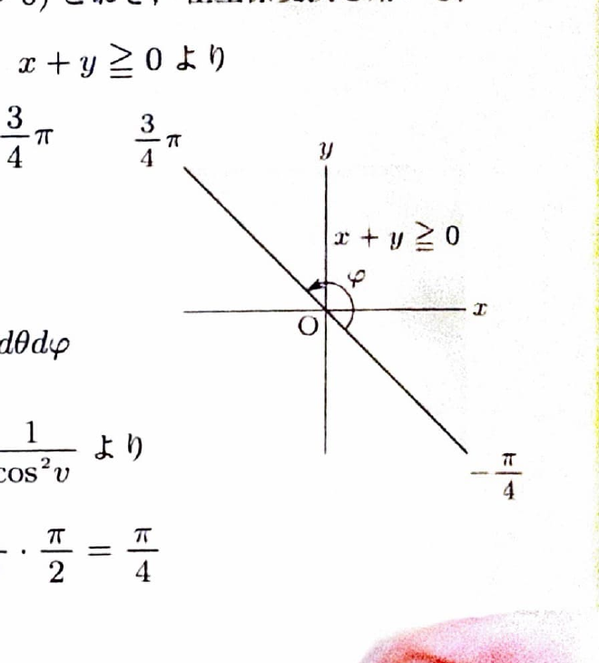

変数変換
$$
x=\varphi(u,v),\qquad y=\psi(u,v)
$$
では、
$$
dxdy=
\left|
\frac{\partial(x,y)}{\partial(u,v)}
\right|dudv
$$
である。ヤコビアンは
$$
\frac{\partial(x,y)}{\partial(u,v)}
=
\begin{vmatrix}
x_u&x_v\\
y_u&y_v
\end{vmatrix}
$$
で計算し、積分ではその絶対値を用いる。

3次元極座標
$$
x=r\sin\theta\cos\varphi,\qquad
y=r\sin\theta\sin\varphi,\qquad
z=r\cos\theta
$$
では、
$$
dxdydz=r^2\sin\theta\,drd\theta d\varphi
$$
である。通常、
$$
0\le\theta\le\pi,\qquad0\le\varphi\le2\pi
$$
とする。

広義積分では、無限領域を有限領域で切り取り、その境界を極限で無限へ送る。

---
問題 115

次の広義積分の値を求めよ。

---
## (1)

$$
\iint_D
(x^2-y^2)^2e^{y-x}
\,dxdy
$$

ただし、
$$
D:\ -1\le x+y\le1,\qquad y-x\le1
$$
である。

---
## (1) 解答

> 領域と被積分関数に $x+y$ と $y-x$ が現れるため、$u=x+y,\ v=y-x$ と変換する。$v$ は下方に無限なので、$v\ge-a$ で切り取ってから $a\to\infty$ とする。

変数変換を、
$$
u=x+y,\qquad v=y-x
$$
とする。逆変換は、
$$
x=\frac12(u-v),\qquad
y=\frac12(u+v)
$$
である。

ヤコビアンは、
$$
\frac{\partial(x,y)}{\partial(u,v)}
=
\begin{vmatrix}
\frac12&-\frac12\\
\frac12&\frac12
\end{vmatrix}
=
\frac12
$$
なので、
$$
dxdy=\frac12dudv
$$
である。

また、
$$
x^2-y^2=(x-y)(x+y)=(-v)u=-uv
$$
より、
$$
(x^2-y^2)^2=u^2v^2
$$
であり、
$$
e^{y-x}=e^v
$$
である。

$a>0$ として、切り取った領域を、
$$
D_a:
-1\le u\le1,\qquad
-a\le v\le1
$$
とする。すると、
$$
\iint_{D_a}
(x^2-y^2)^2e^{y-x}
\,dxdy
=
\frac12
\int_{-a}^1
\int_{-1}^1
u^2v^2e^v\,dudv
$$

$u$ の積分は、
$$
\int_{-1}^1u^2\,du
=
\left[\frac13u^3\right]_{-1}^1
=
\frac23
$$
なので、
$$
=
\frac13
\int_{-a}^1v^2e^v\,dv
$$

部分積分を2回行うと、
$$
\int v^2e^v\,dv
=
v^2e^v-2\int ve^v\,dv
$$
であり、
$$
\int ve^v\,dv=ve^v-e^v
$$
なので、
$$
\int v^2e^v\,dv
=
e^v(v^2-2v+2)
$$
である。

したがって、
$$
\iint_{D_a}
(x^2-y^2)^2e^{y-x}
\,dxdy
=
\frac13
\left[
e^v(v^2-2v+2)
\right]_{-a}^1
$$
$$
=
\frac e3
-
\frac13(a^2+2a+2)e^{-a}
$$

ここで、
$$
\lim_{a\to\infty}
(a^2+2a+2)e^{-a}=0
$$
である。したがって、
$$
\boxed{
\iint_D
(x^2-y^2)^2e^{y-x}
\,dxdy
=
\frac e3
}
$$

---
## (2)

$$
\iint_{x\ge0,\ y\ge0}
e^{-x^2-xy-y^2}
\,dxdy
$$
を求めよ。

---
## (2) 解答

> 指数の二次形式 $x^2+xy+y^2$ を平方完成して円に移す線形変換を用いる。第1象限の条件は変換後の角度範囲になる。通常の直交座標で片方を積分すると誤差関数が現れるため、この変換が有効である。

平方完成すると、
$$
x^2+xy+y^2
=
\left(x+\frac12y\right)^2
+
\left(\frac{\sqrt3}{2}y\right)^2
$$
である。

変数変換を、
$$
x+\frac12y=r\cos\theta,
\qquad
\frac{\sqrt3}{2}y=r\sin\theta
$$
とする。逆変換は、
$$
x=r\cos\theta-\frac1{\sqrt3}r\sin\theta,
$$
$$
y=\frac2{\sqrt3}r\sin\theta
$$
である。

ヤコビアンは、
$$
dxdy=\frac2{\sqrt3}r\,drd\theta
$$
である。

条件 $y\ge0$ より、
$$
\sin\theta\ge0
$$
である。条件 $x\ge0$ より、
$$
\cos\theta-\frac1{\sqrt3}\sin\theta\ge0
$$
すなわち、
$$
0\le\theta\le\frac{\pi}{3}
$$
である。

半径を $0\le r\le R$ で切り取り、最後に $R\to\infty$ とする。すると、
$$
\iint_{D_R}
e^{-x^2-xy-y^2}
\,dxdy
$$
$$
=
\int_0^{\pi/3}
\int_0^R
e^{-r^2}
\frac2{\sqrt3}r\,drd\theta
$$

$r$ の積分で、置換前の文字式を、
$$
t=r^2
$$
とすると、
$$
dt=2r\,dr
$$
である。したがって、
$$
\int_0^Re^{-r^2}r\,dr
=
\frac12\int_0^{R^2}e^{-t}\,dt
=
\frac12(1-e^{-R^2})
$$

よって、
$$
\iint_{D_R}
e^{-x^2-xy-y^2}
\,dxdy
=
\frac2{\sqrt3}
\cdot\frac{\pi}{3}
\cdot\frac12(1-e^{-R^2})
$$

$R\to\infty$ とすると、
$$
e^{-R^2}\to0
$$
なので、
$$
\boxed{
\iint_{x\ge0,\ y\ge0}
e^{-x^2-xy-y^2}
\,dxdy
=
\frac{\pi}{3\sqrt3}
}
$$

---
## (3)

$$
\iiint_V
\frac{dxdydz}{(x^2+y^2+z^2+1)^2}
$$

ただし、
$$
V:\ x+y\ge0
$$
である。

---
## (3) 解答

> 被積分関数は原点からの距離だけに依存し、領域は原点を通る平面で全空間を二等分した半空間である。そのため3次元極座標を用いる。対称性だけで全空間積分の半分とする方法もあるが、資料に沿って角度範囲を明示する。

3次元極座標では、
$$
x+y
=
r\sin\theta(\cos\varphi+\sin\varphi)
$$
である。

条件
$$
x+y\ge0
$$
は、
$$
\cos\varphi+\sin\varphi\ge0
$$
を表す。これは、
$$
-\frac{\pi}{4}\le\varphi\le\frac{3\pi}{4}
$$
であり、角度幅は $\pi$ である。

半径を $0\le r\le R$ で切り取ると、
$$
0\le\theta\le\pi
$$
なので、
$$
\iiint_{V_R}
\frac{dxdydz}{(x^2+y^2+z^2+1)^2}
$$
$$
=
\int_{-\pi/4}^{3\pi/4}
\int_0^\pi
\int_0^R
\frac{r^2\sin\theta}{(r^2+1)^2}
\,drd\theta d\varphi
$$

変数ごとに分離すると、
$$
=
\left(
\int_0^R\frac{r^2}{(r^2+1)^2}\,dr
\right)
\left(
\int_0^\pi\sin\theta\,d\theta
\right)
\left(
\int_{-\pi/4}^{3\pi/4}d\varphi
\right)
$$

角度積分は、
$$
\int_0^\pi\sin\theta\,d\theta=2
$$
および、
$$
\int_{-\pi/4}^{3\pi/4}d\varphi=\pi
$$
である。

半径積分では、置換前の文字式を、
$$
r=\tan v
$$
とする。すると、
$$
dr=\frac1{\cos^2v}\,dv,
\qquad
r^2+1=\frac1{\cos^2v}
$$
である。よって、
$$
\frac{r^2}{(r^2+1)^2}dr
=
\tan^2v\cos^4v\frac1{\cos^2v}dv
=
\sin^2v\,dv
$$

$R\to\infty$ のとき、$v\to\pi/2$ なので、
$$
\int_0^\infty
\frac{r^2}{(r^2+1)^2}\,dr
=
\int_0^{\pi/2}\sin^2v\,dv
=
\frac{\pi}{4}
$$

したがって、
$$
\iiint_V
\frac{dxdydz}{(x^2+y^2+z^2+1)^2}
=
\frac{\pi}{4}\cdot2\cdot\pi
=
\boxed{\frac{\pi^2}{2}}
$$
