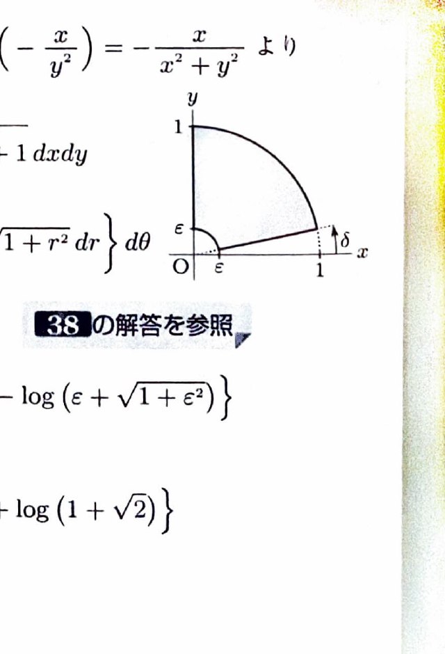

曲面 $z=f(x,y)$ の領域 $D$ に対応する部分の面積は
$$
S=
\iint_D
\sqrt{
1+\left(\frac{\partial z}{\partial x}\right)^2
+\left(\frac{\partial z}{\partial y}\right)^2
}
\,dxdy
$$
で求める。

極座標変換
$$
x=r\cos\theta,\qquad y=r\sin\theta
$$
を用いると、
$$
x^2+y^2=r^2,\qquad dxdy=r\,drd\theta
$$
である。面積要素にヤコビアンの因子 $r$ が付くことに注意する。

---
問題 116

曲面
$$
f(x,y)=\tan^{-1}\frac{x}{y}
$$
の領域
$$
D=\{(x,y)\mid x\ge0,\ y\ge0,\ x^2+y^2\le1\}
$$
に対応する部分の面積を求めよ。

---
## 解答

> 曲面積公式を用いる。関数は $y=0$ 上で定義できないため、原点付近と $y=0$ 付近を一度除外し、極限を取る。偏微分後の式が $x^2+y^2$ だけに依存するので極座標変換が適切である。

まず偏微分を文字のまま求める。$u=x/y$ とおくと、
$$
f(x,y)=\tan^{-1}u
$$
であり、
$$
\frac{d}{du}\tan^{-1}u=\frac1{1+u^2}
$$
である。

したがって、
$$
f_x
=
\frac1{1+(x/y)^2}\cdot\frac1y
=
\frac{y}{x^2+y^2}
$$
である。

また、
$$
f_y
=
\frac1{1+(x/y)^2}\cdot\left(-\frac{x}{y^2}\right)
=
-\frac{x}{x^2+y^2}
$$
である。

よって、
$$
f_x^2+f_y^2
=
\frac{y^2+x^2}{(x^2+y^2)^2}
=
\frac1{x^2+y^2}
$$
である。

$\varepsilon>0,\ \delta>0$ として、極座標で切り取った領域を、
$$
D_{\delta,\varepsilon}:
\varepsilon\le r\le1,\qquad
\delta\le\theta\le\frac{\pi}{2}
$$
とする。

曲面積は、
$$
S_{\delta,\varepsilon}
=
\iint_{D_{\delta,\varepsilon}}
\sqrt{1+\frac1{x^2+y^2}}
\,dxdy
$$

極座標に変換すると、
$$
S_{\delta,\varepsilon}
=
\int_\delta^{\pi/2}
\int_\varepsilon^1
\sqrt{1+\frac1{r^2}}\cdot r
\,drd\theta
$$

$r>0$ なので、
$$
\sqrt{1+\frac1{r^2}}\cdot r
=
\sqrt{1+r^2}
$$
である。よって、
$$
S_{\delta,\varepsilon}
=
\int_\delta^{\pi/2}
\int_\varepsilon^1
\sqrt{1+r^2}\,drd\theta
$$

公式
$$
\int\sqrt{1+r^2}\,dr
=
\frac12
\left\{
r\sqrt{1+r^2}
+
\log\left(r+\sqrt{1+r^2}\right)
\right\}
$$
を用いると、
$$
S_{\delta,\varepsilon}
=
\frac12\left(\frac{\pi}{2}-\delta\right)
\Bigl[
r\sqrt{1+r^2}
+
\log\left(r+\sqrt{1+r^2}\right)
\Bigr]_\varepsilon^1
$$

上端 $r=1$ を代入すると、
$$
\sqrt2+\log(1+\sqrt2)
$$
である。

下端 $r=\varepsilon$ の項は、
$$
\varepsilon\sqrt{1+\varepsilon^2}
+
\log\left(\varepsilon+\sqrt{1+\varepsilon^2}\right)
$$
であり、$\varepsilon\to+0$ で0へ収束する。

したがって、$\delta\to+0,\ \varepsilon\to+0$ とすると、
$$
S
=
\frac12\cdot\frac{\pi}{2}
\left\{
\sqrt2+\log(1+\sqrt2)
\right\}
$$

よって、
$$
\boxed{
S=
\frac{\pi}{4}
\left\{
\sqrt2+\log(1+\sqrt2)
\right\}
}
$$
