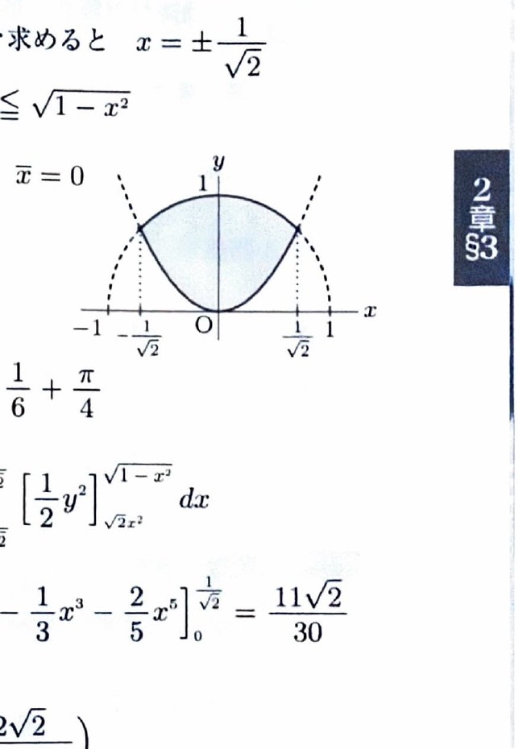

平面図形 $D$ の面積を
$$
S=\iint_D dxdy
$$
とすると、重心 $G(\bar x,\bar y)$ は
$$
\bar x=\frac1S\iint_D x\,dxdy,\qquad
\bar y=\frac1S\iint_D y\,dxdy
$$
である。立体の場合は体積で1次モーメントを割る。

3次元極座標
$$
x=r\sin\theta\cos\varphi,\qquad
y=r\sin\theta\sin\varphi,\qquad
z=r\cos\theta
$$
では、
$$
dxdydz=r^2\sin\theta\,drd\theta d\varphi
$$
である。通常、
$$
0\le\theta\le\pi,\qquad0\le\varphi\le2\pi
$$
とする。

---
問題 117

次の領域の重心を求めよ。

---
## (1)

$$
D=
\{(x,y)\mid x^2+y^2\le1,\ \sqrt2x^2\le y\}
$$

---
## (1) 解答

> 領域は $y$ 軸に関して対称なので、ただちに $\bar x=0$ と分かる。$\bar y$ は面積と $y$ の1次モーメントを累次積分で求める。極座標も使えるが、上端が円、下端が放物線なので直交座標が分かりやすい。

円と放物線の交点では、
$$
x^2+y^2=1
$$
および、
$$
y=\sqrt2x^2
$$
が成り立つ。

放物線を代入すると、
$$
x^2+2x^4=1
$$
である。$X=x^2$ とおくと、
$$
2X^2+X-1=0
$$
なので、
$$
(2X-1)(X+1)=0
$$
である。$X\ge0$ より、
$$
X=\frac12
$$
したがって、
$$
x=\pm\frac1{\sqrt2}
$$
である。

よって領域は、
$$
-\frac1{\sqrt2}\le x\le\frac1{\sqrt2},
\qquad
\sqrt2x^2\le y\le\sqrt{1-x^2}
$$
と表せる。

$y$ 軸対称なので、
$$
\boxed{\bar x=0}
$$
である。

面積 $S$ は、
$$
S
=
\int_{-1/\sqrt2}^{1/\sqrt2}
\left(
\sqrt{1-x^2}-\sqrt2x^2
\right)dx
$$

被積分関数は偶関数なので、
$$
S
=
2
\int_0^{1/\sqrt2}
\left(
\sqrt{1-x^2}-\sqrt2x^2
\right)dx
$$

公式
$$
\int\sqrt{1-x^2}\,dx
=
\frac12
\left(
x\sqrt{1-x^2}+\sin^{-1}x
\right)
$$
を用いると、
$$
S
=
2
\left[
\frac12
\left(
x\sqrt{1-x^2}+\sin^{-1}x
\right)
-
\frac{\sqrt2}{3}x^3
\right]_0^{1/\sqrt2}
$$

値を代入すると、
$$
x\sqrt{1-x^2}
=
\frac1{\sqrt2}\cdot\frac1{\sqrt2}
=
\frac12
$$
および、
$$
\sin^{-1}\frac1{\sqrt2}
=
\frac{\pi}{4}
$$
である。また、
$$
\frac{\sqrt2}{3}
\left(\frac1{\sqrt2}\right)^3
=
\frac16
$$
である。

したがって、
$$
S
=
2\left(
\frac14+\frac{\pi}{8}-\frac16
\right)
=
\frac16+\frac{\pi}{4}
$$

次に、$x$ 軸まわりの1次モーメントは、
$$
M_x
=
\iint_Dy\,dxdy
$$
である。累次積分にすると、
$$
M_x
=
\int_{-1/\sqrt2}^{1/\sqrt2}
\left\{
\int_{\sqrt2x^2}^{\sqrt{1-x^2}}
y\,dy
\right\}dx
$$

内側の積分は、
$$
\int y\,dy=\frac12y^2
$$
なので、
$$
M_x
=
\frac12
\int_{-1/\sqrt2}^{1/\sqrt2}
\left(
1-x^2-2x^4
\right)dx
$$

被積分関数は偶関数なので、
$$
M_x
=
\int_0^{1/\sqrt2}
\left(
1-x^2-2x^4
\right)dx
$$
$$
=
\left[
x-\frac13x^3-\frac25x^5
\right]_0^{1/\sqrt2}
$$

各項へ値を代入すると、
$$
M_x
=
\frac1{\sqrt2}
-
\frac1{3\cdot2\sqrt2}
-
\frac2{5\cdot4\sqrt2}
$$
$$
=
\frac1{\sqrt2}
\left(
1-\frac16-\frac1{10}
\right)
=
\frac1{\sqrt2}\cdot\frac{11}{15}
=
\frac{11\sqrt2}{30}
$$

したがって、
$$
\bar y
=
\frac{M_x}{S}
=
\frac{11\sqrt2/30}{1/6+\pi/4}
$$

分母を通分すると、
$$
\frac16+\frac{\pi}{4}
=
\frac{2+3\pi}{12}
$$
なので、
$$
\bar y
=
\frac{11\sqrt2}{30}
\cdot
\frac{12}{2+3\pi}
=
\frac{22\sqrt2}{5(2+3\pi)}
$$
$$
=
\frac{22\sqrt2}{10+15\pi}
$$

よって重心は、
$$
\boxed{
\left(
0,\frac{22\sqrt2}{10+15\pi}
\right)
}
$$

---
## (2)

$$
V=
\{(x,y,z)\mid x^2+y^2+z^2\le a^2,\ z\ge0\}
$$

---
## (2) 解答

> 半球は $yz$ 平面と $zx$ 平面に関して対称なので、$\bar x=\bar y=0$ である。$\bar z$ は $z$ の1次モーメントを体積で割って求める。領域が半球なので3次元極座標を用いる。

対称性より、
$$
\boxed{\bar x=0,\qquad\bar y=0}
$$
である。

半径 $a$ の球の体積は、
$$
\frac43\pi a^3
$$
なので、半球の体積は、
$$
V_0=\frac12\cdot\frac43\pi a^3
=
\frac23\pi a^3
$$
である。

$z$ の1次モーメントは、
$$
M_{xy}
=
\iiint_Vz\,dxdydz
$$
である。

上半球では、
$$
0\le r\le a,\qquad
0\le\theta\le\frac{\pi}{2},\qquad
0\le\varphi\le2\pi
$$
である。

また、
$$
z=r\cos\theta
$$
なので、
$$
M_{xy}
=
\int_0^{2\pi}
\int_0^{\pi/2}
\int_0^a
r\cos\theta\cdot r^2\sin\theta
\,drd\theta d\varphi
$$

変数ごとに分離すると、
$$
M_{xy}
=
\left(\int_0^ar^3\,dr\right)
\left(\int_0^{\pi/2}\sin\theta\cos\theta\,d\theta\right)
\left(\int_0^{2\pi}d\varphi\right)
$$

それぞれ、
$$
\int_0^ar^3\,dr
=
\frac14a^4
$$
であり、
$$
\int_0^{\pi/2}\sin\theta\cos\theta\,d\theta
=
\left[\frac12\sin^2\theta\right]_0^{\pi/2}
=
\frac12
$$
であり、
$$
\int_0^{2\pi}d\varphi=2\pi
$$
である。

したがって、
$$
M_{xy}
=
\frac14a^4\cdot\frac12\cdot2\pi
=
\frac{\pi}{4}a^4
$$

よって、
$$
\bar z
=
\frac{M_{xy}}{V_0}
=
\frac{\pi a^4/4}{(2/3)\pi a^3}
=
\frac38a
$$

したがって重心は、
$$
\boxed{
\left(0,0,\frac38a\right)
}
$$
