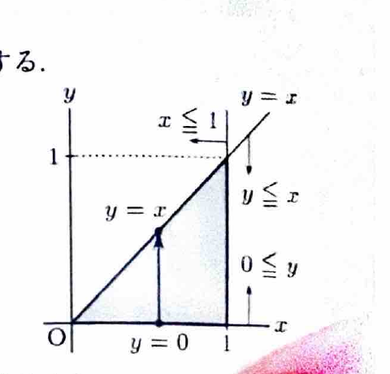
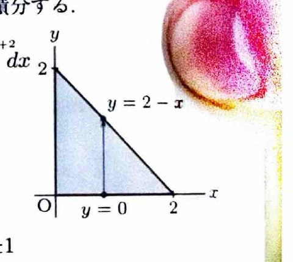
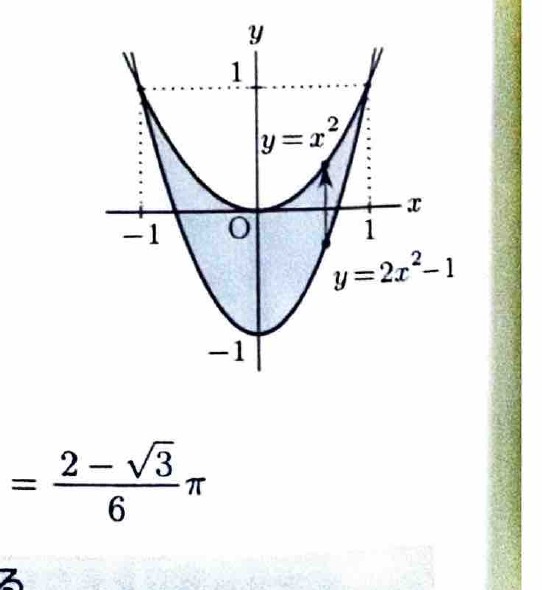

累次積分では、領域を
$$
D=\{(x,y)\mid a\le x\le b,\ \varphi_1(x)\le y\le\varphi_2(x)\}
$$
と表せるとき、
$$
\iint_D f(x,y)\,dxdy
=
\int_a^b\left\{\int_{\varphi_1(x)}^{\varphi_2(x)}f(x,y)\,dy\right\}dx
$$
と計算できる。積分順序を逆にする場合は、同じ領域を
$$
D=\{(x,y)\mid c\le y\le d,\ \psi_1(y)\le x\le\psi_2(y)\}
$$
と表し直す。

---
問題 98

$D$ を括弧内の不等式の表す領域とするとき、次の2重積分の値を求めよ。

---
## (1)

$$
\iint_D(x+y)^2\,dxdy
$$

ただし、
$$
0\le y\le x\le1
$$
である。

---
## (1) 解答

> 領域がそのまま $0\le x\le1,\ 0\le y\le x$ と表されており、被積分関数も $y$ について容易に積分できるため、$y$ から先に積分する。積分順序を逆にしても解けるが、範囲を書き直す必要がない今回の順序が簡単である。

領域は、
$$
0\le x\le1,\qquad0\le y\le x
$$
である。

したがって、
$$
\iint_D(x+y)^2\,dxdy
=
\int_0^1\left\{\int_0^x(x+y)^2\,dy\right\}dx
$$

まず文字のまま積分すると、
$$
\int(x+y)^2\,dy
=
\frac13(x+y)^3
$$

境界を代入して、
$$
\int_0^x(x+y)^2\,dy
=
\left[\frac13(x+y)^3\right]_0^x
=
\frac13\{(2x)^3-x^3\}
=
\frac73x^3
$$

したがって、
$$
\iint_D(x+y)^2\,dxdy
=
\int_0^1\frac73x^3\,dx
=
\frac73\left[\frac14x^4\right]_0^1
=
\boxed{\frac7{12}}
$$

---
## (2)

$$
\iint_D(x^2+y^2)\,dxdy
$$

ただし、
$$
x\ge0,\qquad y\ge0,\qquad x+y\le2
$$
である。

---
## (2) 解答

> 領域は第1象限の三角形で、$x$ を固定すると $0\le y\le2-x$ と一続きになる。したがって $y$ から先に積分する。対称性を利用して $\iint_Dx^2\,dxdy=\iint_Dy^2\,dxdy$ として計算を半分にする方法もある。

領域は、
$$
0\le x\le2,\qquad0\le y\le2-x
$$
である。

よって、
$$
\iint_D(x^2+y^2)\,dxdy
=
\int_0^2\left\{\int_0^{2-x}(x^2+y^2)\,dy\right\}dx
$$

まず文字のまま積分すると、
$$
\int(x^2+y^2)\,dy
=
x^2y+\frac13y^3
$$

境界を代入して、
$$
\int_0^{2-x}(x^2+y^2)\,dy
=
x^2(2-x)+\frac13(2-x)^3
$$

展開すると、
$$
x^2(2-x)=2x^2-x^3
$$
および
$$
\frac13(2-x)^3
=
\frac13(8-12x+6x^2-x^3)
$$
なので、
$$
x^2(2-x)+\frac13(2-x)^3
=
\frac83-4x+4x^2-\frac43x^3
$$

したがって、
$$
\iint_D(x^2+y^2)\,dxdy
=
\int_0^2
\left(
\frac83-4x+4x^2-\frac43x^3
\right)dx
$$

積分して、
$$
=
\left[
\frac83x-2x^2+\frac43x^3-\frac13x^4
\right]_0^2
$$
$$
=
\frac{16}{3}-8+\frac{32}{3}-\frac{16}{3}
=
\boxed{\frac83}
$$

---
## (3)

$$
\iint_D\frac{dxdy}{\sqrt{(x^2-2y+4)^3}}
$$

ただし、
$$
2x^2-1\le y\le x^2
$$
である。

---
## (3) 解答

> $y$ の上下限が2つの放物線で与えられているため、まず交点から $x$ の範囲を求め、$y$ から積分する。被積分関数は $x^2-2y+4$ のべきなので、$y$ に関する積分が直接できる。順序を逆にすると領域を分割する必要がある。

交点は、
$$
x^2=2x^2-1
$$
より、
$$
x^2=1
$$
したがって、
$$
x=\pm1
$$
である。

よって領域は、
$$
-1\le x\le1,\qquad2x^2-1\le y\le x^2
$$
である。

したがって、
$$
\iint_D\frac{dxdy}{\sqrt{(x^2-2y+4)^3}}
=
\int_{-1}^1
\left\{
\int_{2x^2-1}^{x^2}
(x^2-2y+4)^{-3/2}\,dy
\right\}dx
$$

まず不定積分を求める。文字の置換
$$
u=x^2-2y+4
$$
とおくと、
$$
du=-2\,dy
$$
なので、
$$
dy=-\frac12du
$$
である。よって、
$$
\int u^{-3/2}\left(-\frac12\right)du
=
u^{-1/2}
$$
となる。したがって、
$$
\int(x^2-2y+4)^{-3/2}\,dy
=
(x^2-2y+4)^{-1/2}
$$

境界を代入すると、
$$
\int_{2x^2-1}^{x^2}
(x^2-2y+4)^{-3/2}\,dy
=
\left[
\frac1{\sqrt{x^2-2y+4}}
\right]_{2x^2-1}^{x^2}
$$
$$
=
\frac1{\sqrt{4-x^2}}
-
\frac1{\sqrt{6-3x^2}}
$$
$$
=
\frac1{\sqrt{4-x^2}}
-
\frac1{\sqrt3\sqrt{2-x^2}}
$$

したがって、
$$
\iint_D\frac{dxdy}{\sqrt{(x^2-2y+4)^3}}
=
\int_{-1}^1
\left(
\frac1{\sqrt{4-x^2}}
-
\frac1{\sqrt3\sqrt{2-x^2}}
\right)dx
$$

公式
$$
\int\frac{dx}{\sqrt{a^2-x^2}}
=
\sin^{-1}\frac{x}{a}
$$
を用いると、
$$
=
\left[
\sin^{-1}\frac{x}{2}
-
\frac1{\sqrt3}\sin^{-1}\frac{x}{\sqrt2}
\right]_{-1}^1
$$

それぞれ、
$$
\sin^{-1}\frac12=\frac{\pi}{6},\qquad
\sin^{-1}\frac1{\sqrt2}=\frac{\pi}{4}
$$
であるため、
$$
=
2\cdot\frac{\pi}{6}
-
\frac2{\sqrt3}\cdot\frac{\pi}{4}
=
\frac{\pi}{3}-\frac{\pi}{2\sqrt3}
$$
$$
=
\boxed{\frac{2-\sqrt3}{6}\pi}
$$
