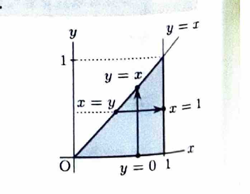
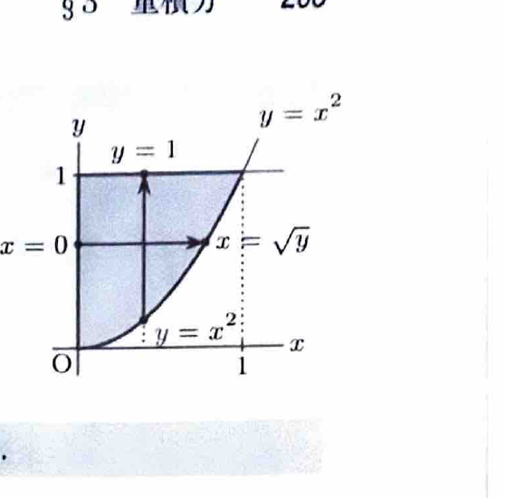

累次積分では、領域を
$$
D=\{(x,y)\mid a\le x\le b,\ \varphi_1(x)\le y\le\varphi_2(x)\}
$$
と表せるとき、
$$
\iint_D f(x,y)\,dxdy
=
\int_a^b\left\{\int_{\varphi_1(x)}^{\varphi_2(x)}f(x,y)\,dy\right\}dx
$$
と計算できる。積分順序を逆にする場合は、同じ領域を
$$
D=\{(x,y)\mid c\le y\le d,\ \psi_1(y)\le x\le\psi_2(y)\}
$$
と表し直す。

---
問題 99

$D$ を括弧内の不等式の表す領域とするとき、次の2重積分の値を求めよ。

---
## (1)

$$
\iint_Dy^2e^{x^4}\,dxdy
$$

ただし、
$$
y\le x\le1,\qquad0\le y\le1
$$
である。

---
## (1) 解答

> 与えられた順序のまま $x$ から積分すると $\int e^{x^4}\,dx$ が現れ、初等関数では積分できない。領域を $0\le x\le1,\ 0\le y\le x$ と書き直し、$y$ から先に積分する。

条件から、
$$
0\le x\le1,\qquad0\le y\le x
$$
である。

したがって、
$$
\iint_Dy^2e^{x^4}\,dxdy
=
\int_0^1
\left\{
\int_0^xy^2\,dy
\right\}
e^{x^4}dx
$$

内側の積分は、
$$
\int y^2\,dy=\frac13y^3
$$
なので、
$$
\int_0^xy^2\,dy
=
\left[\frac13y^3\right]_0^x
=
\frac13x^3
$$

よって、
$$
\iint_Dy^2e^{x^4}\,dxdy
=
\frac13\int_0^1x^3e^{x^4}\,dx
$$

置換前の文字式を
$$
t=x^4
$$
とする。微分すると、
$$
dt=4x^3\,dx
$$
なので、
$$
x^3\,dx=\frac14dt
$$
である。

したがって、
$$
\frac13\int_0^1x^3e^{x^4}\,dx
=
\frac1{12}\int_0^1e^t\,dt
=
\frac1{12}[e^t]_0^1
=
\boxed{\frac{e-1}{12}}
$$

---
## (2)

$$
\iint_D\frac{2x}{1+y^4}\,dxdy
$$

ただし、
$$
0\le x\le1,\qquad x^2\le y\le1
$$
である。

---
## (2) 解答

> 与えられた順序のまま $y$ から積分すると $\int(1+y^4)^{-1}dy$ が現れ、計算が複雑になる。そこで領域を $0\le y\le1,\ 0\le x\le\sqrt y$ と書き直し、$x$ から先に積分する。

条件 $x^2\le y$ は、$x\ge0$ より
$$
x\le\sqrt y
$$
と同値である。よって、
$$
0\le y\le1,\qquad0\le x\le\sqrt y
$$
である。

したがって、
$$
\iint_D\frac{2x}{1+y^4}\,dxdy
=
\int_0^1
\left\{
\int_0^{\sqrt y}2x\,dx
\right\}
\frac1{1+y^4}\,dy
$$

まず、
$$
\int2x\,dx=x^2
$$
なので、
$$
\int_0^{\sqrt y}2x\,dx
=
[x^2]_0^{\sqrt y}
=
y
$$

よって、
$$
\iint_D\frac{2x}{1+y^4}\,dxdy
=
\int_0^1\frac{y}{1+y^4}\,dy
$$

置換前の文字式を
$$
t=y^2
$$
とする。微分すると、
$$
dt=2y\,dy
$$
なので、
$$
y\,dy=\frac12dt
$$
である。また $y^4=t^2$ である。

したがって、
$$
\int_0^1\frac{y}{1+y^4}\,dy
=
\frac12\int_0^1\frac{dt}{1+t^2}
=
\frac12[\tan^{-1}t]_0^1
=
\boxed{\frac{\pi}{8}}
$$
