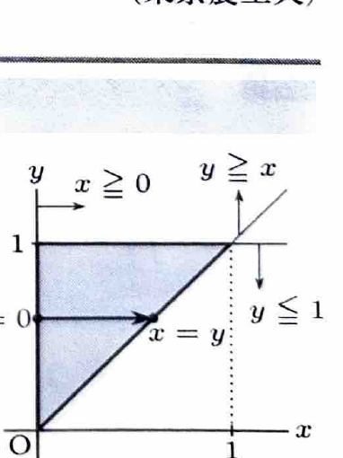
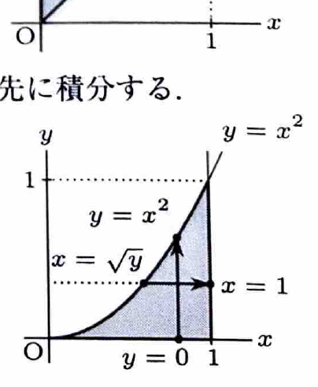

累次積分では、領域を
$$
D=\{(x,y)\mid a\le x\le b,\ \varphi_1(x)\le y\le\varphi_2(x)\}
$$
と表せるとき、
$$
\iint_D f(x,y)\,dxdy
=
\int_a^b\left\{\int_{\varphi_1(x)}^{\varphi_2(x)}f(x,y)\,dy\right\}dx
$$
と計算できる。積分順序を逆にする場合は、同じ領域を
$$
D=\{(x,y)\mid c\le y\le d,\ \psi_1(y)\le x\le\psi_2(y)\}
$$
と表し直す。

---
例題 27

$D$ を括弧内の不等式の表す領域とするとき、次の2重積分の値を求めよ。

---
## (1)

$$
\iint_D xy^2\,dxdy
$$

ただし、
$$
x\ge0,\qquad y\le1,\qquad y\ge x
$$
である。

---
## (1) 解答

> 被積分関数 $xy^2$ は $x$ について積分しやすく、領域も $y$ を固定すると $0\le x\le y$ と一続きに表せる。そのため、$x$ から先に積分する。逆順にして $0\le x\le1,\ x\le y\le1$ としてもよいが、今回は内側の積分がより単純になる順序を選ぶ。

不等式を整理すると、
$$
0\le y\le1,\qquad0\le x\le y
$$
である。

したがって、
$$
\iint_Dxy^2\,dxdy
=
\int_0^1\left\{\int_0^yxy^2\,dx\right\}dy
$$

> 内側では $y$ を定数として扱う。

まず文字のまま積分すると、
$$
\int xy^2\,dx
=
\frac12x^2y^2
$$

境界 $x=0,\ y$ を代入して、
$$
\int_0^yxy^2\,dx
=
\left[\frac12x^2y^2\right]_0^y
=
\frac12y^4
$$

よって、
$$
\iint_Dxy^2\,dxdy
=
\int_0^1\frac12y^4\,dy
=
\left[\frac1{10}y^5\right]_0^1
=
\boxed{\frac1{10}}
$$

---
## (2)

$$
\iint_D e^{x^3}\,dxdy
$$

ただし、
$$
\sqrt y\le x\le1,\qquad0\le y\le1
$$
である。

---
## (2) 解答

> 与えられた順序のまま $x$ から先に積分すると $\int e^{x^3}\,dx$ が現れ、初等関数では積分できない。そこで領域を描き直し、$y$ から先に積分する。積分順序の変更がこの問題の要点である。

条件 $\sqrt y\le x$ は、両辺が非負なので
$$
y\le x^2
$$
と同値である。したがって、
$$
0\le x\le1,\qquad0\le y\le x^2
$$
と表せる。

よって、
$$
\iint_De^{x^3}\,dxdy
=
\int_0^1\left\{\int_0^{x^2}e^{x^3}\,dy\right\}dx
$$

> 内側では $x$ が定数なので、$e^{x^3}$ は定数として積分する。

まず文字のまま積分すると、
$$
\int e^{x^3}\,dy
=
ye^{x^3}
$$

境界 $y=0,\ x^2$ を代入して、
$$
\int_0^{x^2}e^{x^3}\,dy
=
\left[ye^{x^3}\right]_0^{x^2}
=
x^2e^{x^3}
$$

したがって、
$$
\iint_De^{x^3}\,dxdy
=
\int_0^1x^2e^{x^3}\,dx
$$

ここで置換前の文字式
$$
t=x^3
$$
を用いる。微分すると、
$$
dt=3x^2\,dx
$$
なので、
$$
x^2\,dx=\frac13dt
$$
である。また、$x=0$ のとき $t=0$、$x=1$ のとき $t=1$ である。

よって、
$$
\int_0^1x^2e^{x^3}\,dx
=
\frac13\int_0^1e^t\,dt
=
\frac13\left[e^t\right]_0^1
=
\boxed{\frac{e-1}{3}}
$$
