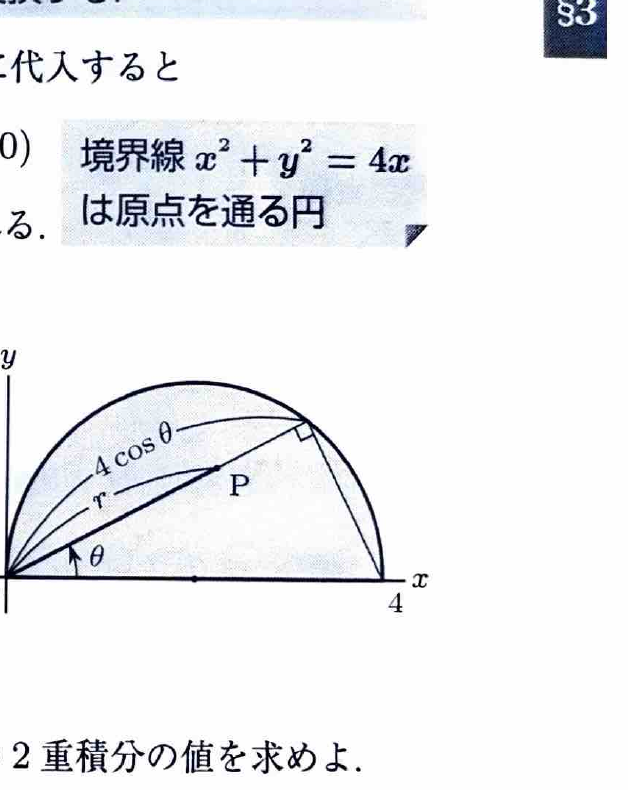

極座標変換
$$
x=r\cos\theta,\qquad y=r\sin\theta
$$
を用いると、
$$
x^2+y^2=r^2,\qquad dxdy=r\,drd\theta
$$
である。面積要素にヤコビアンの因子 $r$ が付くことに注意する。

---
例題 29

領域
$$
D:\ x^2+y^2\le4x,\qquad y\ge0
$$
において、
$$
\iint_D\frac{y}{x}\,dxdy
$$
を求めよ。

---
## 解答

> 境界 $x^2+y^2=4x$ は原点を通る円であり、分子・分母の比 $y/x$ も極座標で $\tan\theta$ になる。したがって極座標変換を選ぶ。直交座標で円を平方根表示する方法もあるが、積分領域と被積分関数の両方が複雑になる。

極座標を代入すると、
$$
r^2\le4r\cos\theta
$$
である。$r\ge0$ なので、
$$
0\le r\le4\cos\theta
$$
となる。また $y\ge0$ かつ $\cos\theta\ge0$ より、
$$
0\le\theta\le\frac{\pi}{2}
$$
である。

被積分関数は、
$$
\frac{y}{x}
=
\frac{r\sin\theta}{r\cos\theta}
=
\frac{\sin\theta}{\cos\theta}
$$
である。したがって、
$$
\iint_D\frac{y}{x}\,dxdy
=
\int_0^{\pi/2}
\left\{
\int_0^{4\cos\theta}
\frac{\sin\theta}{\cos\theta}r\,dr
\right\}d\theta
$$

まず文字のまま $r$ で積分すると、
$$
\int r\,dr=\frac12r^2
$$
である。境界を代入して、
$$
\int_0^{4\cos\theta}
\frac{\sin\theta}{\cos\theta}r\,dr
=
\frac{\sin\theta}{\cos\theta}
\left[\frac12r^2\right]_0^{4\cos\theta}
=
8\sin\theta\cos\theta
$$

よって、
$$
\iint_D\frac{y}{x}\,dxdy
=
8\int_0^{\pi/2}\sin\theta\cos\theta\,d\theta
$$

ここで、
$$
\int\sin\theta\cos\theta\,d\theta
=
\frac12\sin^2\theta
$$
なので、
$$
8\left[\frac12\sin^2\theta\right]_0^{\pi/2}
=
\boxed{4}
$$
