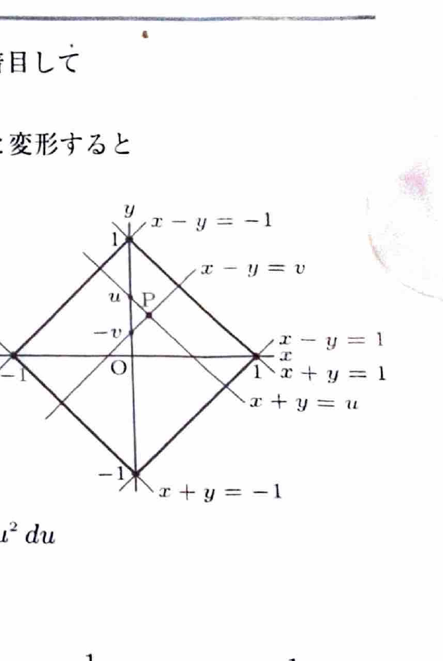

変数変換
$$
x=\varphi(u,v),\qquad y=\psi(u,v)
$$
では、
$$
dxdy=
\left|
\frac{\partial(x,y)}{\partial(u,v)}
\right|dudv
$$
である。ヤコビアンは
$$
\frac{\partial(x,y)}{\partial(u,v)}
=
\begin{vmatrix}
x_u&x_v\\
y_u&y_v
\end{vmatrix}
$$
で計算し、積分ではその絶対値を用いる。

---
例題 30

領域
$$
D:\ |x+y|\le1,\qquad|x-y|\le1
$$
において、
$$
\iint_D(x+y)^2e^{2(x-y)}\,dxdy
$$
を求めよ。

---
## 解答

> 領域の不等式と被積分関数に $x+y$ と $x-y$ が繰り返し現れるため、$u=x+y,\ v=x-y$ とおく。すると領域が長方形になり、被積分関数も積の形に分離できる。直交座標のまま領域を分割する方法もあるが、計算量が増える。

変数変換を
$$
u=x+y,\qquad v=x-y
$$
とする。連立方程式を解くと、
$$
x=\frac12(u+v),\qquad y=\frac12(u-v)
$$
である。

領域は、
$$
-1\le u\le1,\qquad-1\le v\le1
$$
となる。

ヤコビアンを文字式で書くと、
$$
\frac{\partial(x,y)}{\partial(u,v)}
=
\begin{vmatrix}
x_u&x_v\\
y_u&y_v
\end{vmatrix}
$$
である。各偏微分を代入すると、
$$
\frac{\partial(x,y)}{\partial(u,v)}
=
\begin{vmatrix}
\frac12&\frac12\\
\frac12&-\frac12
\end{vmatrix}
=
-\frac12
$$
したがって、
$$
dxdy=\frac12dudv
$$
である。

被積分関数は、
$$
(x+y)^2e^{2(x-y)}=u^2e^{2v}
$$
となるので、
$$
\iint_D(x+y)^2e^{2(x-y)}\,dxdy
=
\frac12\int_{-1}^1\int_{-1}^1u^2e^{2v}\,dvdu
$$

積に分離して、
$$
=
\frac12
\left(\int_{-1}^1u^2\,du\right)
\left(\int_{-1}^1e^{2v}\,dv\right)
$$

それぞれ、
$$
\int_{-1}^1u^2\,du
=
\left[\frac13u^3\right]_{-1}^1
=
\frac23
$$
および
$$
\int_{-1}^1e^{2v}\,dv
=
\left[\frac12e^{2v}\right]_{-1}^1
=
\frac12(e^2-e^{-2})
$$
である。

したがって、
$$
\boxed{\iint_D(x+y)^2e^{2(x-y)}\,dxdy
=
\frac16(e^2-e^{-2})}
$$

> $\sinh2=(e^2-e^{-2})/2$ を用いれば、答えは
> $$
> \boxed{\frac13\sinh2}
> $$
> とも表せる。
