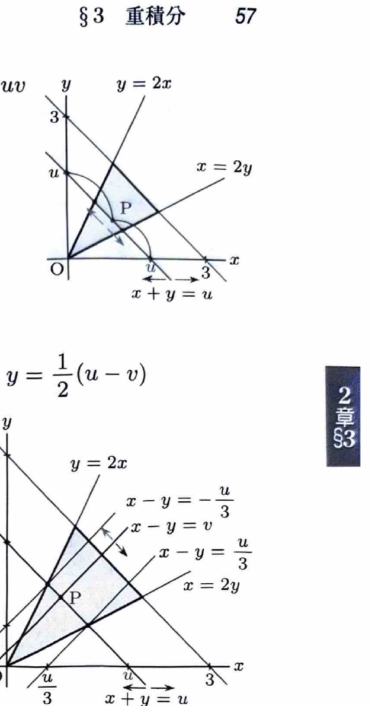

変数変換
$$
x=\varphi(u,v),\qquad y=\psi(u,v)
$$
では、
$$
dxdy=
\left|
\frac{\partial(x,y)}{\partial(u,v)}
\right|dudv
$$
である。ヤコビアンは
$$
\frac{\partial(x,y)}{\partial(u,v)}
=
\begin{vmatrix}
x_u&x_v\\
y_u&y_v
\end{vmatrix}
$$
で計算し、積分ではその絶対値を用いる。

三角形
$$
x+y\le a,\qquad x\ge0,\qquad y\ge0
$$
では、
$$
x=u(1-v),\qquad y=uv
$$
とおくと、
$$
0\le u\le a,\qquad0\le v\le1,\qquad
\left|\frac{\partial(x,y)}{\partial(u,v)}\right|=u
$$
となる。

> 3重積分で
> $$
> x+y+z\le a,\qquad x\ge0,\ y\ge0,\ z\ge0
> $$
> の場合は、
> $$
> x=u(1-v),\qquad
> y=uv(1-w),\qquad
> z=uvw
> $$
> と変換すると、
> $$
> 0\le u\le a,\qquad0\le v\le1,\qquad0\le w\le1
> $$
> となり、ヤコビアンは
> $$
> \left|
> \frac{\partial(x,y,z)}{\partial(u,v,w)}
> \right|
> =
> u^2v
> $$
> である。

---
例題 32

領域
$$
D:\ y\le2x,\qquad x\le2y,\qquad x+y\le3
$$
において、
$$
\iint_Dy\,dxdy
$$
を求めよ。

---
## 解答

> 3本の境界線のうち、$x+y=3$ と原点からの方向を表す2直線がある。そこで $u=x+y$ を「原点からの大きさ」、$v=y/(x+y)$ を「比率」とする変換を選ぶ。別解として $u=x+y,\ v=x-y$ を使う方法や、領域を2つに分割する方法もある。

変数変換を
$$
u=x+y,\qquad uv=y
$$
とする。これを解くと、
$$
x=u(1-v),\qquad y=uv
$$
である。

条件
$$
y\le2x
$$
に代入すると、
$$
uv\le2u(1-v)
$$
より、
$$
v\le\frac23
$$
である。

同様に、
$$
x\le2y
$$
へ代入すると、
$$
u(1-v)\le2uv
$$
より、
$$
v\ge\frac13
$$
である。

さらに、
$$
x+y\le3
$$
より、
$$
0\le u\le3
$$
となる。したがって、
$$
0\le u\le3,\qquad\frac13\le v\le\frac23
$$
である。

ヤコビアンは、
$$
\frac{\partial(x,y)}{\partial(u,v)}
=
\begin{vmatrix}
1-v&-u\\
v&u
\end{vmatrix}
=
u
$$
なので、
$$
dxdy=u\,dudv
$$
である。

よって、
$$
\iint_Dy\,dxdy
=
\int_0^3\int_{1/3}^{2/3}(uv)u\,dvdu
$$

内側の積分は、
$$
\int_{1/3}^{2/3}v\,dv
=
\left[\frac12v^2\right]_{1/3}^{2/3}
=
\frac16
$$
である。したがって、
$$
\iint_Dy\,dxdy
=
\frac16\int_0^3u^2\,du
=
\frac16\left[\frac13u^3\right]_0^3
=
\boxed{\frac32}
$$

> 別解では $u=x+y,\ v=x-y$ とすると、$x=(u+v)/2,\ y=(u-v)/2$、$|J|=1/2$、領域は $0\le u\le3,\ -u/3\le v\le u/3$ となり、同じ値を得る。
