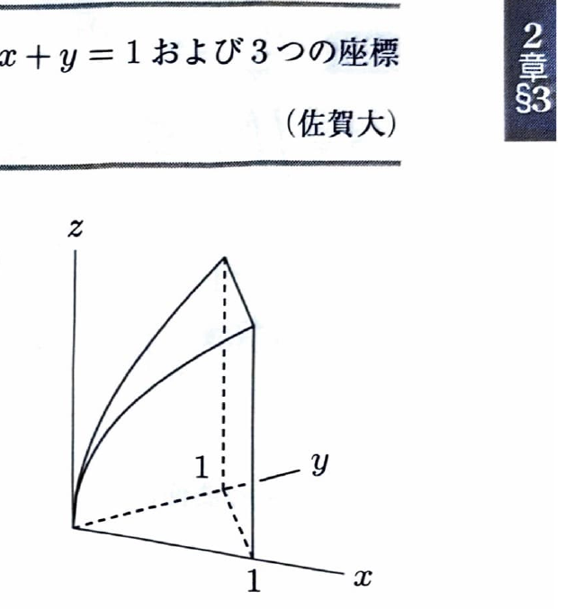

体積は、$xy$ 平面上の領域 $D$ の各点で「上面の高さ - 下面の高さ」を積分して、
$$
V=\iint_D\{z_{\mathrm{upper}}-z_{\mathrm{lower}}\}\,dxdy
$$
と求める。

---
例題 34

曲面
$$
z=\sqrt{x+y}
$$
と平面
$$
x+y=1
$$
および3つの座標平面で囲まれた立体の体積を求めよ。

---
## 解答

> 第1象限で $x+y\le1$ が底面となり、下面は $z=0$、上面は $z=\sqrt{x+y}$ である。したがって高さを直接2重積分する。変数変換 $u=x+y,\ v=y/(x+y)$ を使う方法もあるが、今回は累次積分だけで十分に計算できる。

底面領域は、
$$
D:\ x\ge0,\qquad y\ge0,\qquad x+y\le1
$$
である。$x$ を固定すると、
$$
0\le x\le1,\qquad0\le y\le1-x
$$
となる。

体積は、
$$
V
=
\int_0^1\left\{\int_0^{1-x}\sqrt{x+y}\,dy\right\}dx
$$

まず文字のまま積分すると、
$$
\int\sqrt{x+y}\,dy
=
\frac23(x+y)^{3/2}
$$
である。境界を代入して、
$$
\int_0^{1-x}\sqrt{x+y}\,dy
=
\left[\frac23(x+y)^{3/2}\right]_0^{1-x}
=
\frac23\left(1-x^{3/2}\right)
$$

したがって、
$$
V
=
\frac23\int_0^1\left(1-x^{3/2}\right)dx
$$
$$
=
\frac23
\left[
x-\frac25x^{5/2}
\right]_0^1
=
\frac23\left(1-\frac25\right)
=
\boxed{\frac25}
$$
