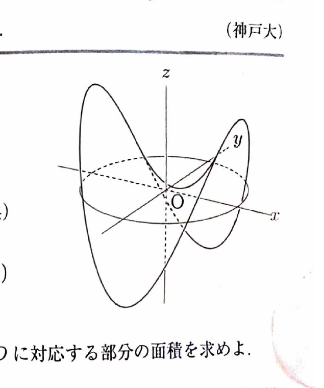

曲面 $z=f(x,y)$ の領域 $D$ に対応する部分の面積は
$$
S=
\iint_D
\sqrt{
1+\left(\frac{\partial z}{\partial x}\right)^2
+\left(\frac{\partial z}{\partial y}\right)^2
}
\,dxdy
$$
で求める。

極座標変換
$$
x=r\cos\theta,\qquad y=r\sin\theta
$$
を用いると、
$$
x^2+y^2=r^2,\qquad dxdy=r\,drd\theta
$$
である。面積要素にヤコビアンの因子 $r$ が付くことに注意する。

---
例題 35

$xy$ 平面上の閉領域を
$$
D=\{(x,y)\mid x^2+y^2\le1\}
$$
と定める。曲面
$$
z=x^2-y^2
$$
の $D$ に対応する部分の面積を求めよ。

---
## 解答

> 曲面が $z=f(x,y)$ の形なので曲面積公式を用いる。偏微分後の式が $x^2+y^2$ だけに依存し、領域も単位円なので、最後に極座標変換を使う。

まず、
$$
z=x^2-y^2
$$
より、
$$
z_x=2x,\qquad z_y=-2y
$$
である。

曲面積は、
$$
S
=
\iint_D\sqrt{1+(2x)^2+(-2y)^2}\,dxdy
$$
$$
=
\iint_D\sqrt{1+4x^2+4y^2}\,dxdy
$$

極座標変換を用いると、
$$
S
=
\int_0^{2\pi}\int_0^1\sqrt{1+4r^2}\,r\,drd\theta
$$

内側の積分では、置換前の文字式
$$
t=1+4r^2
$$
を用いる。微分すると、
$$
dt=8r\,dr
$$
なので、
$$
r\,dr=\frac18dt
$$
である。

したがって、
$$
\int r\sqrt{1+4r^2}\,dr
=
\frac18\int t^{1/2}\,dt
=
\frac1{12}(1+4r^2)^{3/2}
$$

境界を代入して、
$$
\int_0^1r\sqrt{1+4r^2}\,dr
=
\left[\frac1{12}(1+4r^2)^{3/2}\right]_0^1
=
\frac1{12}(5\sqrt5-1)
$$

よって、
$$
S
=
\int_0^{2\pi}\frac1{12}(5\sqrt5-1)\,d\theta
=
\boxed{\frac{\pi}{6}(5\sqrt5-1)}
$$
