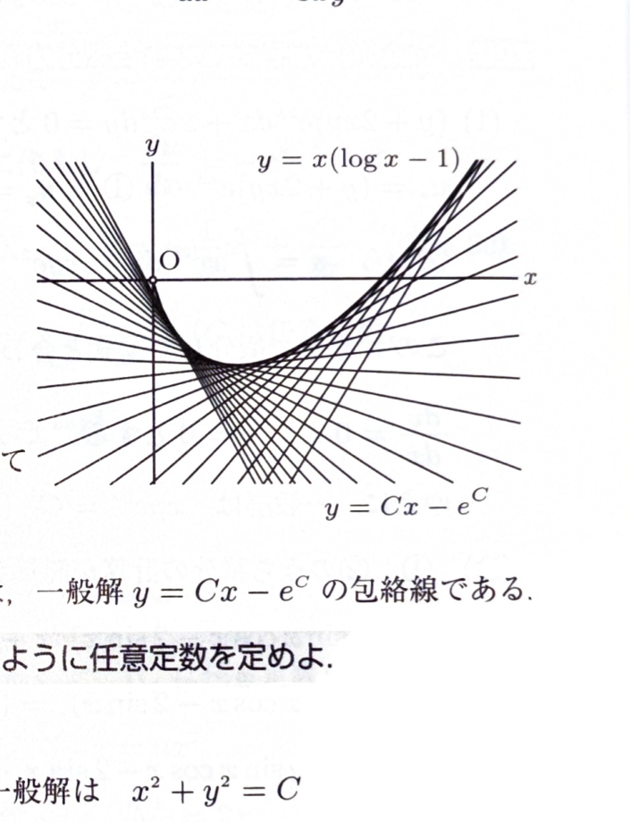

クレローの微分方程式は
$$
y=xp+f(p),\qquad p=\frac{dy}{dx}
$$
の形である。両辺を $x$ で微分すると、
$$
p=p+xp'+f'(p)p'
$$
より、
$$
p'\{x+f'(p)\}=0
$$
となる。

- $p'=0$ の場合は $p=C$ であり、一般解
$$
y=Cx+f(C)
$$
を得る。
- $x+f'(p)=0$ の場合は、$p$ を消去して特異解を得る。特異解は一般解の1パラメータ曲線族の包絡線になる。

---

問題 124

次の微分方程式を解け。
$$
y=xp-e^p,\qquad p=\frac{dy}{dx}
$$

---

解答

> この方程式は
> $$
> y=xp+f(p)
> $$
> において
> $$
> f(p)=-e^p
> $$
> としたクレロー形である。一般解だけなら $p=C$ を代入すればよいが、「解け」には特異解も含めて調べる必要がある。
>
> 両辺を $x$ で微分する。左辺は
> $$
> \frac{dy}{dx}=p
> $$
> である。右辺は、
> $$
> \frac{d}{dx}(xp)=p+xp'
> $$
> および
> $$
> \frac{d}{dx}(-e^p)=-e^pp'
> $$
> なので、
> $$
> p=p+xp'-e^pp'
> $$
> となる。両辺から $p$ を引くと、
> $$
> p'(x-e^p)=0
> $$
> である。
>
> まず、
> $$
> p'=0
> $$
> の場合を考える。このとき
> $$
> p=C
> $$
> である。代入前の式
> $$
> y=xp-e^p
> $$
> に $p=C$ を代入すると、
> $$
> y=Cx-e^C
> $$
> となる。これが一般解である。
>
> 次に、
> $$
> x-e^p=0
> $$
> の場合を考える。これは
> $$
> x=e^p
> $$
> であるから、$x>0$ であり、
> $$
> p=\log x
> $$
> となる。代入前の式
> $$
> y=xp-e^p
> $$
> に
> $$
> p=\log x,\qquad e^p=x
> $$
> を代入すると、
> $$
> y=x\log x-x=x(\log x-1)
> $$
> を得る。これが特異解である。
>
> 一般解族
> $$
> y=Cx-e^C
> $$
> を $C$ で微分すると、
> $$
> \frac{\partial y}{\partial C}=x-e^C
> $$
> である。包絡条件 $\partial y/\partial C=0$ は $x=e^C$ となり、上で得た特異解と一致する。

一般解は
$$
\boxed{y=Cx-e^C}
$$
であり、特異解は
$$
\boxed{y=x(\log x-1)}\qquad(x>0)
$$
である。

特異解は一般解の曲線族の包絡線である。

