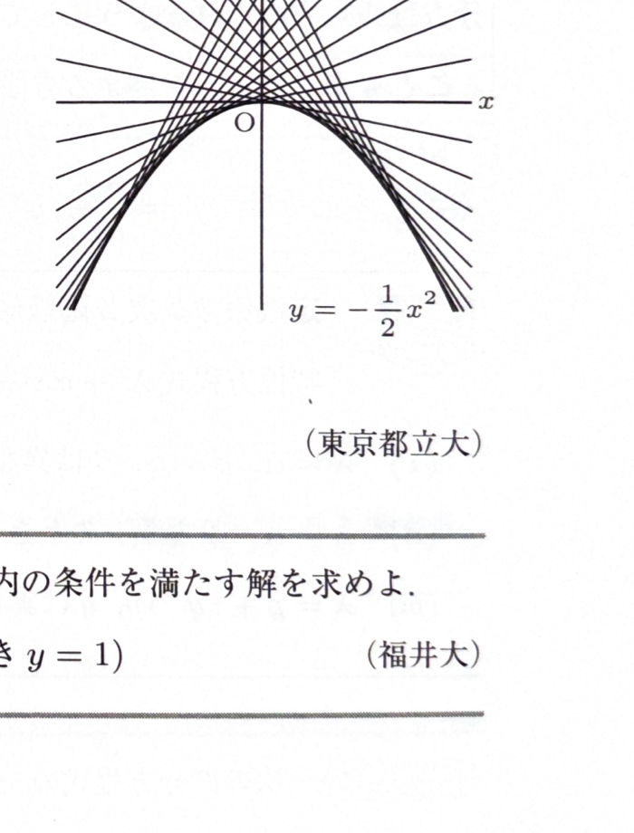

クレローの微分方程式は
$$
y=xp+f(p),\qquad p=\frac{dy}{dx}
$$
の形である。両辺を $x$ で微分すると、
$$
p=p+xp'+f'(p)p'
$$
より、
$$
p'\{x+f'(p)\}=0
$$
となる。

- $p'=0$ の場合は $p=C$ であり、一般解
$$
y=Cx+f(C)
$$
を得る。
- $x+f'(p)=0$ の場合は、$p$ を消去して特異解を得る。特異解は一般解の1パラメータ曲線族の包絡線になる。

---

例題 44

次の微分方程式を解き、特異解のグラフが一般解のグラフにどのように関係するか答えよ。
$$
y=x\frac{dy}{dx}
+\frac12\left(\frac{dy}{dx}\right)^2
$$

---

解答

> $$
> p=\frac{dy}{dx}
> $$
> とおくと、方程式は
> $$
> y=xp+\frac12p^2
> $$
> となり、クレロー形である。
>
> 両辺を $x$ で微分する。右辺の微分を省略せずに書くと、
> $$
> \frac{d}{dx}(xp)=p+xp'
> $$
> であり、
> $$
> \frac{d}{dx}\left(\frac12p^2\right)=pp'
> $$
> である。左辺は $dy/dx=p$ なので、
> $$
> p=p+xp'+pp'
> $$
> となる。両辺から $p$ を引いて、
> $$
> p'(x+p)=0
> $$
> を得る。したがって、次の2場合に分かれる。
>
> 第1の場合は、
> $$
> p'=0
> $$
> である。このとき
> $$
> p=C
> $$
> であり、微分方程式に代入する前の式
> $$
> y=xp+\frac12p^2
> $$
> に $p=C$ を代入すると、
> $$
> y=Cx+\frac12C^2
> $$
> となる。これが一般解である。
>
> 第2の場合は、
> $$
> x+p=0
> $$
> である。したがって、
> $$
> p=-x
> $$
> となる。これを
> $$
> y=xp+\frac12p^2
> $$
> に代入すると、
> $$
> y=x(-x)+\frac12(-x)^2
> =-x^2+\frac12x^2
> =-\frac12x^2
> $$
> を得る。これが特異解である。
>
> 一般解の曲線族
> $$
> y=Cx+\frac12C^2
> $$
> に対して、固定した $x$ で $C$ に関する最小値を考えると、
> $$
> \frac{\partial}{\partial C}
> \left(Cx+\frac12C^2\right)
> =x+C
> $$
> である。これを $0$ とすると $C=-x$ となり、そのとき
> $$
> y=-\frac12x^2
> $$
> である。したがって、特異解は一般解の各直線に接する包絡線である。

一般解は
$$
\boxed{y=Cx+\frac12C^2}
$$
であり、特異解は
$$
\boxed{y=-\frac12x^2}
$$
である。

特異解のグラフは、一般解の直線族の包絡線である。

