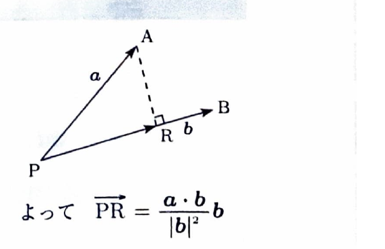

問題 147

空間に3点 $P,A,B$ がある。点 $A$ から直線 $PB$ に下ろした垂線と、直線 $PB$ との交点を $R$ とする。

---

## (1)

$$
\boldsymbol{a}=\overrightarrow{PA},
\qquad
\boldsymbol{b}=\overrightarrow{PB}
$$

とするとき、

$$
\overrightarrow{PR}
=
\frac{\boldsymbol{a}\cdot\boldsymbol{b}}
{|\boldsymbol{b}|^2}
\boldsymbol{b}
$$

となることを示せ。

---

## (1) 解答

> $\overrightarrow{PR}$ は直線 $PB$ 上のベクトルなので、$\boldsymbol{b}$ の実数倍と置ける。さらに、$\overrightarrow{AR}$ が $\boldsymbol{b}$ に垂直であることを内積で表し、倍率を決める。この式は $\boldsymbol{a}$ の $\boldsymbol{b}$ への正射影の公式である。

点 $R$ は直線 $PB$ 上にあるため、ある実数 $t$ が存在して、

$$
\overrightarrow{PR}=t\boldsymbol{b}
$$

と表せる。

また、

$$
\overrightarrow{AR}
=
\overrightarrow{PR}-\overrightarrow{PA}
$$

である。

ここに、

$$
\overrightarrow{PR}=t\boldsymbol{b},
\qquad
\overrightarrow{PA}=\boldsymbol{a}
$$

を代入すると、

$$
\overrightarrow{AR}
=
t\boldsymbol{b}-\boldsymbol{a}
$$

である。

$AR$ は直線 $PB$ に垂直であり、直線 $PB$ の方向ベクトルは $\boldsymbol{b}$ である。したがって、

$$
\overrightarrow{AR}\cdot\boldsymbol{b}=0
$$

である。

代入前の式は、

$$
\overrightarrow{AR}\cdot\boldsymbol{b}=0
$$

である。

ここに、

$$
\overrightarrow{AR}=t\boldsymbol{b}-\boldsymbol{a}
$$

を代入すると、

$$
(t\boldsymbol{b}-\boldsymbol{a})\cdot\boldsymbol{b}=0
$$

内積の分配法則を用いると、

$$
t(\boldsymbol{b}\cdot\boldsymbol{b})
-
\boldsymbol{a}\cdot\boldsymbol{b}
=
0
$$

である。

ここで、

$$
\boldsymbol{b}\cdot\boldsymbol{b}
=
|\boldsymbol{b}|^2
$$

だから、

$$
t|\boldsymbol{b}|^2
=
\boldsymbol{a}\cdot\boldsymbol{b}
$$

である。

$\boldsymbol{b}\ne\boldsymbol{0}$ なので、

$$
|\boldsymbol{b}|^2\ne0
$$

であり、両辺を $|\boldsymbol{b}|^2$ で割ると、

$$
t
=
\frac{\boldsymbol{a}\cdot\boldsymbol{b}}
{|\boldsymbol{b}|^2}
$$

である。

これを

$$
\overrightarrow{PR}=t\boldsymbol{b}
$$

に代入すると、

$$
\boxed{
\overrightarrow{PR}
=
\frac{\boldsymbol{a}\cdot\boldsymbol{b}}
{|\boldsymbol{b}|^2}
\boldsymbol{b}
}
$$

となる。

---

## (2)

$P(3,-6,9)$、$A(-3,2,5)$、$B(-1,-3,8)$ に対して、$R$ の座標を求めよ。

---

## (2) 解答

> (1)で証明した正射影の公式をそのまま使う。まず $\boldsymbol{a}=\overrightarrow{PA}$ と $\boldsymbol{b}=\overrightarrow{PB}$ を求め、内積と大きさの2乗を計算する。

まず、

$$
\boldsymbol{a}
=
\overrightarrow{PA}
=
A-P
$$

である。

座標を代入すると、

$$
\boldsymbol{a}
=
\begin{pmatrix}
-3-3\\
2-(-6)\\
5-9
\end{pmatrix}
=
\begin{pmatrix}
-6\\
8\\
-4
\end{pmatrix}
$$

である。

次に、

$$
\boldsymbol{b}
=
\overrightarrow{PB}
=
B-P
$$

である。

座標を代入すると、

$$
\boldsymbol{b}
=
\begin{pmatrix}
-1-3\\
-3-(-6)\\
8-9
\end{pmatrix}
=
\begin{pmatrix}
-4\\
3\\
-1
\end{pmatrix}
$$

である。

内積は、

$$
\boldsymbol{a}\cdot\boldsymbol{b}
=
(-6)(-4)+8\cdot3+(-4)(-1)
$$

$$
=
24+24+4
=
52
$$

である。

また、

$$
|\boldsymbol{b}|^2
=
(-4)^2+3^2+(-1)^2
$$

$$
=
16+9+1
=
26
$$

である。

正射影の公式は、

$$
\overrightarrow{PR}
=
\frac{\boldsymbol{a}\cdot\boldsymbol{b}}
{|\boldsymbol{b}|^2}
\boldsymbol{b}
$$

である。

値を代入すると、

$$
\overrightarrow{PR}
=
\frac{52}{26}
\begin{pmatrix}
-4\\
3\\
-1
\end{pmatrix}
$$

$$
\overrightarrow{PR}
=
2
\begin{pmatrix}
-4\\
3\\
-1
\end{pmatrix}
=
\begin{pmatrix}
-8\\
6\\
-2
\end{pmatrix}
$$

である。

点 $R$ の位置ベクトルは、

$$
\overrightarrow{OR}
=
\overrightarrow{OP}
+
\overrightarrow{PR}
$$

である。

値を代入すると、

$$
\overrightarrow{OR}
=
\begin{pmatrix}
3\\
-6\\
9
\end{pmatrix}
+
\begin{pmatrix}
-8\\
6\\
-2
\end{pmatrix}
=
\begin{pmatrix}
-5\\
0\\
7
\end{pmatrix}
$$

である。

したがって、

$$
\boxed{R(-5,0,7)}
$$
