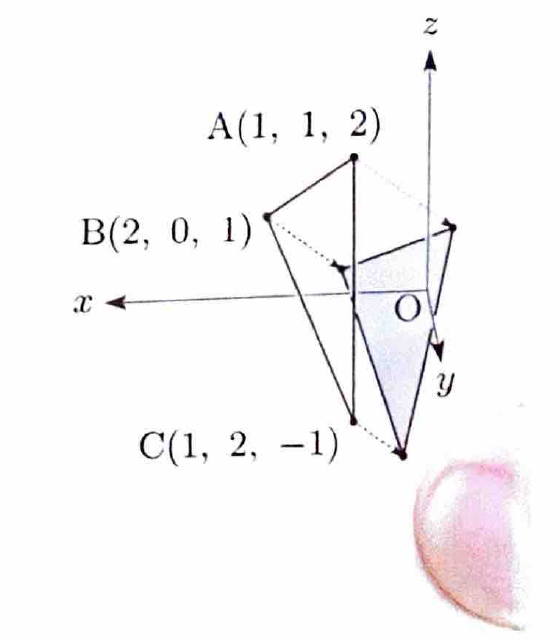

問題 151

右図を参照して、以下の問いに答えよ。

---

## (1)

3次元空間内に $x$ 軸、$y$ 軸、$z$ 軸からなる直交座標系を考え、頂点

$$
A(1,1,2),\qquad B(2,0,1),\qquad C(1,2,-1)
$$

からなる三角形 $ABC$ と、ベクトル $(1,1,1)$ に垂直な原点 $O$ を通る平面 $P$ を考える。このとき三角形 $ABC$ の、$(-1,-1,-1)$ 方向に無限遠方から入射する平行光線 $R$ による平面 $P$ への投影図の面積を求めよ。

---

## (1) 解答

> 平行光線の方向は平面 $P$ の法線方向と平行なので、各頂点から平面に垂直な直線を引き、その平面との交点を投影点として求める。3点の投影後、2辺ベクトルから三角形の面積を計算する。

平面 $P$ は原点を通り、法線ベクトルが、

$$
\begin{pmatrix}
1\\
1\\
1
\end{pmatrix}
$$

である。

したがって、平面 $P$ の方程式は、

$$
x+y+z=0
$$

である。

点 $A,B,C$ の投影点をそれぞれ $E,F,G$ とする。

平行光線の方向は $(-1,-1,-1)$ だが、直線の方向ベクトルはその反対向きの $(1,1,1)$ を用いても同じ直線を表す。

点 $A(1,1,2)$ を通る投影直線は、

$$
x=1+t,\qquad y=1+t,\qquad z=2+t
$$

である。

平面の式に代入すると、

$$
(1+t)+(1+t)+(2+t)=0
$$

$$
4+3t=0
$$

より、

$$
t=-\frac43
$$

である。

したがって、

$$
E
=
\left(
1-\frac43,
1-\frac43,
2-\frac43
\right)
$$

$$
E
=
\left(
-\frac13,
-\frac13,
\frac23
\right)
$$

である。

点 $B(2,0,1)$ を通る投影直線は、

$$
x=2+t,\qquad y=t,\qquad z=1+t
$$

である。

平面に代入すると、

$$
(2+t)+t+(1+t)=0
$$

$$
3+3t=0
$$

より、

$$
t=-1
$$

である。

したがって、

$$
F=(1,-1,0)
$$

である。

点 $C(1,2,-1)$ を通る投影直線は、

$$
x=1+t,\qquad y=2+t,\qquad z=-1+t
$$

である。

平面に代入すると、

$$
(1+t)+(2+t)+(-1+t)=0
$$

$$
2+3t=0
$$

より、

$$
t=-\frac23
$$

である。

したがって、

$$
G
=
\left(
1-\frac23,
2-\frac23,
-1-\frac23
\right)
$$

$$
G
=
\left(
\frac13,
\frac43,
-\frac53
\right)
$$

である。

次に、

$$
\overrightarrow{EF}=F-E
$$

を求める。

$$
\overrightarrow{EF}
=
\begin{pmatrix}
1-(-\frac13)\\
-1-(-\frac13)\\
0-\frac23
\end{pmatrix}
=
\begin{pmatrix}
\frac43\\
-\frac23\\
-\frac23
\end{pmatrix}
$$

である。

また、

$$
\overrightarrow{EG}=G-E
$$

より、

$$
\overrightarrow{EG}
=
\begin{pmatrix}
\frac13-(-\frac13)\\
\frac43-(-\frac13)\\
-\frac53-\frac23
\end{pmatrix}
=
\begin{pmatrix}
\frac23\\
\frac53\\
-\frac73
\end{pmatrix}
$$

である。

三角形の面積は、

$$
S
=
\frac12
\sqrt{
|\overrightarrow{EF}|^2
|\overrightarrow{EG}|^2
-
(\overrightarrow{EF}\cdot\overrightarrow{EG})^2
}
$$

で求められる。

まず、

$$
|\overrightarrow{EF}|^2
=
\left(\frac43\right)^2
+
\left(-\frac23\right)^2
+
\left(-\frac23\right)^2
$$

$$
=
\frac{16+4+4}{9}
=
\frac{24}{9}
=
\frac83
$$

である。

次に、

$$
|\overrightarrow{EG}|^2
=
\left(\frac23\right)^2
+
\left(\frac53\right)^2
+
\left(-\frac73\right)^2
$$

$$
=
\frac{4+25+49}{9}
=
\frac{78}{9}
=
\frac{26}{3}
$$

である。

内積は、

$$
\overrightarrow{EF}\cdot\overrightarrow{EG}
=
\frac43\cdot\frac23
+
\left(-\frac23\right)\frac53
+
\left(-\frac23\right)\left(-\frac73\right)
$$

$$
=
\frac89-\frac{10}{9}+\frac{14}{9}
=
\frac{12}{9}
=
\frac43
$$

である。

したがって、

$$
S
=
\frac12
\sqrt{
\frac83\cdot\frac{26}{3}
-
\left(\frac43\right)^2
}
$$

$$
=
\frac12
\sqrt{
\frac{208}{9}
-
\frac{16}{9}
}
$$

$$
=
\frac12
\sqrt{\frac{192}{9}}
=
\frac12\cdot\frac{8\sqrt3}{3}
=
\frac{4\sqrt3}{3}
$$

である。

したがって、

$$
\boxed{\frac{4\sqrt3}{3}}
$$

---

## (2)

四面体 $ABCD$ の平行光線 $R$ による平面 $P$ への投影を考える。四面体 $ABCD$ が $0$ でない体積を持ち、なおかつ頂点 $D$ の投影が三角形 $ABC$ の投影図に内包されるとき、頂点 $D$ の座標が満たす必要条件を求めよ。ただし、頂点 $D$ の座標 $(d_x,d_y,d_z)$ は、

$$
4d_x+3d_y+d_z-9>0
$$

を満たすとする。

---

## (2) 解答

> まず、点 $D$ が平面 $ABC$ 上にないことを与えられた不等式から確認する。次に、$D$ の投影点 $H$ を求め、投影三角形 $EFG$ の内部にある条件を、2辺ベクトルの非負な係数による表現
>
> $$
> \overrightarrow{EH}
> =
> s\overrightarrow{EF}
> +
> t\overrightarrow{EG},
> \qquad
> s\ge0,\ t\ge0,\ s+t\le1
> $$
>
> で表す。

まず、平面 $ABC$ の法線ベクトルを求める。

$$
\overrightarrow{AB}
=
\begin{pmatrix}
2-1\\
0-1\\
1-2
\end{pmatrix}
=
\begin{pmatrix}
1\\
-1\\
-1
\end{pmatrix}
$$

である。

$$
\overrightarrow{AC}
=
\begin{pmatrix}
1-1\\
2-1\\
-1-2
\end{pmatrix}
=
\begin{pmatrix}
0\\
1\\
-3
\end{pmatrix}
$$

である。

外積を計算すると、

$$
\overrightarrow{AB}\times\overrightarrow{AC}
=
\begin{pmatrix}
4\\
3\\
1
\end{pmatrix}
$$

である。

したがって、平面 $ABC$ の方程式は、点 $B(2,0,1)$ を用いて、

$$
4(x-2)+3(y-0)+(z-1)=0
$$

である。

整理すると、

$$
4x+3y+z-9=0
$$

である。

与えられた条件

$$
4d_x+3d_y+d_z-9>0
$$

により、点 $D$ は平面 $ABC$ 上にない。したがって、四面体 $ABCD$ の体積は $0$ ではない。

次に、点 $D(d_x,d_y,d_z)$ の平面 $P$ への投影点を $H$ とする。

投影直線は方向ベクトル $(1,1,1)$ を用いて、

$$
x=d_x+t,\qquad
y=d_y+t,\qquad
z=d_z+t
$$

と表せる。

平面 $P$ の方程式

$$
x+y+z=0
$$

に代入すると、

$$
d_x+d_y+d_z+3t=0
$$

より、

$$
t=-\frac{d_x+d_y+d_z}{3}
$$

である。

したがって、

$$
H
=
\left(
d_x-\frac{d_x+d_y+d_z}{3},
d_y-\frac{d_x+d_y+d_z}{3},
d_z-\frac{d_x+d_y+d_z}{3}
\right)
$$

整理すると、

$$
H
=
\left(
\frac{2d_x-d_y-d_z}{3},
\frac{-d_x+2d_y-d_z}{3},
\frac{-d_x-d_y+2d_z}{3}
\right)
$$

である。

(1)より、

$$
E\left(-\frac13,-\frac13,\frac23\right)
$$

$$
\overrightarrow{EF}
=
\begin{pmatrix}
\frac43\\
-\frac23\\
-\frac23
\end{pmatrix},
\qquad
\overrightarrow{EG}
=
\begin{pmatrix}
\frac23\\
\frac53\\
-\frac73
\end{pmatrix}
$$

である。

まず、

$$
\overrightarrow{EH}=H-E
$$

を計算する。

$$
\overrightarrow{EH}
=
\begin{pmatrix}
\frac{2d_x-d_y-d_z+1}{3}\\
\frac{-d_x+2d_y-d_z+1}{3}\\
\frac{-d_x-d_y+2d_z-2}{3}
\end{pmatrix}
$$

である。

点 $H$ が三角形 $EFG$ に内包されるための条件は、ある実数 $s,t$ が存在して、

$$
\overrightarrow{EH}
=
s\overrightarrow{EF}
+
t\overrightarrow{EG}
$$

かつ、

$$
s\ge0,\qquad t\ge0,\qquad s+t\le1
$$

となることである。

両辺を成分比較し、分母 $3$ を払うと、

$$
2d_x-d_y-d_z+1
=
4s+2t
$$

$$
-d_x+2d_y-d_z+1
=
-2s+5t
$$

$$
-d_x-d_y+2d_z-2
=
-2s-7t
$$

である。

最初の2式を解く。

第1式を、

$$
4s+2t=2d_x-d_y-d_z+1
$$

第2式を、

$$
-2s+5t=-d_x+2d_y-d_z+1
$$

とする。

資料の解答に従って整理すると、

$$
s
=
\frac{4d_x-3d_y-d_z+1}{8}
$$

$$
t
=
\frac{d_y-d_z+1}{4}
$$

である。

したがって、

$$
s+t
=
\frac{4d_x-d_y-3d_z+3}{8}
$$

である。

条件

$$
s\ge0
$$

から、

$$
4d_x-3d_y-d_z+1\ge0
$$

である。

条件

$$
t\ge0
$$

から、

$$
d_y-d_z+1\ge0
$$

である。

条件

$$
s+t\le1
$$

から、

$$
\frac{4d_x-d_y-3d_z+3}{8}\le1
$$

両辺を $8$ 倍すると、

$$
4d_x-d_y-3d_z+3\le8
$$

したがって、

$$
4d_x-d_y-3d_z-5\le0
$$

である。

よって、求める必要条件は、

$$
\boxed{
\begin{aligned}
4d_x-3d_y-d_z+1&\ge0,\\
d_y-d_z+1&\ge0,\\
4d_x-d_y-3d_z-5&\le0
\end{aligned}
}
$$

である。
