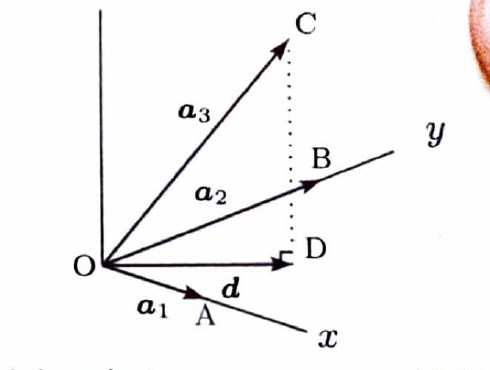

問題 158

$\boldsymbol{a}_1,\boldsymbol{a}_2,\boldsymbol{a}_3$ は空間の3次元ベクトルとして、以下の設問に答えよ。

> 一次独立の判定では、線形結合が零ベクトルになると仮定し、係数がすべて $0$ しかないことを示す。
>
> 正方行列 $M$ に対して、
>
> $$
> M\boldsymbol{c}=\boldsymbol{0}
> $$
>
> が零解しかもたないことと、
>
> $$
> \det M\ne0
> $$
>
> は同値である。

---

## (1)

$\boldsymbol{a}_1,\boldsymbol{a}_2,\boldsymbol{a}_3$ が一次独立であるための必要十分条件は、

$$
\boldsymbol{a}_1,\quad
\boldsymbol{a}_1+\boldsymbol{a}_2,\quad
\boldsymbol{a}_1+\boldsymbol{a}_2+\boldsymbol{a}_3
$$

が一次独立であることであると証明せよ。

---

## (1) 解答

> 必要性と十分性をそれぞれ証明する。前向きでは新しい3本の線形結合を元の3本の係数にまとめる。逆向きでは元の3本を新しい3本の線形結合として書き直す。

まず、$\boldsymbol{a}_1,\boldsymbol{a}_2,\boldsymbol{a}_3$ が一次独立であると仮定する。

$$
c_1\boldsymbol{a}_1
+
c_2(\boldsymbol{a}_1+\boldsymbol{a}_2)
+
c_3(\boldsymbol{a}_1+\boldsymbol{a}_2+\boldsymbol{a}_3)
=
\boldsymbol{0}
$$

とする。

展開すると、

$$
(c_1+c_2+c_3)\boldsymbol{a}_1
+
(c_2+c_3)\boldsymbol{a}_2
+
c_3\boldsymbol{a}_3
=
\boldsymbol{0}
$$

である。

元の3本は一次独立なので、

$$
c_1+c_2+c_3=0
$$

$$
c_2+c_3=0
$$

$$
c_3=0
$$

である。

第3式から、

$$
c_3=0
$$

第2式から、

$$
c_2=0
$$

第1式から、

$$
c_1=0
$$

である。

したがって、新しい3本は一次独立である。

逆に、

$$
\boldsymbol{a}_1,\quad
\boldsymbol{a}_1+\boldsymbol{a}_2,\quad
\boldsymbol{a}_1+\boldsymbol{a}_2+\boldsymbol{a}_3
$$

が一次独立であると仮定する。

元の3本について、

$$
c_1\boldsymbol{a}_1
+
c_2\boldsymbol{a}_2
+
c_3\boldsymbol{a}_3
=
\boldsymbol{0}
$$

とする。

ここで、

$$
\boldsymbol{a}_2
=
(\boldsymbol{a}_1+\boldsymbol{a}_2)-\boldsymbol{a}_1
$$

$$
\boldsymbol{a}_3
=
(\boldsymbol{a}_1+\boldsymbol{a}_2+\boldsymbol{a}_3)
-
(\boldsymbol{a}_1+\boldsymbol{a}_2)
$$

である。

代入すると、

$$
c_1\boldsymbol{a}_1
+
c_2\{(\boldsymbol{a}_1+\boldsymbol{a}_2)-\boldsymbol{a}_1\}
+
c_3\{(\boldsymbol{a}_1+\boldsymbol{a}_2+\boldsymbol{a}_3)-(\boldsymbol{a}_1+\boldsymbol{a}_2)\}
=
\boldsymbol{0}
$$

整理すると、

$$
(c_1-c_2)\boldsymbol{a}_1
+
(c_2-c_3)(\boldsymbol{a}_1+\boldsymbol{a}_2)
+
c_3(\boldsymbol{a}_1+\boldsymbol{a}_2+\boldsymbol{a}_3)
=
\boldsymbol{0}
$$

である。

新しい3本は一次独立なので、

$$
c_1-c_2=0
$$

$$
c_2-c_3=0
$$

$$
c_3=0
$$

である。

これより、

$$
c_3=0,\qquad c_2=0,\qquad c_1=0
$$

となる。

したがって、元の3本も一次独立である。

以上より、

$$
\boxed{
\boldsymbol{a}_1,\boldsymbol{a}_2,\boldsymbol{a}_3
\text{ が一次独立}
\Longleftrightarrow
\boldsymbol{a}_1,\boldsymbol{a}_1+\boldsymbol{a}_2,
\boldsymbol{a}_1+\boldsymbol{a}_2+\boldsymbol{a}_3
\text{ が一次独立}
}
$$

---

## (2)

$\boldsymbol{a}_1,\boldsymbol{a}_2,\boldsymbol{a}_3$ が一次独立で、

$$
\boldsymbol{a}
=
\boldsymbol{a}_1
+
\lambda_2\boldsymbol{a}_2
+
\lambda_3\boldsymbol{a}_3
$$

とおくと、$\boldsymbol{a},\boldsymbol{a}_2,\boldsymbol{a}_3$ は一次独立であることを証明せよ。ただし、$\lambda_2,\lambda_3$ は実定数である。

---

## (2) 解答

> 新しいベクトル $\boldsymbol{a}$ の $\boldsymbol{a}_1$ の係数が $1$ であることが重要である。新しい3本の線形関係を元の一次独立な3本の係数比較に帰着させる。

$$
c_1\boldsymbol{a}
+
c_2\boldsymbol{a}_2
+
c_3\boldsymbol{a}_3
=
\boldsymbol{0}
$$

とする。

$\boldsymbol{a}$ の定義を代入すると、

$$
c_1(
\boldsymbol{a}_1
+
\lambda_2\boldsymbol{a}_2
+
\lambda_3\boldsymbol{a}_3)
+
c_2\boldsymbol{a}_2
+
c_3\boldsymbol{a}_3
=
\boldsymbol{0}
$$

整理すると、

$$
c_1\boldsymbol{a}_1
+
(\lambda_2c_1+c_2)\boldsymbol{a}_2
+
(\lambda_3c_1+c_3)\boldsymbol{a}_3
=
\boldsymbol{0}
$$

である。

元の3本は一次独立なので、

$$
c_1=0
$$

$$
\lambda_2c_1+c_2=0
$$

$$
\lambda_3c_1+c_3=0
$$

である。

第1式から、

$$
c_1=0
$$

である。

これを第2式、第3式に代入すると、

$$
c_2=0,\qquad c_3=0
$$

である。

したがって、

$$
\boxed{\boldsymbol{a},\boldsymbol{a}_2,\boldsymbol{a}_3\text{ は一次独立}}
$$

---

## (3)

$\boldsymbol{a}_1,\boldsymbol{a}_2,\boldsymbol{a}_3$ が一次独立で、

$$
\boldsymbol{a}
=
\lambda_1\boldsymbol{a}_1
+
\lambda_2\boldsymbol{a}_2
+
\lambda_3\boldsymbol{a}_3
$$

とする。

$$
\boldsymbol{a}_1-\boldsymbol{a},\quad
\boldsymbol{a}_2-\boldsymbol{a},\quad
\boldsymbol{a}_3-\boldsymbol{a}
$$

が一次独立であるための必要十分条件は、

$$
\lambda_1+\lambda_2+\lambda_3\ne1
$$

であることを証明せよ。

---

## (3) 解答

> 3本の線形関係を元の基底 $\boldsymbol{a}_1,\boldsymbol{a}_2,\boldsymbol{a}_3$ の係数に変換すると、係数行列が得られる。その行列式が非零である条件を求める。

線形関係を、

$$
c_1(\boldsymbol{a}_1-\boldsymbol{a})
+
c_2(\boldsymbol{a}_2-\boldsymbol{a})
+
c_3(\boldsymbol{a}_3-\boldsymbol{a})
=
\boldsymbol{0}
$$

とおく。

$\boldsymbol{a}$ の定義を代入して、$\boldsymbol{a}_1$ の係数をまとめると、

$$
(1-\lambda_1)c_1-\lambda_1c_2-\lambda_1c_3
$$

である。

$\boldsymbol{a}_2$ の係数は、

$$
-\lambda_2c_1+(1-\lambda_2)c_2-\lambda_2c_3
$$

である。

$\boldsymbol{a}_3$ の係数は、

$$
-\lambda_3c_1-\lambda_3c_2+(1-\lambda_3)c_3
$$

である。

元の3本は一次独立なので、

$$
\begin{pmatrix}
1-\lambda_1&-\lambda_1&-\lambda_1\\
-\lambda_2&1-\lambda_2&-\lambda_2\\
-\lambda_3&-\lambda_3&1-\lambda_3
\end{pmatrix}
\begin{pmatrix}
c_1\\
c_2\\
c_3
\end{pmatrix}
=
\begin{pmatrix}
0\\
0\\
0
\end{pmatrix}
$$

を得る。

求める3本が一次独立であるための必要十分条件は、この係数行列の行列式が $0$ でないことである。

行列式を計算すると、

$$
\det
\begin{pmatrix}
1-\lambda_1&-\lambda_1&-\lambda_1\\
-\lambda_2&1-\lambda_2&-\lambda_2\\
-\lambda_3&-\lambda_3&1-\lambda_3
\end{pmatrix}
=
1-(\lambda_1+\lambda_2+\lambda_3)
$$

である。

したがって、

$$
1-(\lambda_1+\lambda_2+\lambda_3)\ne0
$$

すなわち、

$$
\boxed{\lambda_1+\lambda_2+\lambda_3\ne1}
$$

が必要十分条件である。

---

## (4)

空間に直交座標系 $O-xyz$ が与えられているものとする。図に示すように、$x$ 軸上の点 $A$ に対して、

$$
\boldsymbol{a}_1=\overrightarrow{OA},
$$

$y$ 軸上の点 $B$ に対して、

$$
\boldsymbol{a}_2=\overrightarrow{OB},
$$

空間内の点 $C$ に対して、

$$
\boldsymbol{a}_3=\overrightarrow{OC}
$$

とする。点 $C$ から $xy$ 平面に垂線 $CD$ を引くとき、ベクトル

$$
\boldsymbol{d}=\overrightarrow{OD}
$$

を $\boldsymbol{a}_1$ と $\boldsymbol{a}_2$ の線形結合で表せ。

---

## (4) 解答

> $\boldsymbol{d}$ は $\boldsymbol{a}_3$ の $xy$ 平面への直交射影である。$\boldsymbol{a}_1$ と $\boldsymbol{a}_2$ はそれぞれ $x$ 軸、$y$ 軸方向で互いに直交するため、各方向への正射影を足せばよい。係数を未知数として、$\overrightarrow{DC}$ が両方向に垂直である条件から求める方法もある。

$x$ 軸方向の単位ベクトルを $\boldsymbol{e}_1$、$y$ 軸方向の単位ベクトルを $\boldsymbol{e}_2$ とする。

$\boldsymbol{a}_1$ は $x$ 軸方向なので、

$$
\boldsymbol{e}_1
=
\frac{\boldsymbol{a}_1}{|\boldsymbol{a}_1|}
$$

である。

同様に、

$$
\boldsymbol{e}_2
=
\frac{\boldsymbol{a}_2}{|\boldsymbol{a}_2|}
$$

である。

ベクトル $\boldsymbol{a}_3$ の $xy$ 平面への直交射影は、

$$
\boldsymbol{d}
=
(\boldsymbol{a}_3\cdot\boldsymbol{e}_1)\boldsymbol{e}_1
+
(\boldsymbol{a}_3\cdot\boldsymbol{e}_2)\boldsymbol{e}_2
$$

である。

まず、第1項を変形する。

$$
(\boldsymbol{a}_3\cdot\boldsymbol{e}_1)\boldsymbol{e}_1
=
\left(
\boldsymbol{a}_3\cdot
\frac{\boldsymbol{a}_1}{|\boldsymbol{a}_1|}
\right)
\frac{\boldsymbol{a}_1}{|\boldsymbol{a}_1|}
$$

$$
=
\frac{\boldsymbol{a}_1\cdot\boldsymbol{a}_3}
{|\boldsymbol{a}_1|^2}
\boldsymbol{a}_1
$$

である。

同様に、第2項は、

$$
(\boldsymbol{a}_3\cdot\boldsymbol{e}_2)\boldsymbol{e}_2
=
\frac{\boldsymbol{a}_2\cdot\boldsymbol{a}_3}
{|\boldsymbol{a}_2|^2}
\boldsymbol{a}_2
$$

である。

したがって、

$$
\boxed{
\boldsymbol{d}
=
\frac{\boldsymbol{a}_1\cdot\boldsymbol{a}_3}
{|\boldsymbol{a}_1|^2}
\boldsymbol{a}_1
+
\frac{\boldsymbol{a}_2\cdot\boldsymbol{a}_3}
{|\boldsymbol{a}_2|^2}
\boldsymbol{a}_2
}
$$
