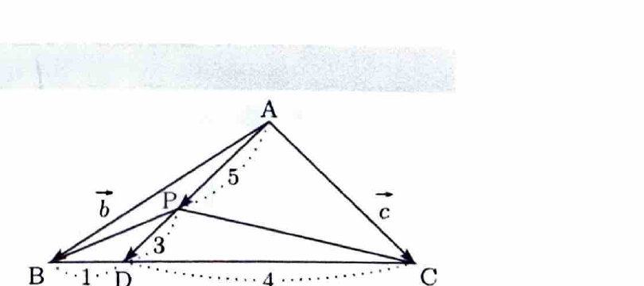

問題 159

三角形 $ABC$ と点 $P$ が、

$$
3\overrightarrow{PA}
+
4\overrightarrow{PB}
+
\overrightarrow{PC}
=
\boldsymbol{0}
$$

を満たすとき、次の問いに答えよ。

---

## (1)

$$
\overrightarrow{AB}=\boldsymbol{b},
\qquad
\overrightarrow{AC}=\boldsymbol{c}
$$

とおく。このとき、$\overrightarrow{AP}$ を $\boldsymbol{b},\boldsymbol{c}$ を用いて表せ。

---

## (1) 解答

> すべてのベクトルの始点を $A$ にそろえる。$\overrightarrow{PA}=-\overrightarrow{AP}$、$\overrightarrow{PB}=\overrightarrow{PA}+\overrightarrow{AB}$、$\overrightarrow{PC}=\overrightarrow{PA}+\overrightarrow{AC}$ を用いる。

$$
\overrightarrow{PA}
=
-\overrightarrow{AP}
$$

である。

また、

$$
\overrightarrow{PB}
=
\overrightarrow{PA}
+
\overrightarrow{AB}
=
-\overrightarrow{AP}
+
\boldsymbol{b}
$$

である。

同様に、

$$
\overrightarrow{PC}
=
-\overrightarrow{AP}
+
\boldsymbol{c}
$$

である。

与えられた式に代入すると、

$$
3(-\overrightarrow{AP})
+
4(-\overrightarrow{AP}+\boldsymbol{b})
+
(-\overrightarrow{AP}+\boldsymbol{c})
=
\boldsymbol{0}
$$

整理すると、

$$
-3\overrightarrow{AP}
-4\overrightarrow{AP}
-\overrightarrow{AP}
+
4\boldsymbol{b}
+
\boldsymbol{c}
=
\boldsymbol{0}
$$

$$
-8\overrightarrow{AP}
+
4\boldsymbol{b}
+
\boldsymbol{c}
=
\boldsymbol{0}
$$

である。

したがって、

$$
8\overrightarrow{AP}
=
4\boldsymbol{b}
+
\boldsymbol{c}
$$

両辺を $8$ で割ると、

$$
\boxed{
\overrightarrow{AP}
=
\frac{4\boldsymbol{b}+\boldsymbol{c}}8
}
$$

---

## (2)

点 $P$ が三角形 $ABC$ の内部にあることを示せ。

---

## (2) 解答

> (1)の式は、$\overrightarrow{AB}$ と $\overrightarrow{AC}$ の係数がともに正で、その和が $1$ より小さいため、重心座標の観点から内部点と判断できる。資料では内分点を2段階に作って示しているため、その方法を用いる。

(1)より、

$$
\overrightarrow{AP}
=
\frac{4\boldsymbol{b}+\boldsymbol{c}}8
$$

である。

これを、

$$
\overrightarrow{AP}
=
\frac58
\cdot
\frac{4\boldsymbol{b}+\boldsymbol{c}}5
$$

と書き直す。

線分 $BC$ を $1:4$ の比に内分する点を $D$ とする。内分点の位置ベクトルの公式より、

$$
\overrightarrow{AD}
=
\frac{4\overrightarrow{AB}+1\overrightarrow{AC}}{1+4}
$$

である。

ここに、

$$
\overrightarrow{AB}=\boldsymbol{b},
\qquad
\overrightarrow{AC}=\boldsymbol{c}
$$

を代入すると、

$$
\overrightarrow{AD}
=
\frac{4\boldsymbol{b}+\boldsymbol{c}}5
$$

である。

したがって、

$$
\overrightarrow{AP}
=
\frac58\overrightarrow{AD}
$$

である。

これは、点 $P$ が線分 $AD$ を、

$$
AP:PD=5:3
$$

に内分することを表す。

点 $D$ は線分 $BC$ 上にあり、点 $P$ は線分 $AD$ の内部にある。したがって、点 $P$ は三角形 $ABC$ の内部にある。

よって、

$$
\boxed{P\text{ は }\triangle ABC\text{ の内部にある}}
$$

---

## (3)

面積の比

$$
\triangle PAB:\triangle PBC:\triangle PCA
$$

を求めよ。

---

## (3) 解答

> 点 $P$ の重心座標から面積比を直接読む方法もあるが、資料では (2) の内分関係を用いて面積を段階的に求めている。

三角形 $ABC$ の面積を $S$ とする。

まず、(1)の式

$$
\overrightarrow{AP}
=
\frac{4\overrightarrow{AB}+\overrightarrow{AC}}8
$$

を点の位置ベクトルの式に直す。

$$
\overrightarrow{OP}
=
\overrightarrow{OA}
+
\overrightarrow{AP}
$$

であるから、

$$
\overrightarrow{OP}
=
\overrightarrow{OA}
+
\frac{
4(\overrightarrow{OB}-\overrightarrow{OA})
+
(\overrightarrow{OC}-\overrightarrow{OA})
}{8}
$$

である。

分子を整理すると、

$$
\overrightarrow{OP}
=
\frac{
8\overrightarrow{OA}
+
4\overrightarrow{OB}
-
4\overrightarrow{OA}
+
\overrightarrow{OC}
-
\overrightarrow{OA}
}{8}
$$

$$
\overrightarrow{OP}
=
\frac{
3\overrightarrow{OA}
+
4\overrightarrow{OB}
+
\overrightarrow{OC}
}{8}
$$

である。

したがって、点 $P$ の重心座標は、

$$
\left(
\frac38,\frac48,\frac18
\right)
$$

である。

> 三角形の内部の点
>
> $$
> \overrightarrow{OP}
> =
> \lambda_A\overrightarrow{OA}
> +
> \lambda_B\overrightarrow{OB}
> +
> \lambda_C\overrightarrow{OC},
> \qquad
> \lambda_A+\lambda_B+\lambda_C=1
> $$
>
> に対して、各係数は向かい側の小三角形の面積比になる。
>
> $$
> \lambda_A
> =
> \frac{[\triangle PBC]}{[\triangle ABC]},
> \quad
> \lambda_B
> =
> \frac{[\triangle PCA]}{[\triangle ABC]},
> \quad
> \lambda_C
> =
> \frac{[\triangle PAB]}{[\triangle ABC]}
> $$
>
> これは、たとえば $\lambda_A$ が、点 $P$ の直線 $BC$ からの高さと点 $A$ の直線 $BC$ からの高さの比に等しく、$\triangle PBC$ と $\triangle ABC$ が同じ底辺 $BC$ をもつことから分かる。

したがって、

$$
[\triangle PBC]
=
\frac38S
$$

$$
[\triangle PCA]
=
\frac48S
$$

$$
[\triangle PAB]
=
\frac18S
$$

である。

よって、問題で指定された順に並べると、

$$
\triangle PAB:\triangle PBC:\triangle PCA
=
\frac18S:\frac38S:\frac48S
$$

各項を $\frac18S$ で割れば、

$$
\boxed{
\triangle PAB:\triangle PBC:\triangle PCA
=
1:3:4
}
$$
